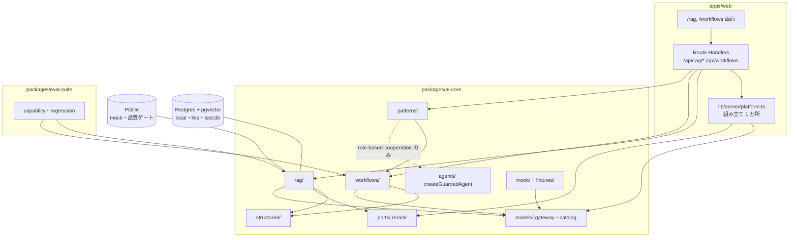
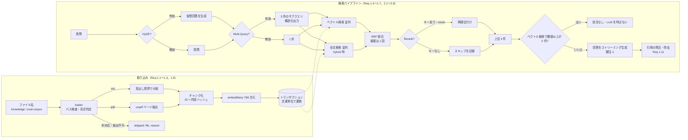
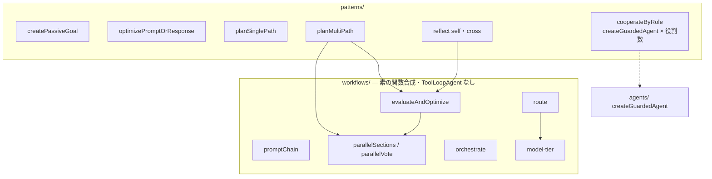
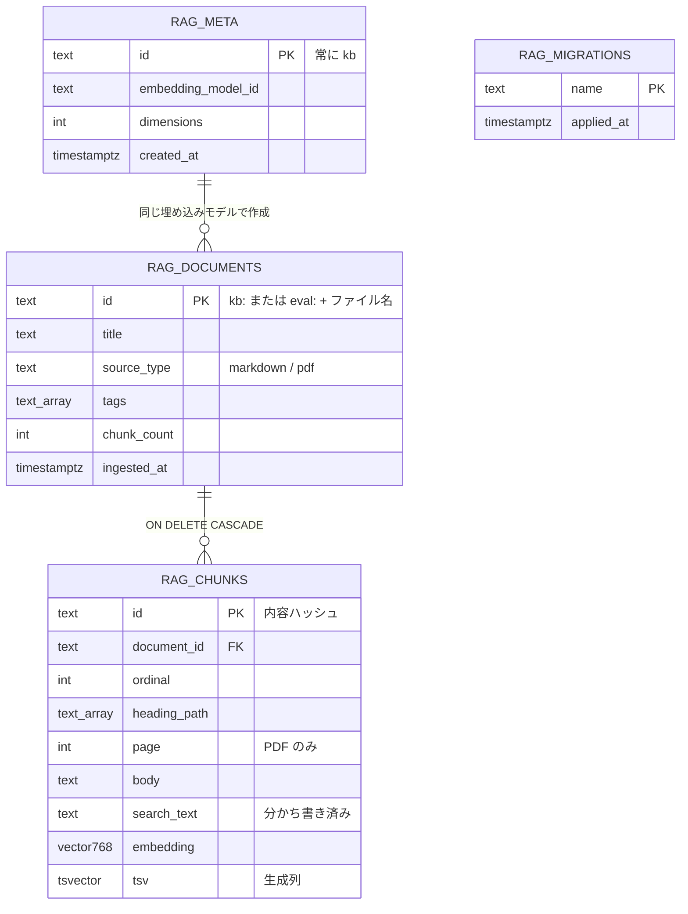

# rag-and-workflows — Technical Plan

承認済みの要件（[spec.md](spec.md)、WHAT）を、アーキテクチャ（HOW）へ落とす。実装コードは書かない。調査の根拠と ADR は [research.md](research.md)、既存コードとの差は [gap-analysis.md](gap-analysis.md) にある。001 の plan（`specs/001-agentic-ai-platform/plan.md`）の C1〜C22 とは別に、本 plan の部品を **C1〜C18** と番号付けする（本文中の「001 C8」は 001 の plan の部品を指す）。

## Summary

M2 は `packages/ai-core` に 4 つの領域（`structured/`、`rag/`、`workflows/`、`patterns/`）を新設し、`apps/web` に `/rag` と `/workflows` の 2 画面と 5 つの Route Handler を足す。M1 の公開契約（ゲートウェイ、ポート規約、`createGuardedAgent`、`defineAciTool`、`data-*` ストリーム、テスト接尾辞）は変えず、拡張点から差し込む。

- **RAG**: ナレッジベースは Postgres + pgvector（Drizzle ORM の型付きクエリ）。品質ゲートは同じ SQL をインプロセスの PGlite に実行し（`*.db.test.ts`）、Docker の Postgres には `*.pg.test.ts` で実行する。RRF・チャンク分割・引用の照合・recall の計算は DB に依存しない純関数で、`mock` で網羅的にテストする。HyDE・Multi-Query・ハイブリッド・Rerank は段ごとに有効・無効を切り替えられるパイプラインで、各段の進行と中間結果を回答テキストとは別の `data-rag-*` パートでストリーミングする。
- **ワークフローとパターン**: 制御フローを素の TypeScript 関数で書き、`ToolLoopAgent` を使わない。唯一の例外は Role-Based Cooperation で、`createGuardedAgent` を役割ごとに 1 回ずつ生成する。この境界はリポジトリ規則 `workflow-no-agent-loop` が機械的に守らせる。
- **品質ゲートの限界の明示**: `mock` の埋め込みは意味を持たないため、検索手法の**効果の差**（Req 2.9）と Judge（Req 2.10）は `*.local.test.ts` だけが示す。gate が保証するのは算術・制御フロー・型・SQL の正しさで、解説と traceability にこの線引きを書く。

調査で確定した主な設計判断（根拠は research.md）: データ層の二層構成（ADR-1）、`drizzle-kit` を採らず手書き SQL のマイグレーション（ADR-2。`npm audit` の中程度 4 件を避ける）、日本語の全文検索は `Intl.Segmenter` + `simple`（ADR-3）、埋め込みを 768 次元に統一（ADR-4）、チャンク ID は内容ハッシュ（ADR-5）、引用は序数の脚注 + 全チャンクを `cited` 付きで返す（ADR-6）、Rerank は Cohere（ADR-7）。

## Clarifications（plan の決定。人の確認が要るもの）

承認済みの要件の曖昧さ（gap-analysis §5）に対する plan の解釈。受け入れ基準の文言と採番は変えない。★は受け入れ基準の読み方に影響するため、`/sdd-plan` の承認時に人が確認する。

| # | 対象 | 決定 | 確認 |
|---|---|---|---|
| CL-1 | Req 1.7 の閾値 | 尺度は**コサイン類似度**（既定 0.5、リクエストで変更可）。ベクトル検索の各段が閾値未満の候補を捨てる。**「該当なし」の判定は、ベクトル検索（HyDE・Multi-Query の各クエリを含む）で閾値以上の候補が 1 件も無いことだけで行い、全文検索のヒットはこの判定に寄与しない**（ハイブリッド有効でも Req 1.7 の文言を保つ）。該当なしのとき LLM を呼ばず、全文検索のみの候補も回答に使わない。判定を通った後は、全文検索の候補も RRF に入れてよい。日本語の `local` 埋め込みでは関連・無関係の類似度が重なる（research I-8）ため、閾値は弱い防御と位置づけ、回答プロンプトでも根拠が無ければ該当なしと答えさせる | ★ |
| CL-2 | Req 2.2 の「3 件」 | 最大 2 回まで再生成し、なお満たさなければ `output-invalid`（`generateValidated`） | |
| CL-3 | Req 3.5、3.6、3.7、4.4 の上限 | `DEFAULT_WORKFLOW_LIMITS`（Interfaces 参照）。呼び出し側が上限を超える値を指定したら `invalid-request` で拒否する。モデルの出力が超える場合はスキーマの上限違反として再生成する。`ToolLoopAgent` を使わないため 001 Req 6 の停止条件は適用されず、上限は各関数が持つ | |
| CL-4 | Req 3.10 の同点 | 最も早い反復の生成物を返す | ★ |
| CL-5 | Req 4.6 の「異なるモデル」 | **カタログ ID が異なる**こと（プロバイダは問わない）。批評側は `purpose: "judge"` のモデルを使う。同じ ID になる構成（`live` の Anthropic 既定）は `invalid-request` で拒否し、`AI_MODEL_JUDGE` の設定を案内する。このため `mock` の `judge` を新しいカタログ項目 `mock:judge-v1` にする | ★ |
| CL-6 | Req 2.6 と `mock` | `mock` では疑似 Rerank を実行する。`local` / `live` でキーが無ければスキップして記録する | |
| CL-7 | Req 1.12 の記録先 | research.md の I-1 と本 plan の Test Strategy に記録する | |
| CL-8 | Req 4.7 の予算 | Role-Based Cooperation は全役割の合計トークンの上限（既定 `AGENT_MAX_TOTAL_TOKENS`）を共有し、各役割のエージェントには「残り」を渡す。残りが尽きたら次の役割を実行せず、停止を結果に含める（003 Req 4 の階層型エージェントの設計には、この共有予算の考え方を引き継ぐ） | |
| CL-9 | Req 1.1 の「指定」 | 取り込み対象の指定は、サーバー側の 2 つのディレクトリ（`knowledge/`、評価コーパス）内のファイル名で行う。アップロード（multipart）は扱わない | ★ |
| CL-10 | Req 3.12 の「軽量 / 高性能」 | `MODEL_TIERS`（カタログ）で表す。`live` のカタログには軽量モデルが無く、Anthropic など 1 社 1 モデルのプロバイダでは両ティアが同じモデルになる（結果の `distinct` で示す） | |
| CL-11 | Rerank の呼び出しが失敗したとき | Req 2.6 はキー未設定だけを規定する。キーがあっても呼び出しが失敗した場合は、回答を止めず統合後の順位に戻り、`rerank: { status: "skipped", reason: "provider-error" }` をトレースに記録する | |
| CL-12 | `005-hub-alignment` の設計が未生成 | 解説の「本番ではどう作るか」節の検査（005 Req 2）は 005 の実装を待たず、`specs/curriculum/README.md` の表に手で合わせて書く。005 の検査が先に入れば 2-1〜2-4 に適用される | |

## Architecture Overview

### 領域の依存方向（`packages/ai-core/src/`）

- 矢印は import の向き。`workflows/` と `patterns/`（`role-based-cooperation.ts` を除く）は `agents/` と `ToolLoopAgent` を import しない。この境界を規則 `workflow-no-agent-loop` が走査する（Req 3.13）。
- `rag/` は `agents/` を直接 import しない。Agentic RAG の検索ツール（`defineAciTool`）を `rag/agentic.ts` が定義し、`createGuardedAgent` の呼び出しは Route Handler（`/api/rag/agent`）が行う。`agents/` は M1 のまま変更しない。
- データベースのハンドルは `lib/server/platform.ts` が 1 か所で組み立てる（`mock` は PGlite、`local` / `live` は postgres.js）。`rag/` は `PgDatabase<PgQueryResultHKT>` だけを受け取る。

### RAG の取り込みと検索の流れ

各段の開始・完了・スキップを `data-rag-stage`、段ごとの候補を `data-rag-trace`、最終結果を `data-rag-result` として、回答テキストのストリームとは別に送る（Req 2.8、2.11）。

### Agentic RAG（Req 1.9、1.10）

`/api/rag/agent` は M1 の `/api/agent/tools` と同じ形で、リクエストごとに `createGuardedAgent` を 1 回生成し、`searchKnowledgeBase`（`risk: "read-only"`）だけをツールとして渡す。エージェントが検索の要否・クエリ・回数を決める。「検索したか」は `AgentRunSummary.toolsCalled` から導く。ツールが返したチャンクは、リクエストごとの**引用レジストリ**（ラベルの採番をリクエストをまたいで共有しない）に登録され、完了時に回答の脚注を照合して `messageMetadata.rag` に載せる。

### 5 つのワークフローと 6 つのパターン

## 構成の補足

- **実行モードと DB**: `mock` は PGlite（メモリ上。サーバーの再起動で消える。取り込みは再実行できる）、`local` / `live` は Compose の Postgres（`mise run services:up:db`）。Postgres に接続できなければ `provider-unavailable` で起動方法を案内する。
- **モデルの解決**: 生成は `purpose: "chat"`、構造化出力は `"structured"`、Judge・評価器・批評は `"judge"`、埋め込みは `resolveEmbedding()`。ワークフロー関数はゲートウェイを呼ばず、解決済みのモデルを引数で受け取る（`workflows/model-tier.ts` の `resolveTiers` だけがゲートウェイを呼ぶ）。
- **後続 spec への契約**: 「Interfaces / Contracts」節の「後続 spec への契約（M2 が固定するもの）」に表で示す。

## Components

各部品の **Does NOT own** は契約であり、tasks.md の `_Boundary:_` が参照する。要件 ID は本 spec の番号（例: 1.4）。M1 の既存ファイルを変更する部品は、変更の範囲を **Owns** に限定する。

### C1 設定・カタログ・ゲートウェイの拡張（M1 のファイルへの追加）

- **Responsibility**: M2 が必要とする設定値、カタログ項目、秘密情報の名前を、M1 の公開契約を変えずに足す。
- **Public interface**:
  - `config/defaults.ts`: `DEFAULT_RAG`（`topK: 5`、`minSimilarity: 0.5`、`candidatePool: 20`、`rrfK: 60`、`subQueryCount: 3`、`chunkMaxCharacters: 800`、`maxQuestionCharacters: 2000`、`maxIngestFiles: 50`、`maxIngestFileBytes: 5 MiB`）、`DEFAULT_WORKFLOW_LIMITS`（Interfaces 参照）。
  - `config/env-schema.ts`: `COHERE_API_KEY`（任意）。`config/feature-requirements.ts`: 機能 `rerank` → `COHERE_API_KEY`。`PlatformConfig.credentials.cohere` と `PlatformConfig.database`（`POSTGRES_*` から、Compose の既定値 `127.0.0.1`・5432・`postgres`・`postgres`・`agentic_ai` を既定とする）。
  - `models/catalog.ts`: カタログ項目 `mock:judge-v1`（`MODEL_DEFAULTS.mock.mock.judge` をこれに変更）、`MODEL_TIERS`（`mode` × `provider` → `{ light, capable }`）、`RERANK_MODELS`（Cohere の多言語モデル 1 件の既定。ID はここにだけ書く）と `defaultRerankModel()`。
  - `models/gateway.ts`: `mock` の既定シナリオに M2 のシナリオを加える。`credentialSecrets` に `COHERE_API_KEY` を加える（録画の秘匿）。
- **Owns**: 上記の定数・型・カタログ項目。`.env.example` の `COHERE_API_KEY` 行。
- **既知の影響**: `mock:judge-v1` を足すと、`mock` モードの画面（チャット、エージェント、要約）のモデル選択肢が 1 つ増える（`local` の `gemma4:e2b` が既に選択肢に出ている前例と同じ扱い）。`catalog.test.ts`、`gateway.test.ts`、モデル選択を数える画面のテストと E2E への影響を、このタスクの RED で洗い出して直す。
- **Does NOT own**: `ModelPurpose` の語彙と cassette スキーマ（変更しない）。`MODEL_CATALOG` の `live` の項目（軽量モデルの追加は別の変更。research Q-1）。DB の接続処理（C4、C13）。
- **Requirements**: 1.4、1.7、2.5、2.6、3.5〜3.8、3.12、4.5、4.6（既定値と設定の供給）

### C2 Rerank ポート（`ports/rerank.ts`、`rag/lexical-rerank.ts`）

- **Responsibility**: Rerank を外部サービスのポートとして抽象化し、本番（Cohere）と `mock` の疑似実装を同じインターフェースで提供する。
- **Public interface**: `RerankProvider { readonly modelId: string; rerank(query, candidates: readonly { id; text }[], options: { topN; signal? }): Promise<readonly { id; score }[]> }`。`createCohereRerank(apiKey, options?)`（`ai` の `rerank()` と `@ai-sdk/cohere`。応答は Zod で検証し、失敗は `source-unavailable`）。`createLexicalRerank()`（質問と候補を C5 の分かち書きで語に分け、重なりの割合で採点する決定論的な疑似実装。キー不要）。
- **Owns**: Rerank の入出力の型、応答の検証、タイムアウトと中断の伝播。
- **Does NOT own**: 「Rerank を実行するか、スキップするか」の判断（C7）。録画ラッパ（作らない。ADR-7）。Rerank 用のモデル ID の保持（C1 のカタログ）。
- **Requirements**: 2.5、2.6

### C3 構造化出力の再生成ヘルパ（`structured/`）

- **Responsibility**: `generateText` + `Output.object` を、スキーマ違反と追加検証の失敗で最大 2 回まで再生成して呼ぶ共通ヘルパを提供する。
- **Public interface**: `generateValidated<T>({ model, schema, system?, prompt, validate?, maxRegenerations?, abortSignal?, providerOptions? }): Promise<{ value: T; attempts: number; usage }>`。失敗は `StructuredOutputError`（`PlatformError("output-invalid")`、各試行の問題点の一覧）。再生成の指示には前回の問題点を含める。使用量は全試行を合算する。
- **Owns**: 再生成の回数と、問題点の集約。
- **Does NOT own**: M1 の `summarize/retry.ts`（変更しない。統合の要否は M2 の最後に判断する。ADR-8）。ストリーミング（このヘルパは `generateText` のみ）。
- **Requirements**: 2.2、3.3、3.8、4.2（構造化出力の遵守）

### C4 DB 層（`rag/db/`、`drizzle/`）

- **Responsibility**: PGlite と Postgres のどちらでも同じ型付きクエリで動く DB ハンドルとスキーマ、手書き SQL のマイグレーションを提供する。
- **Public interface**: `type RagDatabase = PgDatabase<PgQueryResultHKT>`。`createPgliteDatabase(): Promise<RagDatabaseHandle>`（メモリ上の PGlite を作り、`vector` を有効にしてマイグレーションを適用）、`createPostgresDatabase(config): Promise<RagDatabaseHandle>`（postgres.js で接続しマイグレーションを適用。接続失敗は `provider-unavailable` の `KnowledgeBaseUnavailableError`）。`RagDatabaseHandle { db; kind: "pglite" | "postgres"; close() }`。`runMigrations(db, directory)`（`NNNN_*.sql` を順に、各ファイルを 1 トランザクションで適用し、適用済みの名前を `rag_migrations` に記録）。`schema.ts` は `ragMeta`、`ragDocuments`、`ragChunks`、`ragMigrations` の Drizzle テーブル定義（`tsvector` は `customType`）。
- **Owns**: テーブル定義とマイグレーション SQL、ドライバの生成、`rag/db/` だけが `drizzle-orm/pglite`・`drizzle-orm/postgres-js`・`postgres`・`@electric-sql/pglite` を import してよい。マイグレーターだけが生 SQL（`sql.raw`）を使ってよい（`no-sql-raw` の許可リスト）。
- **Does NOT own**: クエリ（C6）。Compose の定義と初期化 SQL（M1 のまま。`CREATE EXTENSION vector` の経路は `*.pg.test.ts` が検証する）。`drizzle-kit`（採らない。ADR-2）。
- **Requirements**: 1.1、1.3、1.12

### C5 取り込み（`rag/ingest/`）

- **Responsibility**: 文書ファイルを検査・読み込み・分割し、チャンクと出典メタデータを作り、埋め込みを付けてナレッジベースへ文書単位で置換保存する。
- **Public interface**:
  - `loadKnowledgeFile(root, name): Promise<LoadedDocument | SkippedFile>`: ファイル名は 1 セグメントのみ（`..`・区切り文字・隠しファイルを拒否）、`realpath` が root 配下であること、通常のファイルであること、サイズ上限を検査する。拡張子で形式（`.md` / `.markdown` / `.pdf`）を判定し、それ以外は `SkippedFile{ reason: "unsupported-format" }`、抽出テキストが空なら `"no-text"`、解析失敗は `"parse-failed"`、サイズ超過は `"too-large"`、存在しない・通常のファイルでないものは `"not-found"`。
  - `splitMarkdown(text): MarkdownSection[]`: ATX 見出し（`#`〜`######`）のみ。フェンス付きコードブロック内の `#` は見出しにしない。YAML の front matter から `tags` だけを読む。**1 つのチャンクが複数の見出しセクションをまたがない**（Req 1.2）。
  - `chunkDocument(doc, options): Chunk[]`: セクションが `chunkMaxCharacters`（コードポイント数）を超えるとき、段落、さらに文の境界で分ける。ID は ADR-5 の内容ハッシュ。
  - `extractPdfPages(bytes): Promise<string[]>`（`unpdf`）。
  - `toSearchText(text): string` / `buildFullTextQuery(text): string | undefined`: `Intl.Segmenter("ja")` による分かち書きと、ひらがなだけで 2 文字以下の語の除去、OR クエリの組み立て（ADR-3）。語が 0 件なら `undefined`。
  - 文書 ID は `ingestDocuments` が取り込み元（`source`）の接頭辞 `kb:` / `eval:` とファイル名から組み立てる（`loadKnowledgeFile` はファイル名だけを扱う）。
- `ingestDocuments({ db, embedding, source, root, files, tags?, reset?, signal? }): Promise<IngestResult>`: `IngestResult { ingested: { documentId; title; chunks: number }[]; skipped: { file; reason }[]; embeddingModelId }`。埋め込みはトランザクションの前に `embedMany` で計算する。
- **Owns**: 形式判定、パス検査、分割規則、チャンク ID の規則、`search_text` の生成、取り込み結果の型。
- **規則（W2 レビュー F-1、F-2）**: 文書 ID は `realpath` の実名から作る（大文字小文字・Unicode 正規形の違いで同じ文書を二重に保存しない）。`reset: true` は取り込めるファイルが 0 件でもナレッジベースを空にする。`IngestResult.embeddingModelId` は呼び出し後にナレッジベースが持つモデルを返す。読めないファイル（`EACCES` など）は `parse-failed` でスキップする。複数文書は 1 つのトランザクションで書く。
- **Does NOT own**: SQL の実行（C6 の `KnowledgeStore.replaceDocument`）。埋め込みの呼び出し方（C6 の `embedTexts`）。ファイルのアップロード（multipart）。OCR（スキャン PDF はテキストが空になり `no-text` でスキップされる）。
- **Requirements**: 1.1、1.2、1.3、1.8、2.12

### C6 ナレッジベースのストアと埋め込み（`rag/store.ts`、`rag/embedding.ts`）

- **Responsibility**: ナレッジベースへの書き込みと検索クエリを 1 か所に集め、埋め込みの次元とモデルを検査する。
- **Public interface**:
  - `createKnowledgeStore(db): KnowledgeStore`: `replaceDocument(doc, chunks, embedding, meta)`（1 トランザクション: 文書の削除 → 挿入。`rag_meta` の照合）、`searchByVector({ embedding, limit, minSimilarity, filter })`、`searchByFullText({ query, limit, filter })`（`ts_rank`）、`getChunks(ids)`、`listDocuments()`、`getMeta()`、`reset()`。`filter { documentIds?: string[]; tags?: string[] }`（`tags` は `&&`。Req 1.6）。結果は `ScoredChunk { chunk; score; similarity? }`。
  - `embedTexts({ resolved, values, signal }): Promise<number[][]>`: `embedMany`。`entry.provider` に応じて `providerOptions` を付ける（OpenAI は `dimensions: 768`、Google は `outputDimensionality: 768`）。結果の長さが 768 でなければ `output-invalid`。`embedQuery` は `embed`。
  - `assertKnowledgeBaseCompatible(meta, resolved)`: 不一致は `invalid-request`（`reason: "embedding-model-changed"`）。
- **Owns**: 全 SQL（生成列、`<=>`、フィルタ、トランザクション）、`rag_meta` の照合、埋め込みの次元の固定（768）。
- **Does NOT own**: RRF（C7 の純関数）。検索手法の組み合わせ（C7）。ドライバの生成（C4）。分かち書き（C5）。
- **Requirements**: 1.1、1.3、1.4、1.6、1.7、2.3

### C7 検索パイプライン（`rag/retrieve/`）

- **Responsibility**: 質問から最終的な上位 k 件の根拠チャンクを、手法の有効・無効の設定に従って取得し、各段の中間結果を返す。
- **Public interface**:
  - `reciprocalRankFusion(rankings: readonly (readonly string[])[], k): { id; score }[]`: 純関数。同一 ID は統合後に 1 回だけ。順位は 1 始まりで `1 / (k + rank)` の和。同点は ID の辞書順（決定論）。
  - `runRetrieval({ question, settings, deps, onStage?, signal? }): Promise<RetrievalResult>`。`settings { topK; minSimilarity; pool; filter?; methods: { hyde; multiQuery; hybrid; rerank } }`。`deps { store; embedding; structuredModel; chatModel; rerank: RerankProvider | undefined }`。`RetrievalResult { chunks: ScoredChunk[]; trace: RetrievalTrace; usage }`。
  - `RetrievalTrace`: `settings`、`hypotheticalAnswer?`、`subQueries?`、`vector: { query; candidates }[]`、`fullText: { query; candidates }[]`、`fused`、`reranked?`、`rerank: { status: "applied" | "skipped" | "disabled"; reason? }`、`final`、`stages`（段、状態、所要時間）。
  - `onStage(event: { stage; status: "running" | "done" | "skipped"; detail? })`: ストリーミング用。
  - `generateHypotheticalAnswer`、`expandQuery`（`generateValidated` で 3 件の異なるサブクエリ。重複は検証失敗として再生成）。
- **Owns**: 段の順序と並列実行（サブクエリごとのベクトル検索・全文検索を `Promise.all`）、閾値の適用と「該当なし」の判定（CL-1。ベクトル検索の閾値通過のみで判定し、全文検索は寄与させない）、全文検索の候補を `candidatePool` で打ち切ること、Rerank の実行・スキップの判断（キー無し → `skipped: api-key-missing`）、中間結果の組み立て。
- **Does NOT own**: 回答の生成（C8）。SQL（C6）。UI へのストリーム書き込み（C13。`onStage` を受けて `writer.write` する）。
- **Requirements**: 1.4、1.6、1.7、2.1〜2.8、2.11

### C8 回答の生成と引用（`rag/answer/`）

- **Responsibility**: 取得したチャンクを根拠にした回答をストリーミングで生成し、引用を照合して返す。根拠が無ければ LLM を呼ばずに「該当なし」を返す。
- **Public interface**:
  - `buildAnswerPrompt(question, chunks)`: 取得チャンクに序数ラベル `[1]`〜`[k]` を付け、「資料だけを根拠に答え、根拠にした資料の番号を文末に付ける。根拠が無ければ該当なしと答える」を要求する。ラベルは**そのリクエストの取得順**で、永続化されない。
  - `streamRagAnswer({ chatModel, question, chunks, signal }): StreamTextResult`（`streamText`）。
  - `resolveCitations(answerText, chunks): { answer; citations: Citation[]; removedCitations: number[] }`: 純関数。範囲外の序数 `[n]` を回答から除去して `removedCitations` に記録（Req 1.11）、取得した全チャンクを `Citation[]` にして、脚注が参照したものに `cited: true` を付ける。`Citation { chunkId; label; documentId; documentTitle; locator: { kind: "page"; page } | { kind: "heading"; path: string[] }; excerpt; similarity?; cited }`。`excerpt` は本文の先頭 200 文字。
  - `NO_EVIDENCE_MESSAGE`（固定の日本語文）。
  - `streamRagQuery(deps, request, signal): AsyncGenerator<RagEvent, void>`（`rag/query.ts`）: C7 と上記を合成する。`RagEvent` は `stage`（`onStage` の中継）、`trace`（累積した `RetrievalTrace`）、`text-delta`（回答の差分）、`result`（`RagResult { answer; citations; removedCitations; noEvidence; rerank; settings; usage }`）の閉じた union。`noEvidence` のときは LLM を呼ばず、`NO_EVIDENCE_MESSAGE` を `text-delta` として 1 回出す。Route Handler は、この列を UI メッセージストリームのパートへ写像するだけにする。
- **Owns**: 回答プロンプト、引用の解析と照合、抜粋の切り出し、「該当なし」の判定結果の型（`noEvidence: boolean`）、`RagEvent` の語彙。
- **Does NOT own**: 検索（C7）。UI メッセージストリームの組み立てとエラーの写像（C13）。ツール経由の検索（C9）。
- **Requirements**: 1.4、1.5、1.7、1.11

### C9 Agentic RAG（`rag/agentic.ts`）

- **Responsibility**: ナレッジベース検索をエージェントのツールとして定義し、検索したチャンクを引用レジストリに登録する。
- **Public interface**:
  - `aci/tools/search-knowledge-base.ts`: `createSearchKnowledgeBaseTool({ search, registry })`（`defineAciTool`、`risk: "read-only"`。構造上 `aci/` は `rag/` を import しないため、検索は `KnowledgeSearcher`（`(query, documentIds?, signal?) => Promise<readonly ScoredChunk-like[]>`）と `CitationRegistry` のインターフェースを `aci/` 側で定義して注入する）。入力は `query`（1〜500 文字）と任意の `documentIds`。出力は `{ label, documentTitle, locator, excerpt }[]` と、0 件のときの該当なしの旨。ツール名は `searchKnowledgeBase`。
  - `rag/agentic.ts`: `createCitationRegistry()`（リクエストごと。ラベルを通し番号で採番し、同じチャンクは同じラベル）、`createKnowledgeSearcher(deps)`（C7 の `runRetrieval` を包む）、`AGENTIC_RAG_INSTRUCTIONS`（検索の要否を判断し、無関係な質問には検索せずに答え、根拠が無ければ該当なしと答える）、`summarizeAgenticRun(summary: AgentRunSummary, registry, answerText): { searched: boolean; searchCount: number; ...resolveCitations }`（`toolsCalled` に `searchKnowledgeBase` があるか。Req 1.10）。
- **Owns**: ツールの定義、レジストリ、「検索したか」の導出。
- **Does NOT own**: `createGuardedAgent` の呼び出しと停止条件（C13 の Route Handler。M1 の `agents/` をそのまま使う）。回答テキストのストリーミング（`createAgentUIStreamResponse`）。
- **Requirements**: 1.9、1.10、1.11

### C10 RAG の評価（`rag/eval/`）

- **Responsibility**: 検索精度の算術、RAG 専用の最小の LLM-as-a-Judge、ラベル付き質問セットの型と読み込みを提供する。
- **Public interface**: `recallAtK(retrievedIds, goldIds, k): number`（含有率 = 上位 k 件に含まれる正解 / 正解の数）、`hitRateAtK`、`meanRecallAtK(results)`、`compareMethods(dataset, retrieveFor: (methods) => Promise<ids>)`（手法の組み合わせごとの平均 recall と質問ごとの結果を返す）。`EvalQuestion { id; question; goldChunkIds: string[]; referenceAnswer: string }`、`loadEvalSet(path)`（Zod 検証。20 問未満・正解 ID の欠落は失敗）。`judgeRagAnswer({ judgeModel, question, answer, chunks })`: 評価軸（忠実性、回答関連性）ごとに別のプロンプトで `generateValidated` を呼び、`{ axis; verdict: "pass" | "fail" | "unknown"; score: 1〜5; rationale }` を返す（`unknown` は根拠不足。004 Req 3.13 に先回りして揃える）。`JudgeModel` は注入できる型で、テストは決定論的なフェイクを渡す。
- **Owns**: recall の定義、Judge のルーブリックとスキーマ、質問セットのスキーマ。
- **Does NOT own**: 評価の実行場所（C16 の `eval-suite`）。Judge の共通化・校正・レポート（004 Req 3。ADR-10）。
- **Requirements**: 2.9、2.10、2.12

### C11 ワークフローパターン（`workflows/`）

- **Responsibility**: Anthropic の 5 パターンを、独立して呼び出せる再利用可能な関数として、`generateText` / `streamText` の素の TypeScript の合成で提供する。
- **Public interface**（すべて、解決済みのモデルと実行関数を引数で受け取り、`signal` を伝播する）:
  - `runPromptChain({ input, steps, signal })`: `ChainStep { name; run(input): Promise<unknown>; validate?(output): readonly string[] }`。検証が問題を返したら後続を実行せず、`{ status: "failed"; failedStep; errors; steps }` を返す。完了は `{ status: "completed"; output; steps }`（Req 3.2）。
  - `route({ input, categories, classify, handlers, fallback })`: `classify` は `{ category; reason }` を返す。事前定義の分類に無ければ `fallback` を実行し `matched: false`。結果は `{ category; reason; matched; output }`（Req 3.3、3.4）。`classifyWithModel`（`generateValidated`、分類は `z.enum`）。
  - `routeByDifficulty({ input, tiers, classifyDifficulty, run })`: 難度を分類し、`tiers.light` / `tiers.capable` のどちらかで実行する。結果に `tier`、`modelId`、`displayName`、`distinct`（2 ティアが別モデルか）、`usage` を含む（Req 3.12）。`resolveTiers(gateway)` が `MODEL_TIERS` からゲートウェイ経由で 2 つのモデルを解決する。
  - `parallelSections({ sections, run, limits, signal })`: 並列実行して順序どおりに全結果を返す。1 つでも失敗したら他を中断し、失敗した区画名を含む `WorkflowStepError` を投げる（Req 3.5）。区画数の上限は `maxSections`。
  - `parallelVote({ task, votes, run, normalize, signal })`: `votes`（既定 3、上限 `maxVotes`）回を並列に実行し、`{ outcome: "majority"; conclusion; tally; ballots } | { outcome: "tie"; tiedLabels; tally; ballots }`（Req 3.6）。同数のときは特定の結論を選ばない。
  - `orchestrate({ task, planner, worker, synthesize, limits, signal })`: 計画（サブタスクを実行時に決定。`generateValidated`、件数は `.min(1).max(maxSubtasks)`）→ ワーカーへ並列委譲 → 統合。`{ subtasks, results: { subtask; status: "completed" | "failed"; output? }[], synthesis }`。一部のワーカーが失敗しても残りで統合し、全件が失敗したら `WorkflowStepError`（Req 3.7）。
  - `evaluateAndOptimize({ task, generate, evaluators, passScore, maxIterations, signal })`: 評価は各評価器を並列に実行し、統合スコア = 評価器ごとのスコアの最小値（評価器が 1 つならそのスコア）。**合格はコードがスコアと基準を比べて判定する**（LLM の自己申告を使わない）。履歴は `{ iteration; output; scores: { evaluator; score; feedback }[]; combinedScore }[]`。結果は `{ final; passed; iterations; history; bestIteration }`。合格しなければ最高スコア（同点は最も早い反復）を返して `passed: false`（Req 3.8〜3.11）。`createModelEvaluator({ name, rubric, model })`（スコアは 0〜100 の整数を `generateValidated` で検証）。
  - `DEFAULT_WORKFLOW_LIMITS` の参照と、上限超過の拒否（`assertWithinLimit` → `invalid-request`）。
  - `runWorkflowDemo(name, deps, input)`（`demos.ts`）: HTTP と画面から呼ぶ、名前ごとの固定の合成（例: `prompt-chaining` はアウトライン → 本文の 2 段で、本文の検証に失敗したら止まる）。`mock` のシナリオはこの合成に対応する。
- **Owns**: 5 パターンの制御フロー、集計（多数決、最小値、最高スコアの選択）、上限の検査、デモの合成、`WorkflowStepError`（`PlatformError("output-invalid")` を継承し、失敗した段の名前を持つ）。
- **Does NOT own**: `ToolLoopAgent` と `agents/`（import しない。規則 `workflow-no-agent-loop`）。耐久実行（ステップの永続化、再開、再試行のスケジューリング。本番との境界）。モデルの選択（呼び出し側が解決する。`resolveTiers` を除く）。
- **Requirements**: 3.1〜3.13

### C12 エージェントデザインパターン（`patterns/`）

- **Responsibility**: 18 パターンのうち主要な 6 つを、独立して呼び出せる関数として提供する。Role-Based Cooperation だけが `ToolLoopAgent` を使う。
- **Public interface**:
  - `createPassiveGoal({ model, instruction, signal })` → `GoalSpec { objective; constraints; successCriteria; missingInformation; clarifyingQuestions }`。情報が不足するとき `missingInformation` と `clarifyingQuestions` が空でないことを検証する（Req 4.2）。
  - `optimizePromptOrResponse({ model, target: "prompt" | "response", original, goal })` → `{ original; improved; reasons }`（Req 4.3）。
  - `planSinglePath({ planner, executor, goal, limits })` → `{ steps; results: { step; output }[] }`（ステップ数は `.max(maxPlanSteps)`。順に実行する。Req 4.4）。
  - `planMultiPath({ planner, evaluator, goal, candidates, limits })` → `{ candidates; evaluations; selectedIndex; reason }`（候補数は既定 3、上限 `maxCandidates`。候補を並列に生成し、評価器が選ぶ。Req 4.5）。
  - `reflect({ mode: "self" | "cross", generator, critic, task, maxIterations, signal })` → `{ final; history: { iteration; output; critique; revised }[]; generatorModelId; criticModelId }`。`cross` は `critic.entry.id !== generator.entry.id` を要求し、満たさなければ `invalid-request`（CL-5。Req 4.6）。
  - `cooperateByRole({ roles, task, budget, clock, signal })`（`role-based-cooperation.ts`）→ `{ outputs: { role; output; run: AgentRunSummary }[]; final; stopped?: "budget-exhausted" | StopReason }`。役割ごとに `createGuardedAgent` を 1 回生成して順に作業を受け渡す。全役割で合計トークンの上限を共有し（CL-8）、各役割には残りを `limits.maxTotalTokens` として渡す（Req 4.7）。
  - `runPatternDemo(name, deps, input)`（`demos.ts`。`role-based-cooperation` のデモだけは `role-based-cooperation.ts` のエクスポートを経由して呼ぶ）。
- **Owns**: 6 パターンの制御フローと入出力の型、共有予算の計算、デモの合成。`role-based-cooperation.ts` が `patterns/` で唯一 `agents/` を import してよいファイル。
- **Does NOT own**: 18 パターンの体系の解説（C18 の解説ドキュメント）。階層型の Supervisor（003 Req 4）。グラフ抽象。
- **Requirements**: 4.1〜4.7

### C13 Web サーバー側（`apps/web/lib/server/`、`apps/web/app/api/`）

- **Responsibility**: RAG とワークフローの HTTP 入口を、既存の検査順（`guard → resolve → validate → adapt → stream`）で提供し、DB とポートを 1 か所で組み立てる。
- **Public interface**: Interfaces / Contracts の HTTP API 表のとおり（`/api/rag/knowledge`、`/api/rag/ingest`、`/api/rag/query`、`/api/rag/agent`、`/api/workflows`）。`platform.ts` の追加: `getKnowledgeBase()`（実行モードに応じて PGlite または postgres.js のハンドルを 1 回だけ作る）、`ports.rerank`（`mock` は `createLexicalRerank()`、`local` / `live` はキーがあれば `createCohereRerank`、なければ `undefined`）、`knowledgeRoots`（`knowledge/` と評価コーパスの絶対パス）。
- **Owns**: HTTP の検査（本文サイズ 413、`z.strictObject` 400、件数・長さ 400、`live` のレート制限 429）、`RagEvent` から UI メッセージストリームのパートへの写像、エラーの `code` と日本語メッセージへの変換、DB ハンドルの寿命。
- **ワークフロー API の呼び出し回数**: `DEFAULT_WORKFLOW_LIMITS` の各上限の積（例: Evaluator-Optimizer は反復 × 評価器）が 1 リクエストの LLM 呼び出しの最大数になる。tasks 生成時に各デモ合成の最大呼び出し回数を算出して `demos.ts` のテストで固定し、`live` ではレート制限（429）に加えてこの上限が費用を抑える。
- **Does NOT own**: 検索・回答・ワークフローのロジック（`ai-core` の関数を呼ぶだけ）。認証。ファイルのアップロード。
- **Requirements**: 1.1、1.4、1.5、1.8、1.9、1.10、2.8、2.11、2.12、3.1、4.1

### C14 Web 画面（`apps/web/app/rag`、`app/workflows`、`components/rag`、`components/workflows`）

- **Responsibility**: ナレッジベースの取り込みと質問、引用の表示、パイプラインの段階表示、ワークフロー / パターンの実行結果の表示を、アクセシブルな画面で提供する。
- **Public interface**: `/rag`（取り込みパネル、質問フォーム、手法のスイッチ 4 つ、Agentic モード、回答と引用の対応付け、段階の進行表示、中間結果の表示）、`/workflows`（パターンの選択、入力、実行、結果の表示）。ホームのモジュール一覧にリンクを追加する。
- **Owns**: 取り込みの `reset: true`（ナレッジベース全体の削除）を実行前の確認ダイアログ（既定でキャンセル、キーボード操作可）にすること、画面の状態、`data-rag-*` パートの縮約（`selectRagView(messages)`）、引用の脚注（`[n]`）を引用カードへの参照（アンカーとキーボード操作）に写像する描画、色はテーマトークン経由（コントラストはルートのテストが検査する）。
- **Does NOT own**: 引用の照合と除去（サーバーが確定した `data-rag-result` を表示するだけ）。LLM を呼ぶロジック。
- **Requirements**: 1.5、1.10、2.7、2.8、2.11

### C15 fixtures とシナリオ（`packages/ai-core/fixtures/rag/`、`fixtures/scenarios/m2-*.ts`）

- **Responsibility**: `mock` の応答（シナリオ）と、評価用のコーパス・ラベル付き質問セットを提供する。
- **Public interface**: `fixtures/rag/corpus/*.md`（日本語の文書 6 本前後）、`fixtures/rag/eval-set.json`（20 問以上: 質問、正解チャンク ID、参照回答）、`M2_1_SCENARIOS`（HyDE、Multi-Query、回答、引用）、`M2_2_SCENARIOS`（Judge）、`M2_3_SCENARIOS`（5 パターン）、`M2_4_SCENARIOS`（6 パターン）。シナリオ ID は `m2-1/...` の形（モジュールと用途を含める）。`testing/pdf-builder.ts`（本文が ASCII の最小 PDF をメモリ上に生成する。PDF のバイナリは置かない）。
- **Owns**: コーパスの文面と、正解チャンク ID（コーパスを編集したら更新する）。シナリオの述語（`purpose` と `lastUserTextIncludes` の `fixture:` マーカー）。
- **Does NOT own**: 学習者の文書（`knowledge/`）。カセット（録画は M1 の仕組みのまま）。
- **Requirements**: 2.12、1.12（`mock` での完走）

### C16 評価テスト（`packages/eval-suite/tests/`）

- **Responsibility**: RAG の検索精度の比較と Judge を `local` 専用の Capability 評価として、品質ゲートで検証できる部分を Regression として置く。
- **Public interface**: `capability/rag-retrieval.local.test.ts`（手法の組み合わせごとの平均 recall@k を質問セットで比較し、結果を表で出力。Req 2.9）、`capability/rag-judge.local.test.ts`（忠実性・回答関連性。Req 2.10）、`regression/rag-eval-set.db.test.ts`（品質ゲート: コーパスを取り込み、すべての正解チャンク ID が実在し、質問セットが 20 問以上で、`mock` の埋め込みで「質問 = チャンク本文」のとき recall@1 が 1.0 になる、という**評価の配管**の検証）。
- **Owns**: 比較の出力形式と、`local` / gate の線引き。**評価は専用のインメモリ DB（PGlite）にコーパスだけを取り込んで行い、稼働中のナレッジベースと学習者の `knowledge/` には触れない**（`kb:` と `eval:` の文書 ID の分離に加え、recall が学習者の文書で変わらないようにする）。`/api/rag/ingest` の `source: "eval-corpus"` は、ハンズオンで評価コーパスに質問するための取り込みであり、評価の実行はこれに依存しない。
- **Does NOT own**: 評価基盤（Task / Trial / Transcript / Outcome、グレーダー、レポート。004 Req 3）。
- **Requirements**: 2.9、2.10、2.12

### C17 リポジトリ検査・ツール（`scripts/`、`mise.toml`、CI）

- **Responsibility**: 新しい境界を機械的に守らせ、新しい依存と秘密情報の名前を既存の検査に結線する。
- **Public interface**:
  - `check-repo-rules.mjs`: 規則 `workflow-no-agent-loop`（`ai-core/src/workflows/` と `patterns/` の全ファイルが `../agents`・`@platform/ai-core/agents`・`ToolLoopAgent` を参照しない。許可は `patterns/role-based-cooperation.ts` のみ。走査 0 件で失敗）と `no-sql-raw`（`ai-core/src/` で `sql.raw` を使わない。許可は `rag/db/migrate.ts` のみ）。`RULE_NAMES` は 9 → 11。
  - `check-model-ids.mjs`: Rerank のモデル族 `rerank-` を `MODEL_ID_FAMILIES` に追加（カタログ以外に ID を書かせない）。
  - `check-docs.mjs`: `REQUIRED_TOPICS` に `2-1`、`2-2` の必須トピックを追加する（`2-3`、`2-4` は定義済み）。
  - `mise.toml`: `client-bundle` のセンチネル環境変数に `COHERE_API_KEY` を追加。M1 のタスク（`test:db` など）はそのまま使う。
  - `pnpm-workspace.yaml`: 新しい依存に `allowBuilds` の理由が要るものは無い想定（`drizzle-kit` を採らないため。実装時に `pnpm install` の警告で確認する）。
  - `.gitignore`: `knowledge/*`（`knowledge/README.md` を除く）。
- **Owns**: 規則の定義、走査件数の検査、各規則のテスト（違反例と許可例）。
- **Does NOT own**: `gate` の段の順序（変えない。規則は `check:repo-rules` に入る）。CI のジョブ構成（変えない）。
- **Requirements**: 3.13、1.12

### C18 解説ドキュメントとステアリング（`docs/`、`.sdd/steering/`、`AGENTS.md`）

- **Responsibility**: モジュール 2-1〜2-4 の解説を `_template.md` の必須節で書き、固定した決定をステアリングに反映する。
- **Public interface**: `docs/modules/2-1-typescript-native-rag.md`、`2-2-advanced-rag.md`、`2-3-workflow-patterns.md`、`2-4-agent-design-patterns.md`、`docs/phases/phase-2.md`、`docs/modules/index.md` の更新。各解説に「本番ではどう作るか」の節（005 Req 2。2-1・2-2 は CE、2-3 は LE・AE、2-4 は AE のハブのページ。文字列は `specs/curriculum/README.md` の表と一致させる）、ハンズオン手順（実行モードと必要なサービスを明示）、習熟度チェックリスト（テスト名を参照）、元教材との対照表、移植時の変更点（API・版は実測値）。2-4 には 18 パターンの対応表（Req 4.8）。2-4 のハンズオン手順には、Cross-Reflection に `AI_MODEL_JUDGE`（生成側と異なるカタログ ID）の設定が必須であること（`live` の Anthropic 既定では未設定だと `invalid-request` になること。CL-5）を前提として書く。2-1・2-2 には「`mock` の緑が保証しないもの」と、日本語の埋め込みでの閾値の限界（research I-8）を書く。
- **Owns**: 解説の文面、18 パターンの対応表、ステアリング（`tech.md`、`structure.md`）と `AGENTS.md` の更新。
- **Does NOT own**: ハブの文書の転載（リンクのみ。005 Req 2.5）。完成タグの push（人が行う）。
- **Requirements**: 4.8（および 001 Req 7、005 Req 2 の遵守）

## Data Model

| Entity | Field | Type | Notes |
|--------|-------|------|-------|
| `rag_meta` | `id` | `text` PK | 常に `'kb'` の 1 行。ナレッジベースが空のときは行が無い |
| | `embedding_model_id` | `text` NOT NULL | 作成時のカタログ ID。取り込み・検索のたびに現在のモデルと照合（ADR-4） |
| | `dimensions` | `integer` NOT NULL | 常に 768 |
| `rag_documents` | `id` | `text` PK | 取り込み元の接頭辞 + ファイル名（1 セグメント）: `kb:<file>`（`knowledge/`）、`eval:<file>`（評価コーパス）。同名ファイルが取り込み元をまたいで置換し合わないようにする。再取り込みの置換単位（Req 1.3） |
| | `title` | `text` NOT NULL | Markdown は最初の H1（なければファイル名）、PDF はファイル名 |
| | `source_type` | `text` NOT NULL | `'markdown'` / `'pdf'`（CHECK 制約） |
| | `tags` | `text[]` NOT NULL DEFAULT `'{}'` | front matter の `tags` とリクエストの `tags` の和集合。メタデータフィルタ（Req 1.6）は `&&` |
| | `chunk_count` | `integer` NOT NULL | 一覧表示用 |
| | `ingested_at` | `timestamptz` NOT NULL | `Clock` から設定する（`now()` を SQL に書かない。決定論的テストのため） |
| `rag_chunks` | `id` | `text` PK | ADR-5。重複時は `-2`、`-3` |
| | `document_id` | `text` NOT NULL FK → `rag_documents.id` ON DELETE CASCADE | |
| | `ordinal` | `integer` NOT NULL | 文書内の通し番号。`UNIQUE (document_id, ordinal)` |
| | `heading_path` | `text[]` NOT NULL DEFAULT `'{}'` | Markdown の見出しの階層。PDF は空 |
| | `page` | `integer` NULL | PDF のページ（1 始まり、CHECK `page >= 1`）。Markdown は NULL。PDF の文書に限り非 NULL にすることは、取り込み（C5）が保証する |
| | `body` | `text` NOT NULL | チャンク本文（引用の抜粋の元） |
| | `search_text` | `text` NOT NULL | `toSearchText(body)`（ADR-3） |
| | `embedding` | `vector(768)` NOT NULL | HNSW インデックス（`vector_cosine_ops`） |
| | `tsv` | `tsvector` GENERATED ALWAYS AS `to_tsvector('simple', search_text)` STORED | GIN インデックス |
| `rag_migrations` | `name` | `text` PK | 適用済みのマイグレーションのファイル名 |

- **マイグレーション**: `packages/ai-core/drizzle/0001_rag_schema.sql`（拡張 `vector` の有効化、4 テーブル、インデックス、生成列）。以降の変更は連番のファイルを足す。適用は `runMigrations`。**スキーマ照合テスト**（`*.db.test.ts`）が、適用後の `information_schema.columns` と `schema.ts` の列名・型を突き合わせる。
- **不変条件**: (1) `rag_chunks.embedding` の次元は 768。(2) 1 文書のチャンクは置換のトランザクションで総入れ替えになる。(3) `rag_meta.embedding_model_id` と異なるモデルでの取り込み・検索は拒否される（`reset: true` で `rag_*` を空にして作り直す）。(4) チャンクの本文は見出しセクションをまたがない（Req 1.2）。
- **永続化**: `mock` は PGlite（メモリ）で、プロセスの終了で消える。`local` / `live` は Compose の `postgres-data` ボリューム。

### アプリケーションの型（クライアントに渡す、Zod を含まない型）

| 型 | 内容 |
|---|---|
| `Citation` | `chunkId`、`label`（1 始まりの序数）、`documentId`、`documentTitle`、`locator`（`{ kind: "page"; page }` または `{ kind: "heading"; path }`）、`excerpt`、`similarity?`、`cited` |
| `RagResult` | `answer`（照合後）、`citations`、`removedCitations: number[]`、`noEvidence`、`rerank`、`settings`、`usage?` |
| `RetrievalTrace` | C7 のとおり |
| `IngestResult` | `ingested`、`skipped`（`reason` は `unsupported-format` / `no-text` / `parse-failed` / `too-large` / `not-found`）、`embeddingModelId` |
| `AgenticRagSummary` | `searched`、`searchCount`、`citations`、`removedCitations`（`messageMetadata.rag`） |

## Interfaces / Contracts

### HTTP API（`apps/web/app/api/`）

どのエンドポイントも、LLM を呼ぶ前の拒否は JSON `{ error: { code; message; details? } }`（`message` は日本語で秘密情報を含まない。`code` は M1 の閉じた語彙 `invalid-request` / `capability-unsupported` / `provider-unavailable` / `source-unavailable` / `output-invalid` とガードのコード）を返す。リクエスト本文は `z.strictObject`。検査順は M1 と同じ（本文サイズ 413 → 形式 400 → 件数・長さ 400 → `live` のみレート制限 429）。M2 は語彙を増やさない。

| Method / Path | Request | Response | 主な拒否 |
|---|---|---|---|
| `GET /api/rag/knowledge` | なし | JSON `{ embedding: { modelId; dimensions } \| null; knowledgeBase: { embeddingModelId: string \| null; documents: DocumentSummary[] }; available: { knowledge: string[]; evalCorpus: string[] }; rerank: { available: boolean; reason? } }` | 503 `provider-unavailable`（Postgres・Ollama に接続できない） |
| `POST /api/rag/ingest` | `{ source: "knowledge" \| "eval-corpus"; files?: string[]（50 件以下、各ファイル名は 1 セグメント）; tags?: string[]（10 件以下、各 40 文字以下）; reset?: boolean }`。`files` を省略するとディレクトリの全ファイル | JSON `IngestResult`。非対応形式・テキスト抽出不可・サイズ超過・存在しないファイルは拒否せず `skipped` に理由付きで含める（Req 1.8） | 400 `invalid-request`（ファイル名がパス検査に違反、埋め込みモデルの不一致 `reason: "embedding-model-changed"`）、503、502 `output-invalid`（埋め込みの次元が 768 でない） |
| `POST /api/rag/query` | `{ id: string; question: string（1〜2000 文字）; modelId?: string; settings?: { topK?: 1〜20; minSimilarity?: -1〜1; filter?: { documentIds?: string[]（20 件以下）; tags?: string[]（10 件以下） }; methods?: { hyde?: boolean; multiQuery?: boolean; hybrid?: boolean; rerank?: boolean } } }`。既定は `DEFAULT_RAG` と、全手法 `false`（ナイーブ） | UI メッセージストリーム（SSE）。下の「ストリームのパート」 | 400、`capability-unsupported`（構造化出力に非対応のモデルで Multi-Query が有効）、503、429 |
| `POST /api/rag/agent` | M1 の `/api/agent/tools` と同じ会話形式 `{ id; messages: UIMessage[]（user / assistant のみ）; modelId?: string }` | M1 と同じエージェントの UI メッセージストリーム（`tool-searchKnowledgeBase` パート）。`finish` の `messageMetadata` は `{ run: AgentRunSummary; rag: AgenticRagSummary }` | 同上 + `capability-unsupported`（ツール非対応のモデル） |
| `POST /api/workflows` | `{ kind: "workflow" \| "pattern"; name: <閉じた語彙>; task: string（1〜4000 文字）; options?: <名前ごとの z.strictObject> }` | JSON `{ name; result: <パターン固有の結果>; usage }`。結果は C11・C12 の戻り値の型 | 400（`options` が上限を超える `invalid-request`）、502 `output-invalid`、503、429 |

- `name` の語彙: ワークフロー `prompt-chaining` / `routing` / `model-routing` / `parallel-sectioning` / `parallel-voting` / `orchestrator-workers` / `evaluator-optimizer`、パターン `passive-goal-creator` / `prompt-response-optimizer` / `single-path-plan` / `multi-path-plan` / `self-reflection` / `cross-reflection` / `role-based-cooperation`。各名前の固定の合成（デモの入力と構成）は `workflows/demos.ts`・`patterns/demos.ts` が持ち、Route Handler は `runWorkflowDemo` / `runPatternDemo` を呼ぶだけにする。
- 中断: すべてのルートが `request.signal` を伝播する（`/api/rag/agent` は `createGuardedAgent` の `signal` と `abortSignal`）。クライアントの停止で、検索・生成・ワークフローの LLM 呼び出しが中断する。
- ストリームの途中のエラーは、`PlatformError` の `code` と日本語のメッセージだけに変換して送る（M1 の `toStreamErrorText`）。

### ストリームのパート（`POST /api/rag/query`）

| パート | `id` | 内容 | 用途 |
|---|---|---|---|
| `data-rag-stage` | `stage-<stage>`（同じ `id` で上書き） | `{ stage: "hyde" \| "multi-query" \| "vector-search" \| "full-text-search" \| "fusion" \| "rerank" \| "generate"; status: "running" \| "done" \| "skipped"; detail? }` | 進行状況（Req 2.11） |
| `data-rag-trace` | `trace`（上書き） | `RetrievalTrace`（段ごとの候補、サブクエリ、仮想回答、統合後、Rerank 後） | 中間結果（Req 2.8、2.11） |
| `text-start` / `text-delta` / `text-end` | 回答の本文 | 回答の差分。該当なしのときは固定文 | 回答（Req 1.4） |
| `data-rag-result` | `result` | `RagResult`（`answer` は脚注の照合後） | 引用の対応付けと確定した本文（Req 1.5、1.11） |

`data-rag-*` は回答テキストとは別のデータパートで、`useChat` の `parts` から縮約する（M1 の `/api/summarize` と同じ方式）。UI はストリーム中は本文の差分を表示し、`data-rag-result` を受けたら `answer` に置き換える。

### 設定値（`config/defaults.ts`）

| 定数 | 値 | 根拠 |
|---|---|---|
| `DEFAULT_RAG.topK` | 5 | Req 1.4 |
| `DEFAULT_RAG.minSimilarity` | 0.5 | CL-1。research I-8 の英語の分離点。日本語の `local` では弱い |
| `DEFAULT_RAG.candidatePool` | 20 | 各検索が RRF 前に返す候補の数。`topK` より大きく取る |
| `DEFAULT_RAG.rrfK` | 60 | RRF の標準の定数 |
| `DEFAULT_RAG.subQueryCount` | 3 | Req 2.2 |
| `DEFAULT_RAG.chunkMaxCharacters` | 800 | `nomic-embed-text` の入力上限が 2,048 トークン（カタログの `contextWindow`）で、日本語は 1 文字 1 トークン弱になりうるため、余裕を持たせる |
| `DEFAULT_RAG.maxQuestionCharacters` | 2,000 | 入力の上限 |
| `DEFAULT_RAG.maxIngestFiles` / `maxIngestFileBytes` | 50 / 5 MiB | 暴走する取り込みの防止 |
| `DEFAULT_WORKFLOW_LIMITS` | `maxSections` 8、`defaultVotes` 3・`maxVotes` 9、`maxSubtasks` 6、`maxPlanSteps` 8、`defaultCandidates` 3・`maxCandidates` 5、`passScore` 85、`defaultMaxIterations` 3・`maxIterationsCap` 8、`maxRoles` 5 | CL-3。Req 3.8、4.5、4.6 の既定値は spec のとおり。上限は plan の決定 |

### 環境変数（`.env.example` に名前だけを足す）

| 変数 | 既定 | 用途 |
|---|---|---|
| `COHERE_API_KEY` | なし | Rerank（機能 `rerank`）。未設定なら `local` / `live` では Rerank 段をスキップして記録する（Req 2.6）。`mock` では不要 |

`POSTGRES_*`（M1 で定義済み）から DB の接続先を組み立てる（ホストは `127.0.0.1` 固定）。`NEXT_PUBLIC_` は秘密情報に使わない。`COHERE_API_KEY` は `check-client-bundle` のセンチネルに加える。

### 依存の宣言（憲章 原則 10。完全一致で固定する）

| 依存 | 版 | 追加先 | 理由 | キーが無い場合 |
|---|---|---|---|---|
| `drizzle-orm` | 0.45.4 | `@platform/ai-core` | 型付きクエリ | — |
| `@electric-sql/pglite` | 0.5.8 | `@platform/ai-core` | `mock` と品質ゲートのインプロセス DB | — |
| `@electric-sql/pglite-pgvector` | 0.0.9 | `@platform/ai-core` | PGlite の pgvector | — |
| `postgres` | 3.4.9 | `@platform/ai-core` | `local` / `live` の Postgres 接続 | — |
| `unpdf` | 1.8.1 | `@platform/ai-core` | PDF のページ単位テキスト抽出 | — |
| `@ai-sdk/cohere` | 4.0.59 | `@platform/ai-core` | Rerank | `COHERE_API_KEY` が無ければ Rerank 段をスキップ（`mock` は疑似実装） |

追加しない: `drizzle-kit`（ADR-2）、`pg`、`@types/pg`、Markdown パーサ（`unified` 等。ATX 見出しとフェンスだけを扱う自前の走査で足りる）。インストールスクリプトを持つ依存は無い想定で、`allowBuilds` に追記が要る場合は理由を書く。`apps/web/next.config.ts` の `serverExternalPackages` に足す集合は実サーバーで確定した（リスク R-1）: `@electric-sql/pglite` と `@electric-sql/pglite-pgvector` のみ（`postgres`・`unpdf` は Route Handler でしか実行されず不要。research.md I-10）。新しいインフラ（Compose のサービス）は追加しない。

### 後続 spec への契約（M2 が固定するもの）

| 契約 | 公開場所 | 後続 spec の利用箇所 |
|---|---|---|
| `generateValidated`、`StructuredOutputError` | `@platform/ai-core/structured` | 003 の構造化出力、004 Req 3.15（評価データの合成） |
| `RerankProvider` と、キー有無によるスキップの記録 | `@platform/ai-core/ports` | 003（検索を伴うエージェント） |
| `KnowledgeStore`、`ingestDocuments`、`runRetrieval`、`RagDatabase` | `@platform/ai-core/rag` | 003 Req 1（ヘルプデスクの FAQ 検索を RAG で実装する場合） |
| `createSearchKnowledgeBaseTool`（ツール名 `searchKnowledgeBase`、`risk: "read-only"`）と引用レジストリ | `@platform/ai-core/rag` | 004 Req 4.8（RAG の検索結果は外部コンテンツ。取り込み後の書き込みツールを承認ゲート経由にする判定の入力） |
| `evaluateAndOptimize`、`createModelEvaluator`、`parallelVote`、`orchestrate` | `@platform/ai-core/workflows` | 003 Req 5（要件定義書生成の推敲）、004 Req 6.3（演習シナリオの合成）、003 Req 4（Orchestrator の考え方） |
| `judgeRagAnswer`、`JudgeModel`（注入可能）、`recallAtK` | `@platform/ai-core/rag` | 004 Req 3（Judge の共通化の出発点。ADR-10） |
| `cooperateByRole` の共有予算 | `@platform/ai-core/patterns` | 003 Req 4（階層型リサーチの予算設計） |
| 規則 `workflow-no-agent-loop`、`no-sql-raw` | `scripts/check-repo-rules.mjs` | 004（ハーネスのコードにも同種の境界を足す場合） |

## File Structure Plan

ここに無いファイルは tasks.md が触れない。テストは実装の隣に置く（`<name>.test.ts`、DB を使うものは `<name>.db.test.ts`、実 Postgres は `<name>.pg.test.ts`、`local` の品質評価は `<name>.local.test.ts`）。`C` 列は担当する部品。

### ルート・設定

| File | Create/Modify | Responsibility | C |
|------|---------------|----------------|---|
| `.env.example` | Modify | `COHERE_API_KEY` の行と説明を足す | C1 |
| `.gitignore` | Modify | `knowledge/*` を除外し `knowledge/README.md` だけを追跡する | C17 |
| `knowledge/README.md` | Create | 学習者の文書を置く場所と、対応形式（Markdown、PDF）を日本語で説明する | C5 |
| `mise.toml` | Modify | `client-bundle` のセンチネル環境変数に `COHERE_API_KEY` を足す | C17 |
| `pnpm-workspace.yaml` | Modify | 新しい依存が `allowBuilds` を要する場合に限り、理由付きで追記する（要らなければ変更しない） | C17 |
| `stryker.config.mjs` | Modify | ミューテーション対象に純関数（RRF、チャンク分割、引用の照合、recall、多数決、評価ループ）を足す | C17 |
| `AGENTS.md` | Modify | プロジェクトの状態（M2 の実装済みの範囲）を更新する | C18 |

### packages/ai-core — 設定・モデル・ポート・mock

| File | Create/Modify | Responsibility | C |
|------|---------------|----------------|---|
| `packages/ai-core/package.json` | Modify | 依存 6 件（Interfaces 参照）を完全一致で足し、`exports` に `./structured`、`./rag`、`./workflows`、`./patterns` を足す | C1 |
| `packages/ai-core/src/config/defaults.ts` | Modify | `DEFAULT_RAG` と `DEFAULT_WORKFLOW_LIMITS` を足す | C1 |
| `packages/ai-core/src/config/env-schema.ts` | Modify | `COHERE_API_KEY` を任意の文字列として足す | C1 |
| `packages/ai-core/src/config/feature-requirements.ts` | Modify | 機能 `rerank` → `COHERE_API_KEY` を足す | C1 |
| `packages/ai-core/src/config/load.ts` | Modify | `credentials.cohere` と `database`（`POSTGRES_*`、既定は Compose と同じ）を `PlatformConfig` に足す | C1 |
| `packages/ai-core/src/config/index.ts` | Modify | 新しい定数と型を再エクスポートする | C1 |
| `packages/ai-core/src/config/{env-schema,feature-requirements,load}.test.ts` | Modify | 新しい変数・機能・`database` の既定値のテストを足す | C1 |
| `packages/ai-core/src/models/catalog.ts` | Modify | `mock:judge-v1`、`MODEL_TIERS`、`RERANK_MODELS`、`defaultRerankModel()` を足し、`mock` の `judge` の既定を変更する | C1 |
| `packages/ai-core/src/models/gateway.ts` | Modify | `mock` の既定シナリオに M2 を足し、`credentialSecrets` に `COHERE_API_KEY` を足す | C1 |
| `packages/ai-core/src/models/index.ts` | Modify | `MODEL_TIERS`、`defaultRerankModel` を再エクスポートする | C1 |
| `packages/ai-core/src/models/{catalog,gateway}.test.ts` | Modify | 新しい項目、ティア、`judge` の既定の変更のテストを足す | C1 |
| `packages/ai-core/src/ports/rerank.ts` | Create | `RerankProvider` と `createCohereRerank`（応答の Zod 検証、中断の伝播） | C2 |
| `packages/ai-core/src/ports/rerank.test.ts` | Create | 並べ替え、応答の不正、タイムアウト・中断のテスト（SDK をフェイクに差し替え） | C2 |
| `packages/ai-core/src/ports/index.ts` | Modify | Rerank ポートを再エクスポートする | C2 |
| `packages/ai-core/src/mock/index.ts` | Modify | `M2_*_SCENARIOS` を再エクスポートする | C15 |
| `packages/ai-core/src/testing/pdf-builder.ts` | Create | 本文が ASCII の最小 PDF のバイト列をメモリ上に作るテスト用ビルダー | C15 |
| `packages/ai-core/src/testing/pdf-builder.test.ts` | Create | 生成した PDF を `unpdf` で読み戻し、ページ数と本文が一致するテスト | C15 |
| `packages/ai-core/src/testing/index.ts` | Modify | `buildTextPdf` を再エクスポートする | C15 |

### packages/ai-core — structured

| File | Create/Modify | Responsibility | C |
|------|---------------|----------------|---|
| `packages/ai-core/src/structured/generate-validated.ts` | Create | `Output.object` の生成を、スキーマ違反と追加検証の失敗で最大 2 回再生成し、使用量を合算する | C3 |
| `packages/ai-core/src/structured/errors.ts` | Create | `StructuredOutputError`（`output-invalid`、各試行の問題点） | C3 |
| `packages/ai-core/src/structured/generate-validated.test.ts` | Create | 初回成功、再生成で成功、3 回失敗、追加検証、中断、使用量の合算 | C3 |
| `packages/ai-core/src/structured/index.ts` | Create | `@platform/ai-core/structured` の公開 API | C3 |

### packages/ai-core — rag

| File | Create/Modify | Responsibility | C |
|------|---------------|----------------|---|
| `packages/ai-core/drizzle/0001_rag_schema.sql` | Create | 拡張、4 テーブル、HNSW・GIN インデックス、生成列を作る手書きのマイグレーション | C4 |
| `packages/ai-core/src/rag/db/schema.ts` | Create | `ragMeta`、`ragDocuments`、`ragChunks`、`ragMigrations` の Drizzle 定義（`tsvector` は `customType`） | C4 |
| `packages/ai-core/src/rag/db/client.ts` | Create | `createPgliteDatabase` / `createPostgresDatabase` と `RagDatabaseHandle`（`rag/` で唯一ドライバを import する） | C4 |
| `packages/ai-core/src/rag/db/migrate.ts` | Create | `runMigrations`（順序適用、1 ファイル 1 トランザクション、適用済みの記録。生 SQL を許す唯一のファイル） | C4 |
| `packages/ai-core/src/rag/db/errors.ts` | Create | `KnowledgeBaseUnavailableError`（`provider-unavailable`、起動方法の案内） | C4 |
| `packages/ai-core/src/rag/db/migrate.db.test.ts` | Create | 適用の順序、再実行しても二重適用しない、失敗したファイルのロールバック | C4 |
| `packages/ai-core/src/rag/db/schema.db.test.ts` | Create | スキーマ照合（`information_schema` と `schema.ts` の列名・型）、制約・インデックスの存在 | C4 |
| `packages/ai-core/src/rag/db/client.pg.test.ts` | Create | postgres.js での接続、マイグレーション、`CREATE EXTENSION vector` の経路（`test:db`） | C4 |
| `packages/ai-core/src/rag/db/index.ts` | Create | DB 層の公開 API | C4 |
| `packages/ai-core/src/rag/ingest/markdown.ts` | Create | ATX 見出しとフェンスを扱う Markdown の見出しセクション分割と front matter の `tags` | C5 |
| `packages/ai-core/src/rag/ingest/chunk.ts` | Create | セクションの最大文字数での分割、チャンク ID（内容ハッシュ）、重複 ID の接尾辞 | C5 |
| `packages/ai-core/src/rag/ingest/search-text.ts` | Create | `Intl.Segmenter` による分かち書き、ひらがな短語の除去、全文検索クエリの組み立て | C5 |
| `packages/ai-core/src/rag/ingest/pdf.ts` | Create | `unpdf` でページごとの本文を抽出し、失敗を理由に変換する | C5 |
| `packages/ai-core/src/rag/ingest/loader.ts` | Create | ファイル名・パス・形式・サイズの検査と、スキップ理由の決定 | C5 |
| `packages/ai-core/src/rag/ingest/ingest.ts` | Create | 読み込み → 分割 → 埋め込み → 文書単位の置換保存を組み立て、`IngestResult` を返す | C5 |
| `packages/ai-core/src/rag/ingest/{markdown,chunk,search-text,pdf,loader}.test.ts` | Create | 見出し境界・コードフェンス・最大文字数・ID の安定性・分かち書き・パストラバーサル・シンボリックリンク・非対応形式・空の PDF のテスト | C5 |
| `packages/ai-core/src/rag/ingest/ingest.db.test.ts` | Create | 保存内容、再取り込みで置換され重複しない、埋め込み失敗時に既存チャンクが残る、スキップの報告 | C5 |
| `packages/ai-core/src/rag/ingest/index.ts` | Create | 取り込みの公開 API | C5 |
| `packages/ai-core/src/rag/embedding.ts` | Create | `embedTexts` / `embedQuery`、プロバイダ別の次元指定、長さ検査、`assertKnowledgeBaseCompatible` | C6 |
| `packages/ai-core/src/rag/embedding.test.ts` | Create | 次元の指定（OpenAI・Google）、長さの不一致、モデルの不一致 | C6 |
| `packages/ai-core/src/rag/store.ts` | Create | `createKnowledgeStore`（置換、ベクトル検索、全文検索、フィルタ、一覧、リセット）。全 SQL をここに集める | C6 |
| `packages/ai-core/src/rag/store.db.test.ts` | Create | `<=>` の順位と類似度、閾値、`tags` と文書名のフィルタ、全文検索の順位、日本語の分かち書き経由の一致、トランザクション | C6 |
| `packages/ai-core/src/rag/store.pg.test.ts` | Create | `store.db.test.ts` と同じケースを実 Postgres で実行する（`test:db`） | C6 |
| `packages/ai-core/src/rag/retrieve/rrf.ts` | Create | `reciprocalRankFusion`（純関数。重複排除、決定論的な同点処理） | C7 |
| `packages/ai-core/src/rag/retrieve/hyde.ts` | Create | 仮想回答の生成 | C7 |
| `packages/ai-core/src/rag/retrieve/multi-query.ts` | Create | 3 件のサブクエリの構造化出力（重複は再生成） | C7 |
| `packages/ai-core/src/rag/retrieve/trace.ts` | Create | `RetrievalTrace`、`StageEvent` の型と組み立て | C7 |
| `packages/ai-core/src/rag/retrieve/pipeline.ts` | Create | `runRetrieval`（手法の組み合わせ、並列検索、統合、Rerank、閾値、中間結果） | C7 |
| `packages/ai-core/src/rag/retrieve/{rrf,hyde,multi-query,trace}.test.ts` | Create | RRF の性質（重複排除、順序不変、同点）、HyDE の入力、サブクエリが 3 件・並列、トレースの形 | C7 |
| `packages/ai-core/src/rag/retrieve/pipeline.db.test.ts` | Create | 手法の全組み合わせ（16 通り）の段の実行順、Rerank のスキップの記録、閾値で 0 件、フィルタ、中間結果 | C7 |
| `packages/ai-core/src/rag/retrieve/index.ts` | Create | 検索の公開 API | C7 |
| `packages/ai-core/src/rag/lexical-rerank.ts` | Create | `mock` 用の決定論的な疑似 Rerank（語の重なり） | C2 |
| `packages/ai-core/src/rag/lexical-rerank.test.ts` | Create | 重なりが多い候補が上位、決定論、空入力 | C2 |
| `packages/ai-core/src/rag/answer/prompt.ts` | Create | 序数ラベル付きの回答プロンプトと `NO_EVIDENCE_MESSAGE` | C8 |
| `packages/ai-core/src/rag/answer/citations.ts` | Create | `resolveCitations`（脚注の解析、範囲外の除去と記録、`cited` の付与、抜粋） | C8 |
| `packages/ai-core/src/rag/answer/{prompt,citations}.test.ts` | Create | 範囲外・重複・全角括弧・コードブロック内の `[n]`・脚注なし・0 件のテスト | C8 |
| `packages/ai-core/src/rag/answer/index.ts` | Create | 回答の公開 API | C8 |
| `packages/ai-core/src/rag/query.ts` | Create | `streamRagQuery`（検索 → 該当なし or 生成 → 引用の照合 → `RagEvent` 列）と `RagEvent` の型 | C8 |
| `packages/ai-core/src/rag/query.db.test.ts` | Create | イベントの順序、該当なしで LLM を呼ばない、引用の除去、ストリーミング中断 | C8 |
| `packages/ai-core/src/rag/request-schema.ts` | Create | クエリ・取り込み・知識ベース一覧のリクエストの `z.strictObject` | C13 |
| `packages/ai-core/src/rag/request-schema.test.ts` | Create | 未知フィールドの拒否、範囲、既定値 | C13 |
| `packages/ai-core/src/rag/agentic.ts` | Create | 引用レジストリ、`createKnowledgeSearcher`、エージェントの指示、`summarizeAgenticRun` | C9 |
| `packages/ai-core/src/rag/agentic.db.test.ts` | Create | ラベルの通し番号、検索したかの導出、0 回検索、複数回検索、レジストリのリクエスト間の非共有 | C9 |
| `packages/ai-core/src/aci/tools/search-knowledge-base.ts` | Create | `searchKnowledgeBase` ツール（`risk: "read-only"`。検索と登録は注入） | C9 |
| `packages/ai-core/src/aci/tools/search-knowledge-base.test.ts` | Create | 入力検証、0 件、リスク区分、例外のツール結果への変換 | C9 |
| `packages/ai-core/src/aci/index.ts` | Modify | 新しいツールを再エクスポートする | C9 |
| `packages/ai-core/src/rag/eval/recall.ts` | Create | recall@k、hit-rate@k、手法の組み合わせの比較 | C10 |
| `packages/ai-core/src/rag/eval/dataset.ts` | Create | 質問セットのスキーマと読み込み（20 問以上、正解 ID の検証） | C10 |
| `packages/ai-core/src/rag/eval/judge.ts` | Create | 評価軸ごとのプロンプトで採点する `judgeRagAnswer`（`unknown` を含む） | C10 |
| `packages/ai-core/src/rag/eval/{recall,dataset,judge}.test.ts` | Create | 算術、境界値、不正な質問セット、フェイク Judge による軸の分離と `unknown` | C10 |
| `packages/ai-core/src/rag/eval/index.ts` | Create | 評価の公開 API | C10 |
| `packages/ai-core/src/rag/index.ts` | Create | `@platform/ai-core/rag` の公開 API（型を含む） | C4〜C10 |

### packages/ai-core — workflows・patterns

| File | Create/Modify | Responsibility | C |
|------|---------------|----------------|---|
| `packages/ai-core/src/workflows/limits.ts` | Create | 上限の検査（`assertWithinLimit`）と上限値の参照 | C11 |
| `packages/ai-core/src/workflows/errors.ts` | Create | `WorkflowStepError`（段の名前を持つ） | C11 |
| `packages/ai-core/src/workflows/prompt-chaining.ts` | Create | `runPromptChain` | C11 |
| `packages/ai-core/src/workflows/routing.ts` | Create | `route` と `classifyWithModel` | C11 |
| `packages/ai-core/src/workflows/model-tier.ts` | Create | `resolveTiers` と `routeByDifficulty` | C11 |
| `packages/ai-core/src/workflows/parallelization.ts` | Create | `parallelSections` と `parallelVote`（多数決・同数） | C11 |
| `packages/ai-core/src/workflows/orchestrator-workers.ts` | Create | `orchestrate` | C11 |
| `packages/ai-core/src/workflows/evaluator-optimizer.ts` | Create | `evaluateAndOptimize` と `createModelEvaluator` | C11 |
| `packages/ai-core/src/workflows/demos.ts` | Create | HTTP・画面から呼ぶ名前ごとの固定の合成 `runWorkflowDemo` | C11 |
| `packages/ai-core/src/workflows/*.test.ts` | Create | 上記の各ファイルのテスト（検証失敗で後続を実行しない、フォールバック、並列性、多数決と同数、最小値の統合スコア、同点時に最初の反復、上限超過の拒否、中断） | C11 |
| `packages/ai-core/src/workflows/index.ts` | Create | `@platform/ai-core/workflows` の公開 API | C11 |
| `packages/ai-core/src/patterns/passive-goal-creator.ts` | Create | `createPassiveGoal` | C12 |
| `packages/ai-core/src/patterns/prompt-optimizer.ts` | Create | `optimizePromptOrResponse` | C12 |
| `packages/ai-core/src/patterns/single-path-plan.ts` | Create | `planSinglePath` | C12 |
| `packages/ai-core/src/patterns/multi-path-plan.ts` | Create | `planMultiPath` | C12 |
| `packages/ai-core/src/patterns/reflection.ts` | Create | `reflect`（self / cross、モデルの相違の検査） | C12 |
| `packages/ai-core/src/patterns/role-based-cooperation.ts` | Create | `cooperateByRole`（`createGuardedAgent` を役割ごとに 1 回、共有予算）。`patterns/` で唯一 `agents/` を import する | C12 |
| `packages/ai-core/src/patterns/demos.ts` | Create | 名前ごとの固定の合成 `runPatternDemo` | C12 |
| `packages/ai-core/src/patterns/*.test.ts` | Create | 上記の各ファイルのテスト（情報不足の質問、前後のプロンプトと理由、ステップの順序実行、候補の並列生成と選択、cross の同一モデル拒否、役割間の受け渡しと予算の枯渇） | C12 |
| `packages/ai-core/src/patterns/index.ts` | Create | `@platform/ai-core/patterns` の公開 API | C12 |

### packages/ai-core — fixtures

| File | Create/Modify | Responsibility | C |
|------|---------------|----------------|---|
| `packages/ai-core/fixtures/rag/corpus/01-rag-overview.md` ほか 5 本（`02-chunking.md`、`03-embeddings-and-search.md`、`04-hybrid-and-rrf.md`、`05-rerank-and-evaluation.md`、`06-agentic-rag.md`） | Create | 評価用の日本語コーパス（見出し構造を持つ。HyDE・RRF・Rerank など検索手法の違いを問う質問の根拠になる） | C15 |
| `packages/ai-core/fixtures/rag/eval-set.json` | Create | ラベル付き質問セット（20 問以上。質問、正解チャンク ID、参照回答） | C15 |
| `packages/ai-core/fixtures/scenarios/m2-1.ts` | Create | RAG の回答、引用、HyDE、Multi-Query のシナリオ | C15 |
| `packages/ai-core/fixtures/scenarios/m2-2.ts` | Create | Judge（忠実性・回答関連性）のシナリオ | C15 |
| `packages/ai-core/fixtures/scenarios/m2-3.ts` | Create | 5 ワークフローのシナリオ（`fixture:` マーカーで照合） | C15 |
| `packages/ai-core/fixtures/scenarios/m2-4.ts` | Create | 6 パターンのシナリオ | C15 |
| `packages/ai-core/src/mock/m2-scenarios.test.ts` | Create | シナリオの照合規則（曖昧な一致がない）と、全 `fixture:` マーカーの網羅 | C15 |

### packages/eval-suite

| File | Create/Modify | Responsibility | C |
|------|---------------|----------------|---|
| `packages/eval-suite/tests/capability/rag-retrieval.local.test.ts` | Create | 手法の組み合わせごとの平均 recall@k を比較する（`local` 専用。Req 2.9） | C16 |
| `packages/eval-suite/tests/capability/rag-judge.local.test.ts` | Create | 忠実性と回答関連性を Judge で採点する（`local` 専用。Req 2.10） | C16 |
| `packages/eval-suite/tests/regression/rag-eval-set.db.test.ts` | Create | コーパスの取り込み、正解 ID の実在、質問セットの件数、recall の配管を `mock` で検証する（gate） | C16 |
| `packages/eval-suite/tests/capability/README.md` | Modify | RAG の評価の置き場所と gate / `local` の線引きを足す | C16 |

### apps/web

| File | Create/Modify | Responsibility | C |
|------|---------------|----------------|---|
| `apps/web/next.config.ts` | Modify | `serverExternalPackages` に PGlite と pgvector 拡張を足す（実測で確定。research.md I-10） | C13 |
| `apps/web/lib/server/platform.ts` | Modify | `getKnowledgeBase()`、`ports.rerank`、`knowledgeRoots` を組み立てる | C13 |
| `apps/web/lib/server/platform.test.ts` | Modify | 実行モード別の DB・Rerank の組み立てのテスト | C13 |
| `apps/web/lib/server/rag-stream.ts` | Create | `RagEvent` を UI メッセージストリームのパートへ写像する（`useChat` の `parts` が読む形） | C13 |
| `apps/web/lib/server/rag-stream.test.ts` | Create | イベントごとの写像、`id` の上書き、エラーの `code` への変換 | C13 |
| `apps/web/app/api/rag/knowledge/route.ts` | Create | 知識ベースの状態と取り込み可能なファイルの一覧 | C13 |
| `apps/web/app/api/rag/ingest/route.ts` | Create | 取り込み（`guard → resolve → validate → ingest`） | C13 |
| `apps/web/app/api/rag/query/route.ts` | Create | 引用付き回答のストリーム | C13 |
| `apps/web/app/api/rag/agent/route.ts` | Create | Agentic RAG（`createGuardedAgent` + `createAgentUIStreamResponse`、`messageMetadata` に `run` と `rag`） | C13 |
| `apps/web/app/api/workflows/route.ts` | Create | ワークフロー・パターンのデモ実行 | C13 |
| `apps/web/app/api/rag/{knowledge,ingest,query,agent}/route.test.ts`、`apps/web/app/api/workflows/route.test.ts` | Create | 検査順、拒否のコード、ストリームの形、中断、SSE fixture の生成（`generated SSE fixture`） | C13 |
| `apps/web/app/rag/page.tsx` | Create | `/rag` の画面（モデル一覧と知識ベースの状態をサーバーで取得して渡す） | C14 |
| `apps/web/app/workflows/page.tsx` | Create | `/workflows` の画面 | C14 |
| `apps/web/app/page.tsx` | Modify | モジュール一覧に RAG とワークフローへのリンクを足す | C14 |
| `apps/web/components/rag/RagPanel.tsx` | Create | 質問の送信、`parts` の縮約（`selectRagView`）、エラー表示 | C14 |
| `apps/web/components/rag/IngestPanel.tsx` | Create | 取り込み元の選択、ファイルの選択、結果（取り込み済み・スキップと理由）の表示 | C14 |
| `apps/web/components/rag/MethodSwitches.tsx` | Create | HyDE・Multi-Query・ハイブリッド・Rerank・Agentic のスイッチと k・閾値（Rerank のキー未設定の注記） | C14 |
| `apps/web/components/rag/StageProgress.tsx` | Create | 段階の進行状況（`aria-live`） | C14 |
| `apps/web/components/rag/TraceView.tsx` | Create | 各段の中間結果（サブクエリ、候補、統合後、Rerank 後）の折りたたみ表示 | C14 |
| `apps/web/components/rag/AnswerView.tsx` | Create | 回答本文の脚注を引用カードへの参照にして描画する | C14 |
| `apps/web/components/rag/CitationList.tsx` | Create | 引用カード（文書名、ページまたは見出し、抜粋、`cited` の区別、除去した引用の表示） | C14 |
| `apps/web/components/rag/*.test.tsx` | Create | 上記の各部品のテスト（脚注と引用の対応、範囲外の非表示、段階の更新、キーボード操作） | C14 |
| `apps/web/components/workflows/WorkflowPanel.tsx` | Create | パターンの選択、入力、実行、中断 | C14 |
| `apps/web/components/workflows/WorkflowResultView.tsx` | Create | パターン固有の結果（履歴、スコア、票の内訳、サブタスク一覧など）の表示 | C14 |
| `apps/web/components/workflows/*.test.tsx` | Create | 結果の表示のテスト | C14 |
| `apps/web/e2e/rag.spec.ts` | Create | 取り込み → 質問 → 段階の表示 → 引用の対応付けを、生成した SSE fixture で検証する | C14 |
| `apps/web/e2e/workflows.spec.ts` | Create | Evaluator-Optimizer を代表に、結果の履歴の表示を検証する | C14 |
| `apps/web/e2e/real-server.spec.ts` | Modify | `/rag`・`/workflows` が実サーバー（`mock`、PGlite）で 200・スタイル適用・ブラウザエラー 0 であることと、取り込み → 質問が通ることを足す（リスク R-1 の回帰） | C14 |
| `apps/web/e2e/a11y.spec.ts`、`keyboard.spec.ts` | Modify | 新しい 2 画面の axe（light / dark）とキーボード操作を足す | C14 |
| `apps/web/e2e/support/mock-api.ts` | Modify | 新しいエンドポイントの差し替えを足す | C14 |
| `apps/web/e2e/fixtures/rag-query.sse`、`rag-query-no-evidence.sse`、`workflows-evaluator-optimizer.json` | Create | Route Handler から生成する E2E 用の固定応答 | C14 |
| `scripts/e2e/generate-sse-fixtures.mjs` | Modify | 新しい fixture の生成対象を足す | C14 |

### scripts・docs・ステアリング

| File | Create/Modify | Responsibility | C |
|------|---------------|----------------|---|
| `scripts/check-repo-rules.mjs` | Modify | 規則 `workflow-no-agent-loop` と `no-sql-raw` を足す（`RULE_NAMES` を 11 にする） | C17 |
| `scripts/check-repo-rules.test.mjs` | Modify | 新しい 2 規則の違反例・許可例・走査 0 件のテスト | C17 |
| `scripts/check-model-ids.mjs` | Modify | モデル族 `rerank-` を足す | C17 |
| `scripts/check-model-ids.test.mjs` | Modify | Rerank の ID の検出とカタログ内の許可のテスト | C17 |
| `scripts/check-docs.mjs` | Modify | `REQUIRED_TOPICS` に `2-1`、`2-2` を足す | C17 |
| `scripts/check-docs.test.mjs` | Modify | 新しい必須トピックのテスト | C17 |
| `docs/modules/2-1-typescript-native-rag.md` | Create | モジュール 2-1 の解説（`_template.md` の必須節、本番ではどう作るか） | C18 |
| `docs/modules/2-2-advanced-rag.md` | Create | モジュール 2-2 の解説 | C18 |
| `docs/modules/2-3-workflow-patterns.md` | Create | モジュール 2-3 の解説（ワークフローとエージェントの峻別、5 パターンの利点とトレードオフ） | C18 |
| `docs/modules/2-4-agent-design-patterns.md` | Create | モジュール 2-4 の解説（18 パターンの対応表、LangGraph との比較） | C18 |
| `docs/phases/phase-2.md` | Create | Phase 2 の成熟度の水準と、モジュール一覧 | C18 |
| `docs/modules/index.md` | Modify | 2-1〜2-4 を「提供済み」にし、解説とタグへのリンクを足す | C18 |
| `.sdd/steering/tech.md`、`.sdd/steering/structure.md` | Modify | DB 層、ドライバ、`rag/`・`workflows/`・`patterns/`、新しい規則、日本語の全文検索の決定を反映する | C18 |
| `specs/002-rag-and-workflows/traceability.md` | Create | 受け入れ基準 → テストの対応表と、「gate が保証しないもの」の一覧（tasks 生成時に作成する） | C18 |
| `specs/curriculum/changes-from-drafts.md` | Modify | M2 で実測により確定した API・設定の差分（`drizzle-kit` を採らないことなど）を追記する | C18 |

## Test Strategy

テストは TDD（RED → GREEN → REFACTOR）で、実装の前に失敗するテストを書く（憲章 原則 4）。001 の方針（`mock` 完走、ネットワーク遮断、接尾辞で実行経路を決める）に従い、M2 で新しい接尾辞は作らない。

### 実行経路

| 接尾辞 | 実行方法 | 何を保証するか | 何を保証しないか |
|---|---|---|---|
| `*.test.ts` | `mise run gate`（`mock`） | 純関数（RRF、チャンク分割と ID、分かち書き、引用の照合、recall、多数決、スコア集計）、制御フロー（段の順序、スキップ、検証失敗での停止、上限）、型、リクエストの検査、シナリオによる LLM 呼び出しの配管 | 検索手法の**効果の差**。`mock` の埋め込みは意味を持たない（G-4） |
| `*.db.test.ts` | `mise run gate`（PGlite） | SQL の正しさ（`<=>` の順位、閾値、`tags` と文書名のフィルタ、全文検索、生成列、置換のトランザクション）、スキーマと `schema.ts` の一致 | PostgreSQL 17 + 公式 pgvector イメージでの挙動、接続のライフサイクル、並行する取り込み |
| `*.pg.test.ts` | `mise run test:db`（Docker の Postgres） | `*.db.test.ts` と同じ SQL が実 Postgres でも同じ結果になること、初期化 SQL、postgres.js ドライバ | 品質（精度）の評価 |
| `*.local.test.ts` | `mise run test:local`（Ollama） | 手法の組み合わせごとの recall@k の比較（Req 2.9）、Judge の採点（Req 2.10）、`granite4.2` が構造化出力・脚注を守る割合の観察 | 決定論（モデルの出力は揺れる）。gate では理由付きスキップで、合格に数えない |
| Playwright | `mise run test:e2e`（3 エンジン） | 画面の挙動、引用の対応付け、段階表示、axe、キーボード操作。実サーバーで `/rag`・`/workflows` が起動すること（Turbopack とバンドルの回帰） | LLM の品質 |

### Req 1.12 の分類（実測に基づく）

分類の表と根拠は [research.md](research.md) の「Req 1.12 の分類」に記録した（PGlite 0.5.8 / pgvector 0.8.1 / PostgreSQL 18.3 の実測、Node 26、Vitest 5 の遮断下で成功）。要約:

- **品質ゲートに含める（`*.db.test.ts`）**: ベクトル検索とフィルタ、HNSW の作成、全文検索、置換のトランザクション、スキーマ照合。RRF は SQL に書かず TypeScript の純関数なので、DB を使わない `*.test.ts` に分類する。
- **別タスク（`*.pg.test.ts`）**: 初期化 SQL による拡張の有効化、PostgreSQL 17 での同一 SQL の検証、postgres.js のドライバ、並行する取り込み。この列は実 Postgres での実測が未了の期待であり、`test:db` を初めて実行したタスクが根拠を research.md に追記する（リスク R-2）。

### 設計上の規則

- **DB の分離**: テストファイルごとに PGlite を 1 つ作り（起動は約 1 秒）、マイグレーションは `beforeAll` で 1 回、各テストの前に `TRUNCATE` する。ファイルをまたぐ共有はしない（並列実行の独立性のため）。
- **決定論**: チャンク ID は内容ハッシュ、同点の順序は ID の辞書順、時刻は `Clock` から、乱数は使わない。ミリ秒の所要時間（トレースの `durationMs`）は `FakeClock` で固定し、表示用の値をアサートしない。
- **非空虚**: 次の制御ロジックを壊すと必ず落ちるテストを置く（原則 3）: RRF の重複排除、閾値の分岐（境界値 = 閾値ちょうど。ハイブリッド有効で全文検索だけがヒットし、ベクトル検索が閾値未満のとき、該当なしになり LLM を呼ばないこと）、引用の範囲外の除去、再取り込みの置換、同数のときに結論を選ばないこと、統合スコアが最小値であること、合格判定がコードでスコアと基準を比べていること、最高スコアの同点で最初の反復を返すこと、Cross-Reflection が同一モデルを拒否すること、Rerank 無効・キー無しで段をスキップして記録すること、`workflow-no-agent-loop` の違反例。ミューテーションテストの対象（`stryker.config.mjs`）に、これらの純関数のファイルを加える。
- **シナリオ**: `mock` の LLM 応答は `fixtures/scenarios/m2-*.ts`（`purpose` と、`lastUserTextIncludes` の固有の語で照合）で与える。画面の入力例は、シナリオに対応する質問文を提示する。曖昧な一致（同じ入力に複数のシナリオが一致）を `src/mock/m2-scenarios.test.ts` が検出する（Vitest の `include` が `src/**` のため、`fixtures/` 配下のテストは実行されない）。
- **ネットワーク**: テスト中の `fetch` / `node:net` / `node:dns` の遮断は変えない。`*.pg.test.ts` だけが `127.0.0.1:POSTGRES_PORT` への接続を許される（M1 の `AI_TEST_SUITE=pg`）。Rerank・Ollama・Cohere へは gate から接続しない（`RerankProvider` はフェイクで検証する）。
- **ストリーミング**: `streamRagQuery` は `mock` で `RagEvent` の順序（`stage` → `trace` → `text-delta`* → `result`）を検証する。中断（`AbortSignal`）で後続の LLM 呼び出しが始まらないことも検証する。

### 品質ゲートの時間と網羅

- 追加する `*.db.test.ts` は 8 ファイル（File Structure Plan の `.db.test.ts`）。各ファイルの PGlite の起動が約 1 秒で、Vitest のファイル並列で実行されるため、gate の追加は 10 秒前後の見込み。M1 の gate の実測値（5 分以内）に対して、各 Wave の完了時に所要時間を記録し、予算を超える兆候があればファイルの統合を検討する。
- `packages/ai-core` の行カバレッジ 80% の閾値（M1 から継続）は、新しい領域を最初のテストから対象にする。DB を使うファイルのカバレッジは `*.db.test.ts`（gate）で得る。
- 「gate の緑が保証しないもの」（検索手法の効果の差、Judge の判定、`local` モデルの脚注の遵守率、実 Postgres）は、解説の習熟度チェックリストと `traceability.md` に明記し、チェックリストは `*.local.test.ts` のテスト名を参照する（スキップされることも書く）。

### 実サーバーの確認（M1 W4 の教訓）

Vitest はバンドラーを通らないため、PGlite の WASM、`unpdf`、`postgres` のバンドル失敗を検出できない。最初の Web タスクで `next build` と `real-server.spec.ts`（実サーバー、`mock`）を通し、`serverExternalPackages` の最小の集合を確定する。以降、`/rag` の取り込み → 質問がこの実サーバーの E2E で通ることを回帰として守る。

## Error Handling & Edge Cases

エラーは `PlatformError` を継承し、`code` は M1 の閉じた語彙から選ぶ（語彙は増やさない）。クライアントへは `code` と日本語の `message` だけを返し、スタックトレース・SQL・生のプロンプト・秘密情報を送らない。ログに出してよいのはエラーの `code`・名前、モデル ID、段の名前、数値だけ（憲章 原則 7）。

### 取り込み（C5、C6、C13）

- 非対応形式、テキストを抽出できない（スキャン PDF の空文字を含む）、解析失敗、サイズ超過、存在しないファイル → 拒否せず `skipped: { file, reason }` に含めて残りを処理する（Req 1.8）。
- ファイル名に `..`、区切り文字、先頭の `.`、NUL を含む、または `realpath` が取り込み元の外を指す（シンボリックリンク）→ `invalid-request`（400）。ファイルを読む前に検査する（Req 1.1）。
- 同一文書の再取り込み → 1 トランザクションで削除と挿入。埋め込みはトランザクションの前に計算するため、埋め込みの失敗では既存のチャンクが残る（Req 1.3）。
- 埋め込みモデルが `rag_meta` と異なる → `invalid-request`（`reason: "embedding-model-changed"`）で、`reset: true` を案内する。`reset: true` は全文書を消してから取り込む。
- 埋め込みの結果の長さが 768 でない → `output-invalid`（502）。ナレッジベースは変更しない。
- `live` の Anthropic 既定のように埋め込みモデルが無い → `ModelSelectionError(no-default)` を、`AI_MODEL_EMBEDDING` と対応するプロバイダのキーの設定を案内する `invalid-request` に変換する。
- 取り込み中のクライアントの中断 → 埋め込みの呼び出しを中断し、トランザクションを開始しない（開始後は完了させて整合を保つ）。

### 検索・回答（C7、C8、C9）

- ベクトル検索で閾値以上の候補が 0 件（ハイブリッドで全文検索の一致があっても、CL-1 により該当なし）→ LLM を呼ばず、`NO_EVIDENCE_MESSAGE` と `noEvidence: true` を返す（Req 1.7）。ナレッジベースが空の場合も同じ。
- 質問を分かち書きした語が 0 件（助詞だけなど）→ 全文検索を実行せず空の結果にする（エラーにしない）。
- Multi-Query が 3 件でない・重複を含む → 最大 2 回再生成し、なお不正なら `output-invalid`（502）（Req 2.2）。構造化出力に対応しないモデルで Multi-Query または HyDE が有効 → LLM を呼ぶ前に `capability-unsupported`（400）。
- Rerank が有効でキーが無い（`local` / `live`）→ 段を `skipped` とし `rerank: { status: "skipped", reason: "api-key-missing" }` を結果に含める（Req 2.6）。Rerank の呼び出しが失敗した → `source-unavailable` で回答全体を失敗にせず、統合後の順位に戻って続行し `rerank: { status: "skipped", reason: "provider-error" }` を記録する（回答を止めない。トレースに残す）。
- 回答の脚注が範囲外（`[7]` など）→ 回答から除去して `removedCitations` に記録し、他の引用は残す（Req 1.11）。脚注が 1 つも無い → 取得チャンクをすべて `cited: false` で返す。コードブロック内の `[n]` は引用として扱わない。
- 回答生成の途中で中断（`AbortSignal`）→ 以降の LLM 呼び出しを始めない。ストリームは `aborted` として終わり、`data-rag-result` は送らない。
- 回答生成が失敗（プロバイダ）→ ストリームの途中のエラーとして `provider-unavailable` の固定文を送る（生のメッセージは送らない）。
- Postgres に接続できない（`local` / `live`）→ `provider-unavailable`（503）。`mise run services:up:db` を案内する。

### Agentic RAG（C9、C13）

- 無関係な質問 → エージェントは検索ツールを呼ばずに答えてよい。結果に `searched: false` を含める（Req 1.10）。
- 検索ツールの例外・タイムアウト → M1 の `ToolOutcome` としてツール結果に変換され、ループを継続する（`defineAciTool`）。検索回数は M1 の停止条件（ステップ数、トークン、時間）で止まる。
- エージェントの停止理由（`step-limit` など）は `messageMetadata.run` に載り、画面に表示する（M1 の `RunSummaryBadge` と同じ語彙）。

### ワークフロー・パターン（C11、C12、C13）

- 呼び出し側が上限（区画数、票数、候補数、反復回数、役割数）を超える値を指定 → 実行前に `invalid-request`（CL-3）。
- モデルの出力がスキーマ・上限・追加検証を満たさない（サブタスク数の超過、スコアが 0〜100 の整数でない、情報不足なのに質問が空、など）→ 最大 2 回再生成し、なお不正なら `output-invalid` と失敗した段の名前（`WorkflowStepError`）。
- Prompt Chaining でステップ間検証が失敗 → 後続を実行せず、失敗したステップ名と検証エラーを返す（結果の `status: "failed"`。例外ではない。Req 3.2）。
- Routing の分類が事前定義の外 → フォールバック処理を実行し `matched: false`（Req 3.4）。
- Parallelization の Sectioning で 1 区画が失敗 → 他の区画を中断し、失敗した区画名を含む `WorkflowStepError`（部分的な結果を統合して返さない。Req 3.5「全結果を統合」）。Orchestrator-Workers で一部のワーカーが失敗 → 失敗を結果に含めて残りで統合する。全件が失敗したら `WorkflowStepError`（Req 3.7。003 Req 4.6 と同じ考え方）。
- Voting で最多票が同数 → `outcome: "tie"` と票の内訳を返し、特定の結論を選ばない（Req 3.6）。
- Evaluator-Optimizer が最大反復に達しても未合格 → 最高スコアの生成物（同点は最初の反復）を `passed: false` で返す（Req 3.10）。評価器の 1 つが失敗 → 反復を失敗として `output-invalid`（スコアを推測で補わない）。
- Cross-Reflection で生成側と批評側のカタログ ID が同じ → 実行前に `invalid-request`（CL-5）。
- Role-Based Cooperation で共有予算が尽きた → 以降の役割を実行せず、`stopped: "budget-exhausted"` と、それまでの役割の出力を返す。役割の停止理由が `error` / `aborted` / `timeout` の場合も次の役割へ進まない（CL-8）。
- 難度による振り分けで 2 ティアが同じモデル → `distinct: false` を結果に含めて続行する（CL-10）。

### Web（C13、C14）

- 本文サイズ超過 413、未知フィールド・範囲外 400、`live` のレート制限 429（M1 の `guardRequest`）。
- クライアントが切断 → `request.signal` が検索・生成・ワークフローに伝播する。DB のトランザクションは取り込みの途中で打ち切らず完了または全体ロールバックにする。
- 引用の表示は `data-rag-result` の確定版だけを信頼する。範囲外の脚注はサーバーが除去済みで、クライアントは再検証しない（二重実装を避ける）。
- `mock` のサーバーが再起動すると PGlite のナレッジベースが消える → `GET /api/rag/knowledge` が空の状態を返し、画面は「取り込みが必要」と案内する（`local` / `live` では永続）。

## Constitution Compliance

`.sdd/memory/constitution.md`（v1.0.2）の原則 1〜11 を検査した。CRITICAL な違反はない。⚠ は承認時に人が確認する。

| Principle | Status | Notes |
|-----------|--------|-------|
| 1. ワークフローとエージェントを峻別する | ⚠️ | `workflows/` と `patterns/` は素の関数合成で `ToolLoopAgent` を使わず、規則 `workflow-no-agent-loop`（C17）が機械的に守らせる。`Output.object` を使い `generateObject` / `streamObject` は使わない。Agentic RAG と Role-Based Cooperation は `createGuardedAgent` 経由で `ToolLoopAgent` を使う。**⚠: Role-Based Cooperation（Req 4.7）はマルチエージェント構成**であり、原則 1 は「単一エージェント + ツールで不足することを実測で示し、トークンコストの増加に見合う根拠を設計に記録した場合に限り採用する」と定める。ここでは教材が教える対象のパターンとして要件が求めているため採用し、根拠として (a) 共有予算で全体のコストを上限づける（CL-8）、(b) モジュール 2-4 の解説に、同じタスクを単一エージェントで実行した場合とのトークン使用量の比較（`local` で実測）を記録する、を設計に含める（C12、C18）。人が承認時に確認する。**採否の扱い（確定）**: Req 4.7 が要件として Role-Based Cooperation を求めるため、教材が教える対象のパターンとして採用する。W6 の実測は採否の条件ではなく解説の事実の記録であり、実測で「単一エージェントで足りる」と分かっても実装は残し、その結果を解説に書く |
| 2. エージェントループは必ず止まり、止まった理由を語る | ✅ | すべての `ToolLoopAgent` は `createGuardedAgent`（3 種の停止条件、閉じた停止理由、ツール 20 個以下）から作る。`workflows/` の反復（Evaluator-Optimizer、Reflection）は LLM が継続を決めるのではなく、コードが `maxIterations`（上限 `maxIterationsCap`）とスコア基準で止める。Role-Based Cooperation は共有予算で打ち切り、結果に停止を含める |
| 3. 品質ゲートは決定論的で、空振りしない | ✅ | PGlite により DB を使うテストも Docker なしで gate に含める（Req 1.12）。新しい規則は走査 0 件で失敗する。`mock` で決定論（内容ハッシュの ID、同点の辞書順、`Clock`）。検索手法の効果の差と Judge は `*.local.test.ts` に分離し、スキップを合格に数えない。非空虚なテストの対象を Test Strategy に列挙し、ミューテーションの対象に加える。**gate の所要時間（5 分以内）は各 Wave の完了時に実測して記録する** |
| 4. テストを先に書く | ✅ | Test Strategy のとおり TDD。tasks.md の各タスクを RED → GREEN → REFACTOR の順にする |
| 5. 型で境界を固定する | ✅ | strict、`any` なし。HTTP のリクエスト（`z.strictObject`）、構造化出力（`generateValidated` + Zod）、Rerank の応答、質問セットの JSON、環境変数を Zod で検証する。Drizzle の型付きクエリで SQL の結果を型付けする。`ai-core` は React / Next.js に依存せず、クライアントに渡す型は Zod を含まない |
| 6. 被害範囲を最小にする | ✅ | 検索ツールは `risk: "read-only"`（承認ゲート前に書き込み・破壊的ツールを登録しない）。LLM 生成コードを実行しない。SQL は Drizzle の値のバインドだけで組み立て、`sql.raw` を規則 `no-sql-raw` で禁じる（マイグレーターを除く）。全文検索のクエリは分かち書きした語を英数字・かな・漢字に正規化してバインドする。取り込みのパスは 1 セグメントのファイル名に限り、シンボリックリンクの脱出を拒否する。検索結果（外部由来の文書）はプロンプト上で「資料」として区切り、指示として扱わない旨を回答プロンプトに明記する（承認ゲートとの結合は 004 Req 4.8） |
| 7. 秘密情報とサプライチェーンを守る | ✅ | `COHERE_API_KEY` はサーバー側のみで、`.env.example` にキー名だけ、クライアントバンドル検査のセンチネルに加える。ログに出すのは `code`・モデル ID・段の名前・数値だけ（プロンプト、チャンク本文、質問は出さない）。追加する 6 依存は完全一致で固定し、公開 24 時間以上（`drizzle-orm` と `@ai-sdk/cohere` は 2026-10-08、他はそれ以前）。`drizzle-kit` を採らず `npm audit` の中程度 4 件を避けた（research I-2）。最終確認は `pnpm audit` を依存追加のタスクで実行する |
| 8. 事実は実測で確定する | ⚠️ | 版、API、挙動は Context7 と隔離環境での実測で確定した（research.md）。**未実測**: 実 Postgres 17 での SQL（Docker 未起動）、Cohere の実キーでの呼び出し、Next.js（Turbopack）での PGlite のバンドル。いずれもリスクとして記録し、最初に該当するタスクで実測して research.md を更新する。Rerank のモデル ID はカタログにだけ書き、`check:model-ids` の対象に加える。価格など未確認の数値は記録していない |
| 9. 段階ゲートを飛ばさない | ✅ | M1 は実装済み（`module/1-1`〜`1-3` のタグ、W1〜W5 完了）。002 の要件は承認済み、005 の要件も承認済み（005 の設計は未生成のため、002 の解説の「本番ではどう作るか」節は `specs/curriculum/README.md` の表に手で合わせ、005 の検査が先に入れば通る）。本 plan と tasks は人が承認する。各 Wave の完了後に新規コンテキストで敵対的レビューを 1 回行う |
| 10. 依存は plan に宣言してから追加する | ✅ | Interfaces / Contracts の「依存の宣言」に 6 件を宣言した。インフラの追加はない。API キーが要る Rerank は、キー無しのスキップと `mock` の疑似実装を持つ |
| 11. 教材はテストに裏付けられる | ✅ | 4 モジュールそれぞれの解説（C18）。チェックリストはテスト名を参照し（`docs:check` が実在を検証）、`local` 専用のテストを参照する項目はスキップされうることを明記する。ハンズオンは `local` / `live` を原則とし、必要なサービス（Docker の Postgres、Ollama、`COHERE_API_KEY`）を各手順に明示する |

## Requirements Traceability

検証の列の略号: **G** = gate（`*.test.ts`）、**DB** = gate（`*.db.test.ts`、PGlite）、**PG** = `test:db`、**L** = `test:local`（`local` 専用。gate ではスキップ）、**E** = Playwright、**D** = 解説のレビュー。

| Requirement ID | Component(s) | 検証 |
|----------------|--------------|------|
| 1.1 | C4、C5、C6、C13 | DB（保存内容）、G（分割・パース）、PG |
| 1.2 | C5（`markdown.ts`、`chunk.ts`） | G（見出し境界、フェンス内の `#`） |
| 1.3 | C5、C6 | DB（再取り込みで置換、失敗時に既存が残る）、PG |
| 1.4 | C6、C7、C8、C13 | DB（上位 k 件）、G（イベントの順序）、E |
| 1.5 | C8、C13、C14 | G（`resolveCitations`）、E（脚注と引用カードの対応付け） |
| 1.6 | C6、C7、C13 | DB（`tags` と文書名のフィルタ）、PG |
| 1.7 | C6、C7、C8 | DB（閾値の境界値）、G（LLM を呼ばない） |
| 1.8 | C5、C13 | G（スキップ理由 5 種）、DB |
| 1.9 | C9、C13 | G・DB（ツール、レジストリ）、E |
| 1.10 | C9、C13、C14 | G（`searched`）、E。無関係な質問で検索しないことの実効性は L |
| 1.11 | C8、C9 | G（範囲外の除去と記録。非空虚） |
| 1.12 | C4、C6、research I-1、本 plan の Test Strategy | DB・PG（分類）、D（根拠の記録） |
| 2.1 | C7（`hyde.ts`） | G（仮想回答の埋め込みで検索）。効果は L |
| 2.2 | C3、C7（`multi-query.ts`） | G（3 件、重複で再生成、並列）。小型モデルの遵守は L |
| 2.3 | C6、C7 | DB（全文 + ベクトル）、G（RRF）。日本語の全文は DB |
| 2.4 | C7（`rrf.ts`） | G（重複排除。非空虚、性質テスト） |
| 2.5 | C2、C7 | G（Rerank 後の上位 k 件、疑似実装）。Cohere の実呼び出しは手動のハンズオン |
| 2.6 | C2、C7、C13 | G（スキップと記録） |
| 2.7 | C7、C13、C14 | G（手法 16 通り）、DB、E（スイッチ） |
| 2.8 | C7、C13 | G・DB（`RetrievalTrace` の中身） |
| 2.9 | C10、C16 | G（recall の算術）、DB（配管）、L（手法の比較） |
| 2.10 | C10、C16 | G（フェイク Judge、軸の分離、`unknown`）、L（実モデルの採点） |
| 2.11 | C7、C8、C13、C14 | G（`stage`・`trace` イベント）、E（段階表示） |
| 2.12 | C10、C15、C16、C13 | DB（質問セット 20 問以上、正解 ID の実在） |
| 3.1 | C11 | G（5 関数の独立した呼び出し） |
| 3.2 | C11（`prompt-chaining.ts`） | G（検証失敗で後続を実行しない） |
| 3.3 | C11（`routing.ts`） | G |
| 3.4 | C11 | G（フォールバック） |
| 3.5 | C11（`parallelization.ts`） | G（並列、順序、区画の失敗） |
| 3.6 | C11 | G（多数決、同数。非空虚） |
| 3.7 | C11（`orchestrator-workers.ts`） | G（動的なサブタスク、並列、一部失敗） |
| 3.8 | C11（`evaluator-optimizer.ts`） | G（合格・最大反復。合格判定はコード） |
| 3.9 | C11 | G（履歴） |
| 3.10 | C11 | G（最高スコア、同点で最初。CL-4） |
| 3.11 | C11 | G（最小値の統合スコア。並列実行） |
| 3.12 | C1、C11（`model-tier.ts`） | G（振り分け先、使用量、`distinct`） |
| 3.13 | C11、C17 | G（規則 `workflow-no-agent-loop` の違反例）、`check:repo-rules` |
| 4.1 | C12 | G（6 関数の独立した呼び出し） |
| 4.2 | C12（`passive-goal-creator.ts`） | G（不足項目と質問） |
| 4.3 | C12（`prompt-optimizer.ts`） | G |
| 4.4 | C12（`single-path-plan.ts`） | G（順序実行、ステップ上限） |
| 4.5 | C12（`multi-path-plan.ts`） | G（既定 3、並列生成、選択） |
| 4.6 | C12（`reflection.ts`） | G（反復、履歴、cross の同一モデル拒否。CL-5） |
| 4.7 | C12（`role-based-cooperation.ts`） | G（役割ごとの `createGuardedAgent`、受け渡し、共有予算。CL-8） |
| 4.8 | C18 | D、`docs:check`（`2-4` の必須トピックと参照テストの実在） |

45 の受け入れ基準のすべてが、少なくとも 1 つの部品に対応する。

## Implementation Waves（tasks.md の分割案）

M1 と同じく波（Wave）で分割し、各 Wave の終わりに `mise run gate` が緑であること、所要時間の記録、新規コンテキストでの敵対的レビューを置く。

| Wave | 内容 | 部品 | 先に確かめること |
|------|------|------|------------------|
| W1 基盤 | 依存の追加（`pnpm install`、`pnpm audit`）、設定・カタログ・ゲートウェイの拡張、Rerank ポート、`generateValidated`、リポジトリ規則（`workflow-no-agent-loop`、`no-sql-raw`）、`rerank-` のモデル ID 検査、`docs:check` の必須トピック | C1、C2（ポート）、C3、C17 | `pnpm audit` が 0 件であること（ADR-2）。`allowBuilds` の警告の有無 |
| W2 ナレッジベース | DB 層、マイグレーション、取り込み、ストア、`/api/rag/knowledge`・`/api/rag/ingest`、**実サーバー E2E での PGlite のバンドル確認**、初回の `mise run test:db` と research.md の更新 | C4、C5、C6、C13（一部）、C15（`pdf-builder`） | リスク R-1（Turbopack）と R-2（実 Postgres）。R-1 が失敗したら ADR-1 の A2 へ退く判断をここで行う |
| W3 検索・回答・Agentic | RRF、HyDE、Multi-Query、疑似 Rerank、パイプライン、引用、`streamRagQuery`、Agentic RAG のツールと `/api/rag/agent`、`/api/rag/query`、評価の算術と Judge、コーパスと質問セット、`m2-1`・`m2-2` のシナリオ | C7、C8、C9、C10、C15、C13（一部）、C2（疑似実装） | コーパスの正解チャンク ID の確定（コーパスを固めてから質問セットを書く） |
| W4 ワークフロー・パターン | 5 ワークフロー、6 パターン、共有予算、デモの合成、`/api/workflows`、`m2-3`・`m2-4` のシナリオ | C11、C12、C15、C13（一部） | `workflow-no-agent-loop` が違反例で落ちること |
| W5 画面と E2E | `/rag`、`/workflows`、部品、SSE fixture の生成、axe・キーボード、実サーバー E2E の拡張 | C14、C13（残り） | 3 エンジンの E2E、WCAG 2.2 AA |
| W6 評価・解説・統合 | `eval-suite` のテスト、`local` での実行と結果の記録（recall、Judge、`granite4.2` の遵守率、単一エージェントとのトークン比較）、解説 2-1〜2-4、`phase-2.md`、トレーサビリティ、ステアリングと `AGENTS.md` の更新、`withRegeneration` の統合の要否の判断（ADR-8）、`gate:repeat`、完成タグ | C16、C18 | `local` の結果は gate の外であることを解説に明記 |

**依存**: W2 は W1 に、W3 は W2 に、W5 は W3 と W4 に依存する。W4 は W1 のみに依存するため W2・W3 と並行できるが、憲章 原則 9 に従う段階ゲートは「M2 全体の完了後に M3 の要件を承認する」ことであり、M2 内の並行は妨げない。`005-hub-alignment` の設計・実装（解説リンクの検査）が M2 の解説より先に入る場合は、その検査が 2-1〜2-4 の解説に適用される。

**人が行うこと**: 完成タグ（`module/2-1`〜`2-4`）の push、Docker での `mise run test:db` の実行（Docker を起動できる環境で）、Cohere のキーを使うハンズオンの確認（任意）。
