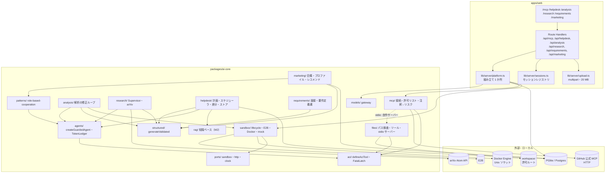
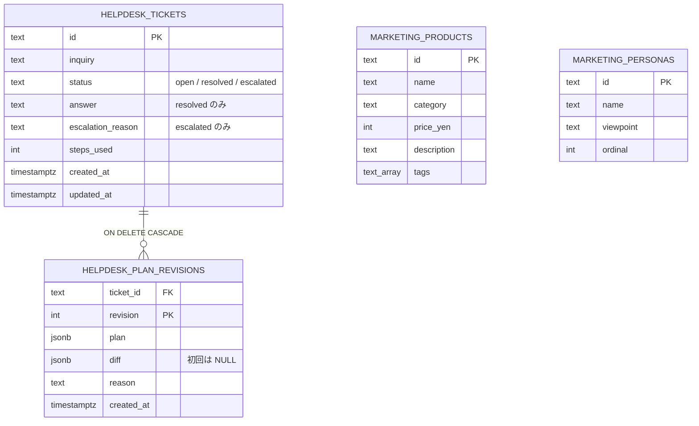

# domain-agents — Technical Plan

承認済みの要件（[spec.md](spec.md)、WHAT）を、アーキテクチャ（HOW）へ落とす。実装コードは書かない。調査の根拠と ADR は [research.md](research.md)、既存コードとの差は [gap-analysis.md](gap-analysis.md) にある。002 の plan（`specs/002-rag-and-workflows/plan.md`）の C1〜C18 とは別に、本 plan の部品を **C1〜C16** と番号付けする。本文中の「002 C4」は 002 の plan の部品を指す。

## Summary

M3 は `packages/ai-core` に 8 つの領域（`files/`、`mcp/`、`sandbox/`、`analysis/`、`research/`、`helpdesk/`、`requirements/`、`marketing/`）を、既存の拡張点から足し、`apps/web` に 6 組の Route Handler と 6 画面を足す。新しいワークスペースは作らない（gap-analysis の Approach C）。M1・M2 の公開契約（`defineAciTool`、`buildToolSet`、`createGuardedAgent`、`generateValidated`、`RerankProvider`、`data-*` ストリーム、テスト接尾辞）は変えず、拡張点から差し込む。

- **ACI と MCP**: ツールは既存の `defineAciTool`（必須の `risk`）で定義し、MCP のツールはアダプターで同じ型へ写像する。MCP のクライアントは `@ai-sdk/mcp`、自作のファイル操作サーバーは `@modelcontextprotocol/server` で作る。どちらも `mock` で、外部の MCP サーバーを使わずに検証できる（自作サーバーは stdio で起動するが、テストは同じプロセス内の接続で行う）。致命的なツールエラーは Run 単位のラッチで止める（ADR-5）。
- **ヘルプデスク・データ分析・リサーチ**: ヘルプデスクの計画と再計画は `ToolLoopAgent` を使わない素の制御フローとし（ADR-9）、個々のタスクの実行だけが `createGuardedAgent` を使う。データ分析の修正ループは、LLM が `runPython` の結果を見て修正と再実行を決めるエージェントで、`createGuardedAgent` で作る（修正の上限 3 回はツールの側でコードが数える）。リサーチの Supervisor とサブエージェントも `createGuardedAgent` で作る。各構成がエージェントとワークフローのどちらに属するかは「構成の補足」の分類表を正とする。サンドボックスは `SandboxProvider` ポートの背後に、E2B、ローカルのコンテナ（Docker Engine API を `node:http` で叩く）、`mock` の疑似実装を置く（ADR-6）。
- **品質ゲートの限界の明示**: 外部サービス（E2B、Docker、arXiv、GitHub）と実際の LLM の品質は gate で保証しない。gate が保証するのは、ラッチ、スケジューラ、差分、照合、上限、パス検査、トークン集計などの決定論的な制御であり、実機の挙動は `*.container.test.ts`（Docker）と手動のハンズオン記録（E2B と GitHub）で補う。

調査で確定した主な設計判断（根拠は research.md）: 解析はホストで行わずサンドボックスで行う（ADR-1）、グラフは PNG と素の `<table>`（ADR-2）、arXiv は `HttpFetcher` と `fast-xml-parser`（ADR-3）、`dockerode` と `no-dynamic-eval` の例外は作らない（ADR-4）、致命的エラーのラッチ（ADR-5）、サンドボックスの選択と寿命（ADR-6）、MCP のリスク区分は注釈から決め、注釈のないツールは `destructive`（ADR-7）、階層型リサーチは単一プロセスの Agent-as-a-Tool（ADR-8）、チケットは既存の rag の drizzle 基盤（ADR-10）。

## Clarifications（plan の決定。人の確認が要るもの）

承認済みの要件の曖昧さ（gap-analysis §5、research.md の ❓）に対する plan の解釈。受け入れ基準の文言と採番は変えない。★は受け入れ基準の読み方に影響するため、`/sdd-plan` の承認時に人が確認する。

| # | 対象 | 決定 | 確認 |
|---|---|---|---|
| CL-1 | Req 1.3 と 1.5 の分類 | パスが許可ルートの外へ出る（シンボリックリンクを含む）操作は「許可されない操作」として**致命的**に分類し、run を `error` で止める。学習者には許可ルートのパスを含むエラーを表示し、モデルには同じ内容を短い文言で返す。Req 1.5 の「エラーを返す」は、この文言を返すことで満たす。存在しない相対パスや形式の誤りは回復可能（Req 1.2、1.4 の修正ガイド） | ★ |
| CL-2 | Req 1.2 の修正ガイド | AI SDK が入力検証の失敗を `tool-error` として返すため、その文言を `aci/input-guide.ts` が Zod の違反一覧（パラメータ名、期待する型、例）から作る形式に差し替える。差し替えられない場合の代替は spike S-1 で決める | |
| CL-3 | Req 1.7 の自作サーバーの起動 | サーバーは TypeScript のまま、Node 26 の型除去で直接起動する（`command: process.execPath`、引数はサーバーのファイル）。`tsx` などの依存は足さない。サーバーの TypeScript は型除去の対象に限る（`erasableSyntaxOnly`）。spike S-2 で確認する | ★ |
| CL-4 | Req 1.9 の GitHub MCP | GitHub の公式ホスト型 MCP（HTTP、`GITHUB_TOKEN` を `Authorization` で送る）へ接続する。npm の GitHub MCP パッケージは採らない（依存と供給網の面積を増やさないため、憲章 原則 7）。読み取り専用のツールだけを許可リストに載せる。エンドポイントと注釈の実機確認は spike S-6 | ★ |
| CL-5 | Req 1.7 の「許可されたワークスペース」 | `MCP_FS_ROOT`（既定は `workspace/`。リポジトリの `.gitignore` に入れ、`workspace/README.md` だけを追跡する）。テストは一時ディレクトリを使う | ★ |
| CL-6 | Req 2.6、2.7 の永続化（❓ research 下記） | チケットは DB に保存する（`helpdesk_tickets`、PGlite / Postgres）。承認待ちや実行の再開は行わない（005 の境界）。M2 の基盤を使うため、DB を使わない構成は取らない | ★ |
| CL-7 | Req 3.1 の「送信」 | 学習者はファイルを**アップロード**する（`multipart/form-data`）。M2 の CL-9（サーバー側ディレクトリのみ）とは別の要件のため、アップロードを扱う。サイズは Route Handler が `Content-Length` と受信バイト数の両方で 20 MB に制限する | ★ |
| CL-8 | Req 3.7 の「セッション」 | 学習者の作業単位を `sessionId`（クライアントが生成する UUID）で表す。セッションの状態はプロセス内のレジストリに置き、DB には保存しない（単一の学習者、ADR-10）。アイドルは `Clock` で数え、既定 10 分で破棄する。接続の途絶は `request.signal` の abort で即時に破棄する | |
| CL-9 | テストの接尾辞 | Docker が必要なテストは `*.container.test.ts`（`mise run test:container`、Docker がなければ理由付きでスキップ）を新設する。E2B の実機テストは置かず、spike S-4 とハンズオンの記録で確認する | ★ |
| CL-10 | 004 Req 4.8（外部コンテンツの汚染状態）の扱い | M3 は書き込みと破壊的ツールを登録しない（Req 1.17）ため、外部コンテンツの汚染状態は M3 の実行に影響しない。M3 は `RunObserver` で外部コンテンツ（arXiv の要旨、ファイルの内容、MCP の応答）の取り込みを記録する口だけを置き、判定と遮断は 004 で実装する | |
| CL-11 | Req 5.1、5.6 の状態 | 要件インタビューの状態（回答、要件、ラウンド数）はセッションのレジストリに置く。要件定義書は Markdown として返し、ダウンロードは同じセッションの内容から生成する | |
| CL-12 | Req 6.2 の合意判定 | 各ラウンドの終わりに、モデレーターが構造化出力で `agreed`（真偽）、`reason`、`remainingObjections` を返す。`agreed` が真で、かつ全ペルソナの直近の発言に未解決の反対が無いことをコードで確認する。判定が不正なら `generateValidated` で再生成する | ★ |
| CL-13 | Req 2.3 の差分 | 差分は純関数 `diffPlan(before, after)` が計算する。タスク ID の集合の増減と、同じ ID で依存や説明が変わったものを記録する。ID は計画の生成時に付け直さず、再計画では残るタスクの ID を保つ | |
| CL-14 | Req 2.4 の上限 | 「ステップ」はタスクの実行 1 回と、計画・再計画の生成 1 回を数える。既定は `DEFAULT_HELPDESK.maxSteps = 12`。上限に達したら残りのタスクを一覧にして `escalated` にはせず、チケットは `open` のまま `stopped_reason = 'step-limit'` を記録して返す（再開は行わない）。中断は `'aborted'` | |
| CL-15 | Req 6.5 の商品照合 | レコメンドの候補は DB の `marketing_products` からだけ取り、表示の前に商品 ID を照合する。照合できないものを除去し、除去の件数を記録する | |
| CL-16 | Req 1.1、1.11 の説明文 | 説明文の要素（用途、入力の意味、使用例、「いつ使うか」「いつ使わないか」）は、`defineAciTool` の検査として機械的に確かめる。文言の品質は人の確認（レビュー）で見る | |
| CL-17 | Req 4.8、4.10 と 002 CL-8 の共有予算 | Supervisor は Run 全体の `maxTotalTokens`（`DEFAULT_RESEARCH.maxTotalTokens`）を持ち、各サブエージェント呼び出しの上限には残量を渡す。残量が 0 の呼び出しは実行せず、Supervisor に予算切れを返す（Req 4.6 の欠落として扱う）。呼び出し回数は Req 4.8 の上限で別に数える。役割別の集計は `TokenLedger` が行う（ADR-8） | |
| CL-18 | Req 1.1、1.11 の説明文の形式 | 説明文は「用途の 1 文」に続けて `使うとき:`、`使わないとき:`、`例:` の 3 つの見出し行を含む。入力の意味は、入力スキーマの全フィールドに `.describe()` があることで確かめる。`defineAciTool` がこれを検査し、M1 の既存 5 ツールの説明文も同じ形式に改める | |
| CL-19 | Req 3.5 のグラフと表の受け渡し | E2B と Docker で経路を分けない。サンドボックスに事前投入する Python の補助関数 `show_figure(alt)` と `show_table(df, caption)` が、目印付きの 1 行（`__PNG__:` / `__TABLE__:` + JSON）を標準出力へ書く。ホストは `analysis/output-parser.ts` の純関数でこれを取り出し、サイズと行数を検査して、画面に出す標準出力から除く。E2B の `results[].png` は使わない | |
| CL-20 | Req 3.8 のコンテナの画像 | ネットワークなし（`NetworkMode: none`）のため実行時に `pip install` できない。pandas、openpyxl、xlrd、matplotlib を含む画像を `docker/sandbox/Dockerfile` から `mise run sandbox:build` で作る（画像名 `agentic-ai-sandbox:local`）。Python 側の版の固定と 24 時間規則の確認は spike S-5 で行う。画像が無いときは、コンテナ実行環境が無いのと同じく分析エージェントを無効にして、ビルドの手順を案内する | ★ |
| CL-21 | Req 1.17 と `runPython` のリスク区分 | `runPython` は破棄可能なサンドボックスの中だけで作用するため `read-only` とする。E2B のサンドボックスの外向き通信の既定は spike S-4 で確認し、通信が可能なら解説に明記し、**004 への引き継ぎ事項として `tasks.md` と解説の「確認できていないこと」に記録して** 004 Req 4 で再検討する（サンドボックス内のコードが学習者のデータを外部へ送れるため。Docker は `NetworkMode: none`） | ★ |
| CL-22 | 3-1 の画面の置き場 | M1 の `/agent` は変えず、3-1 は新しい `/mcp` と `/api/mcp/*` に置く（既存のツール学習と混ぜない） | |
| CL-23 | Req 6.6 の永続化 | 商品カタログとペルソナ定義は DB（`marketing_products`、`marketing_personas`）に置き、マイグレーションは `packages/ai-core/drizzle/0003_marketing.sql`（ヘルプデスクの `0002_helpdesk.sql` とは別。Wave を分けるため） | |
| CL-24 | Req 1.3、1.5 の MCP 経由の致命的エラー | 自作サーバーは別プロセスのため、`FatalToolError` は MCP の境界を越えない。サーバーは失敗を例外ではなくツール結果 `{ isError: true, content: [短い文言], _meta: { "agentic-ai/error": { kind: "fatal" \| "recoverable"; code } } }` として返す（`code` は C2 の閉じた語彙。致命的は `not-allowed` など）。クライアントの `adaptMcpTool` は `isError` の結果を `classifyMcpToolResult` で判定し、`trustErrorMeta: true` のサーバー（`filesServerConfig` だけが立てる）の `kind: "fatal"` に限り `FatalToolError` を投げてラッチを立てる（以降は C2 の経路で停止理由 `error`）。学習者向けの文言はクライアントがサーバーの設定（許可ルートのパス）から組み立て、サーバーの文字列をそのまま使わない。`trustErrorMeta` の無いサーバー（GitHub など）の `isError` は回復可能として、要約と次の修正アクションを返す。HTTP の 401 / 403 は従来どおり `auth-failed`。`_meta` がクライアントの `execute` まで届くかは spike S-2 で確かめ、届かなければ `structuredContent` に同じ形を載せる。それも届かなければ `adaptMcpTool` が `tools/call` を自前で呼んで結果を読む（S-2 の退き方と同じ） | ★ |
| CL-25 | Req 1.1、1.11 と Req 1.9 の両立（外部の MCP ツールの説明文） | 外部のサーバー（GitHub）の説明文は CL-18 の形式を満たさない。そこで `McpServerConfig.descriptions`（ツール名 → CL-18 の形式の説明文。リポジトリのコードに書き、クライアントの要求からは受け付けない）で上書きし、上書きがあればそれを、無ければサーバーの説明文を「実効の説明文」として検査する。外部ツールの入力は Zod ではなく JSON Schema のため、入力の意味の検査は `checkJsonSchemaDescription` が行う（入力の全プロパティに `description` があるか、プロパティ名が実効の説明文に現れること）。`githubServerConfig` は既定の許可リストに載せる読み取り専用ツールの上書きを持つ（ツールの一覧は spike S-6 の結果で決める）。上書きが無く検査に通らないツールは登録せず、`disabledReason` に「説明文の形式」を出す。これにより Req 1.1・1.11 は登録されるすべてのツールで満たし、Req 1.9 は上書きを持つ許可リストのツールで満たす | ★ |
| CL-26 | Req 3.3、3.4 の修正回数の数え方 | 「修正」は失敗した実行の次の実行である。**修正の許容は失敗ごと**: 1 回の失敗に対して修正の実行は `maxFixAttempts`（既定 3）回までで、**失敗した実行 1 回 + 修正 3 回 = その失敗に最大 4 回の実行**。通算 4 回目（3 回目の修正）が失敗した時点で `attempt-limit` として止め、5 回目の実行は求めない。成功した実行で失敗は終わり、その後の新しい失敗には改めて 3 回の修正がある（分析全体の長さはエージェントのステップ上限が抑える）。表示用の `fixes` は分析全体の修正の合計。plan の「4 回目は実行せず」の「4 回目」は 4 回目の修正（通算 5 回目）を指すと読んだ。通算 3 回の読みなら `maxFixAttempts` を 2 にする（コードの変更は要らない）。レビュー W4 F-3 で、累積の数え方（失敗と成功が交互だと、修正を 1 回も受けていない失敗で止まる）を失敗ごとに改めた | 確認済み（2026-10-19）。初回 + 修正 3 回で最大 4 回の実行の読みで確定 |

## Architecture Overview

### 領域の依存方向（`packages/ai-core/src/`）

- 矢印は import の向き（`ports/` と `mcp/` の一部は実行時の接続を示す）。`apps/web` は `ai-core` の公開サブパスだけを import し、組み立ては `lib/server/platform.ts` の 1 か所で行う（M2 と同じ）。
- `ToolLoopAgent` を作るのは `agents/guarded-agent.ts` の `createGuardedAgent` だけ（M1 の不変条件）。M3 のサブエージェント（Supervisor の子、分析の修正ループ、合議の役割）も同じ関数を使う。
- `workflow-no-agent-loop` の対象を拡張する。`helpdesk/planner.ts`、`helpdesk/replanner.ts`、`helpdesk/helpdesk.ts`、`requirements/interview.ts`、`requirements/personas.ts`、`marketing/council.ts`、`marketing/moderator.ts`、`marketing/profile.ts`、`marketing/recommend.ts` は `ToolLoopAgent` と `createGuardedAgent` を import しない（ADR-9）。`helpdesk/run.ts` のタスク実行だけが `createGuardedAgent` を使う。
- `@ai-sdk/mcp` は `mcp/` だけが import する（ADR-7、新規則 `mcp-import-scope`）。`@e2b/code-interpreter` は `sandbox/e2b.ts` だけ、`node:http` による Docker 接続は `sandbox/docker/` だけが使う（新規則 `sandbox-import-scope`、ADR-4）。
- `analysis/`、`research/`、`helpdesk/`、`requirements/`、`marketing/` は `sandbox/` の具象を import しない。サンドボックスには `ports/sandbox.ts` の `SandboxProvider` だけに依存する。
- `patterns/role-based-cooperation.ts` が `agents/` を import できる唯一のパターンであることは M2 と同じ。M3 で `marketing/council.ts` がこれを使う。
- `ai-core` は React、Next.js、`@ai-sdk/react` を import しない（M1 と同じ）。

### 主要な流れ

#### ツールの登録（Req 1.x）

1. `mcp/connect` が設定の一覧から各 MCP サーバーへ接続する（失敗は `McpServerStatus` に記録し、そのサーバーのツールだけを利用不可にする。Req 1.10）。
2. エージェントごとの許可リスト（`mcp/allow-list.ts`）で `client.tools({ schemas })` の対象を絞る（許可リストに無いツールは読み込まれない）。
3. 注釈から `ToolRisk` を決め（`readOnlyHint === true` だけが `read-only`）、`defineAciTool` と同じ形の `AciTool` に変換する。
4. 組み込みツールと合わせて `buildToolSet` へ渡す。`write` と `destructive` は登録されず `disabled` に入り、20 個を超えると起動時に拒否する（Req 1.15、1.17）。

#### ヘルプデスク（Req 2）

1. `POST /api/helpdesk` が問い合わせを `helpdesk_tickets` に `open` で保存し、`planner` が `generateValidated` で計画を作る。`validatePlan` が不正なら、フィードバックを付けて再生成する（上限 2 回。超えたら `escalated`、Req 2.10）。
2. `scheduler` が依存順に実行可能なタスクを 1 つ選び、`run` が `createGuardedAgent` でそのタスクを実行する（ナレッジ検索の読み取りツールだけを持つ）。ステップを 1 つ数える（CL-14）。
3. タスクが終わるたびに `replanner` が `continue` / `replan` / `finish` を構造化出力で返す。`replan` なら残りのタスクを再生成し、`diffPlan` で差分を記録する（`helpdesk_plan_revisions`、Req 2.3）。
4. 最終回答は `detectCredentialShapes` で検査し、検出時は保存せず再作成させる（Req 2.8）。保存して `resolved`、または `escalated` を記録する（Req 2.6、2.7）。
5. 各状態変化は `data-helpdesk-*` パートとして UI へ流す（Req 2.5）。

#### データ分析（Req 3）

1. `POST /api/analysis`（multipart）が拡張子、マジックバイト、20 MB を検査する（`analysis/upload-check.ts`）。失敗は起動せずに理由を返す（Req 3.9）。
2. `sandbox/lifecycle.ts` がセッションのサンドボックスを作る（提供者は起動時に選択、CL-8、ADR-6）。ファイルは生バイトのまま書き込む（ADR-1）。
3. `analysis/agent.ts` が `createGuardedAgent` で `runPython` ツール（サンドボックス内だけで実行）を使い、結果の画像と表を `data-analysis-*` で流す。失敗の修正は最大 3 回で、超えたら `FatalToolError`（`attempt-limit`）で止め、試行履歴を表示する（Req 3.3、3.4）。
4. アイドル（10 分）、明示終了（`DELETE /api/analysis/sessions/[id]`）、接続断（`request.signal`）でサンドボックスを破棄する（Req 3.7）。

#### 階層型リサーチ（Req 4）

1. `POST /api/research` が Supervisor を `createGuardedAgent` で作り、3 つのサブエージェントを入力スキーマ付きのツールとして渡す。
2. 各サブエージェントは子の `createGuardedAgent` で動き、Supervisor へは要約だけを返す（Req 4.4）。検索サブエージェントは C8 の arXiv 検索を使う（キュー、キャッシュ、再試行、Req 4.7）。
3. 呼び出し回数（Req 4.8）と共有予算（CL-17）を Supervisor の側で数え、子の上限に残量を渡す。失敗は `missing` に記録する（Req 4.6）。
4. `checkCitations` が論文の集合と照合して、未知の論文を除去し警告を付ける（Req 4.5）。`TokenLedger` が役割別の内訳を集計する（Req 4.10）。

#### 要件定義書の生成（Req 5）

1. `POST /api/requirements/sessions` が概要からペルソナを `generateValidated` で作る（Req 5.1）。
2. `POST /api/requirements/sessions/[id]/messages` が 1 ラウンドを固定の往復として進める（ワークフロー、ADR-9）。回答から要件を抽出して `data-requirements-preview` を返し、`judgeSufficiency` で十分性を判定する（Req 5.3、5.4）。
3. 不足があり上限（既定 5 ラウンド）に達していなければ追加の質問を続ける（Req 5.5）。十分、または上限到達で `renderRequirementDocument` が章立ての Markdown を作る（Req 5.6）。ダウンロードは `GET .../document` が `Content-Disposition: attachment` で返す（Req 5.7）。

#### マーケティング支援（Req 6）

1. `POST /api/marketing/council` が `runCouncil` で、ラウンドごとに `cooperateByRole`（役割は既定 3 名、ツールなし）を呼ぶ。ラウンドの反復と合意の確定はコードが行い（ワークフロー）、各役割の発言だけが役割ごとの `createGuardedAgent` の実行になる（「構成の補足」の分類表）。合議全体のトークンは `DEFAULT_COUNCIL.maxTotalTokens` を全ラウンドで共有し、各ラウンドの `cooperateByRole` の `budget.maxTotalTokens` には残量を渡す。残量が 0 なら次のラウンドを始めず `endReason: "budget-exhausted"` で終える。各役割の発言は `onRoleOutput` で `data-council-turn` として流す（Req 6.3）。
2. 各ラウンドの後に `judgeAgreement` が構造化出力とコードの検査（未解決の反対が無いこと）で合意を判定する（CL-12）。合意か上限で終了する（Req 6.2）。
3. `POST /api/marketing/recommend` は会話ごとに `extractProfile` でプロファイルを更新し（Req 6.4）、`recommend` が `marketing_products` からだけ候補を選んで ID を照合する（Req 6.5、CL-15）。

### 構成の補足

- **エージェントとワークフローの分類**（憲章 原則 1。この表を正とし、Summary や各部品の記述と食い違う場合はこの表に合わせる）:

  | 構成 | 分類 | 制御フローを決めるもの | `ToolLoopAgent` | 根拠 |
  |---|---|---|---|---|
  | MCP チャット（`/api/mcp/chat`、`/api/mcp/compare` の各実行） | エージェント | LLM（どのツールをいつ呼ぶか） | `createGuardedAgent` | ツールの選択を LLM が決める |
  | ヘルプデスクの計画・再計画・判断（`planner`、`replanner`、`helpdesk`） | ワークフロー | コード（依存順のスケジューラ、ステップ上限、再生成の上限） | 使わない | ADR-9 |
  | ヘルプデスクのタスク実行（`helpdesk/run.ts`） | エージェント | LLM（ナレッジ検索をいつ何回呼ぶか） | `createGuardedAgent` | ADR-9 |
  | データ分析の修正ループ（`analysis/agent.ts`） | エージェント | LLM（`runPython` の結果を見て、修正版を書くか終えるかを決める） | `createGuardedAgent` | 修正の回数の上限（3 回）だけはコードが `runPython` の側で数え、超えたら `FatalToolError`（`attempt-limit`）で止める（C2、C7） |
  | 階層型リサーチの Supervisor とサブエージェント | エージェント（マルチエージェント） | LLM（どのサブエージェントを何回呼ぶか、子はどのツールを呼ぶか） | `createGuardedAgent` | ADR-8、憲章 原則 1 の例外（Req 4.1） |
  | 要件インタビュー（`personas`、`interview`） | ワークフロー | コード（固定の往復、ラウンド上限） | 使わない | ADR-9 |
  | マーケティングの合議のラウンド制御と合意判定（`council.ts` のラウンドの反復、`moderator.ts`） | ワークフロー | コード（ラウンドロビンの順序、最大ラウンド、合意の確定規則） | 直接は使わない | CL-12、ADR-9 |
  | マーケティングの合議の各ペルソナの発言（`cooperateByRole` の各役割） | エージェント（マルチエージェント） | 各役割の実行内は LLM | `cooperateByRole` 経由の `createGuardedAgent`（M2 の Role-Based Cooperation） | 憲章 原則 1 の例外（Req 6.1）。M3 の役割は**ツールを持たない**ため、各役割の実行は 1 ステップで終わる。ツールを持たない役割を `ToolLoopAgent` で動かすのは、M2 の Role-Based Cooperation（002 Req 4.7）を教材として再利用し、役割ごとに文脈と停止条件を分けるためである（Constitution Compliance の ⚠ 3） |
  | プロファイル抽出とレコメンド（`profile`、`recommend`） | ワークフロー | コード | 使わない | ADR-9 |

- ワークフローに分類したファイルは、規則 `workflow-no-agent-loop` の対象に入れて機械的に守らせる（C16）。`council.ts` は `patterns/role-based-cooperation.ts` の公開関数だけを import し、`agents/` と `ToolLoopAgent` を直接 import しない。
- セッションの状態（面接、分析の試行、ヘルプデスクの進行）は `SessionRegistry` に置く（CL-8、CL-11）。永続化するのはチケット、計画の改訂、商品、ペルソナだけである（CL-6、ADR-10）。

## Components

各部品の **Does NOT own** は契約であり、tasks.md の `_Boundary:_` が参照する。Public interface の型は TypeScript の形で示す概念的な署名であり、実装コードではない。C 番号は File Structure Plan の C 列と一致する。M2 の部品（002 の C1〜C18）は再利用し、変更する場合は変更の範囲を **Owns** に限定する。

### C1 設定・カタログ・依存

- **Responsibility**: M3 が必要とする設定値、環境変数の名前、機能の必要条件、公開サブパスを、M2 の公開契約を変えずに足す。
- **Public interface**:
  - `config/defaults.ts`: `DEFAULT_HELPDESK`、`DEFAULT_SANDBOX`、`DEFAULT_ANALYSIS`、`DEFAULT_ARXIV`、`DEFAULT_RESEARCH`、`DEFAULT_INTERVIEW`、`DEFAULT_COUNCIL`、`DEFAULT_TOOLS`（値は Interfaces / Contracts「設定値」）。
  - `config/env-schema.ts`: `E2B_API_KEY`、`GITHUB_TOKEN`、`MCP_FS_ROOT`、`DOCKER_HOST`、`DOCKER_SANDBOX_IMAGE`（すべて任意）。
  - `config/feature-requirements.ts`: 機能 `e2b-sandbox` → `E2B_API_KEY`、`github-mcp` → `GITHUB_TOKEN`。Docker は環境変数ではなくソケットの疎通で判定するため、この表には入れない（C6）。
  - `packages/ai-core/package.json` の `exports`: `./files`、`./mcp`、`./sandbox`、`./analysis`、`./research`、`./helpdesk`、`./requirements`、`./marketing` を足す。
- **Owns**: 上記の定数、鍵の名前、機能の必要条件、公開サブパス。`.env.example` の行。秘密情報の一覧（`E2B_API_KEY`、`GITHUB_TOKEN`）を録画の秘匿の対象に加える（M2 の `credentialSecrets` と同じ扱い）。
- **Does NOT own**: `ModelPurpose` の語彙、モデルカタログ（M3 は新しいモデル ID を要求しない）。サンドボックスの選択（C6）。DB の接続（M2 の `rag/db`）。
- **Requirements**: 1.7、1.8、1.9、1.15、2.4、2.10、3.7〜3.9、4.7、4.8、4.10、5.1、5.5、6.2（既定値と設定の供給）

### C2 致命的エラーとラッチ（`aci/`、`agents/`）

- **Responsibility**: ツールのエラーを「回復可能」と「致命的」に分け、致命的なエラーを Run 単位で 1 件だけ保持して、以降のツール実行を止める経路を提供する（ADR-5）。
- **Public interface**:
  - `class FatalToolError extends Error { code: "auth-failed" | "config-missing" | "not-allowed" | "attempt-limit" | "sandbox-unavailable"; learnerMessage: string }`。学習者に見せてよい短い文言だけを持つ。
  - `FatalLatch`: `trip(error: FatalToolError): void`、`readonly error: FatalToolError | undefined`。最初の 1 件だけを保持し、後続は無視する。
  - `classifyToolError(error: unknown): { kind: "recoverable"; summary: string; nextAction: string } | { kind: "fatal"; error: FatalToolError }`。生のスタックトレースを含めない。
  - `ToolRuntime` に任意の `fatal: FatalLatch` を足す（省略時は M1 と同じ挙動）。
- **Owns**: 分類の規則、学習者向け文言の形式（許可ルートを含む文言を含む）、ラッチの 1 件保持。`aci/define-tool.ts` のラッチを立てる処理（`defineAciTool` が投げられたエラーを結果に変換するため、ここでしか分類できない）、`aci/tool-set.ts` のラッチ後の拒否（ラッチがあるときはツール呼び出しを 1 件ずつ実行し、同じステップの残りも拒否する）、`buildToolSet` が `runtime.fatal` を記録して `fatalLatchOf(tools)` で返す経路。`agents/guarded-agent.ts` のラッチ経路（ツールセットのラッチの取得、使用済みのラッチの拒否、`stopWhen` にラッチの状態だけを読む条件を足す、`finalise` の先頭での判定）と、そのテスト。停止は内部 `AbortController` ではなく `stopWhen` で行う（spike S-1。abort は `stream` の `finish` と `onEnd` を落とす）。呼び出し側はラッチを `buildToolSet` の `runtime.fatal` に渡すだけでよい。
- **Does NOT own**: 停止理由の語彙（`STOP_REASONS` は変えない。`error` は既存の `deriveStopReason` の分岐で到達する）。`ToolFailureKind` の `fatal` を戻り値として使うこと（使わない）。UI の表示（C14）。
- **Requirements**: 1.3、1.5、3.4（`attempt-limit` の停止）

### C3 ACI 設計の検査と補助（`aci/`）

- **Responsibility**: ツールの説明文と入力の検査、修正ガイド、応答形式（`concise` / `detailed`）、索引 ID、思考用ツール、高水準ツールと低レベル組み合わせの比較を、ツールの実行経路の外の純関数として提供する。
- **Public interface**:
  - `checkDescription(description: string, inputSchema: z.ZodType): DescriptionIssue[]`: 見出し行（`使うとき:`、`使わないとき:`、`例:`）と、入力の全フィールドの `.describe()` の有無を検査する（CL-16、CL-18）。`defineAciTool` が呼ぶ。
  - `checkJsonSchemaDescription(description: string, inputSchema: JSONSchema7): DescriptionIssue[]`: MCP 由来のツール用。見出し行の検査は `checkDescription` と同じ規則を共有し、入力の意味は「全プロパティに `description` がある、またはプロパティ名が説明文に現れる」ことで確かめる（CL-25）。
  - `formatInputGuide(error: z.ZodError, inputSchema: z.ZodType): string`: 違反したパラメータ名、期待する型、例を含む修正ガイドを作る（CL-2）。
  - `applyResponseFormat(text: string, { format: "concise" | "detailed"; maxCharacters: number; fullTextHint: string }): string`: `concise` で上限を超えた場合に切り詰め、全文の取得方法を付ける（Req 1.6）。
  - `ShortIdIndex<T>`: `assign(items: readonly T[]): readonly { index: number; label: string }[]`、`resolve(index: number): T | undefined`。0 始まりの索引と名称を使い、UUID を使わない（Req 1.13）。
  - `createThinkTool({ enabled: boolean }): AciTool | undefined`: 思考の内容を保持せず、呼び出しを記録して確認の文言を返す。無効なら `undefined`（Req 1.14）。
  - `compareApproaches({ highLevel: RunMetrics; lowLevel: RunMetrics }): { steps: number; tokens: number; ratio: number }`（`aci/high-level-compare.ts`）。計測値を受け取るだけで、実行はしない（Req 1.12）。
- **Owns**: 説明文の形式と検査、修正ガイドの文面、切り詰めの規則、索引 ID の割り当て、思考用ツールの定義、比較の計算。M1 の 6 ツール（`aci/tools/`）の説明文を CL-18 の形式へ改める。`AciTool` に Zod の `inputSchema` を公開する（`aci/types.ts`）。外部の JSON Schema を持つツール（MCP 由来）のために `AciToolDefinition.externalInputSchema` を足した（W2 の 9.3。説明文の検査は `checkJsonSchemaDescription`、モデルへは JSON Schema をそのまま送り、Zod の `inputSchema` は入力が object であることを確かめるだけ）。`defineAciTool` は AI SDK 自身の JSON Schema（`zodSchema`）を保ったまま、検証失敗の文言だけを修正ガイドに差し替える。説明文の形式を必須にしたことで壊れる既存のテスト定義は `describeTool` で直す（`patterns/role-based-cooperation.test.ts` と `aci/tools/calculator.test.ts` を含む。tasks.md の Boundary の例外）。
- **Does NOT own**: ツールの実行とガードの配線（C2 が所有する `aci/tool-set.ts`）。ツール数の上限（既存の `buildToolSet` と `MAX_AGENT_TOOLS` を再利用する）。MCP 由来のツールの説明文の上書きの文言（C5 の `McpServerConfig.descriptions` が持つ。C3 は形式の検査だけを行う、CL-25）。
- **Requirements**: 1.1、1.2、1.6、1.11、1.12（比較）、1.13、1.14

### C4 ファイル操作ツールと自作 MCP サーバー（`files/`）

- **Responsibility**: 許可されたワークスペースの内側だけでファイルを操作するツールを `defineAciTool` で定義し、同じツールを公式 MCP SDK で公開する stdio サーバーを提供する。
- **Public interface**:
  - `resolveWorkspacePath(root: string, input: string): Promise<Result<string, PathError>>`: `PathError` は `relative | outside-root | not-found | invalid` の閉じた種別。相対パスを拒否し、正規化し、シンボリックリンクを解決した実パスが `root` と同一または配下（パス区切り単位）であることを検査する。
  - `createFileTools({ root, conciseMaxCharacters? }): readonly AnyAciTool[]`（W2 で `clock` を外した。時刻に依存するツールがなく、`ToolRuntime` が時計を渡す）: `listFiles`、`readFile`（`format` を持つ）、`searchFiles`、`findAndReadFiles`（高水準。一覧と読み取りを 1 回で行う、Req 1.12）。読み取り系は `risk: "read-only"`。`writeFile`（`write`）と `deleteFile`（`destructive`）は定義するが、C5 の登録対象にならない。
  - `createFileOperations({ root, conciseMaxCharacters? }): readonly FileOperation[]`（`files/operations.ts`、W2 で追加）: 上の 6 つの処理の本体。`FileOperation` は `{ name, description, inputSchema, risk, run }` で、失敗は `FileToolError`（`recoverable` / `fatal` と `not-allowed` / `config-missing`）。`tools.ts` が `defineAciTool` で、`server.ts` が MCP SDK で、それぞれ包む。`stdio.ts` は Node の型除去で直接起動するため拡張子なしの import を解決できない。そこで `operations.ts`・`server.ts`・`stdio.ts` は `.ts` 拡張子付きの import だけで、`aci/` の依存のない 2 ファイル（`response-format.ts`、`short-id.ts`）と `path.ts` に到達する（`tsconfig.base.json` の `allowImportingTsExtensions`）。
  - `createFilesServer({ root }): McpServer`: 上記のツールを登録する。`writeFile` と `deleteFile` は公開するが、注釈は `readOnlyHint: false` とする（Req 1.17 の実例）。ツールの失敗は例外にせず、`isError: true` と `_meta["agentic-ai/error"]`（`kind` と `code`）を持つツール結果として返す（CL-24。許可ルートの外は `kind: "fatal"`、`code: "not-allowed"`、相対パスと存在しないパスは `kind: "recoverable"`）。
  - `files/stdio.ts`: `MCP_FS_ROOT` を読み、`StdioServerTransport` で接続する起動入口（`node` で直接起動する）。
  - `resolveServerRoot(requested)`（`files/server.ts`）: 許可ルートを実パスに解決し、存在しなければ作らずに理由を返す（`stdio.ts` が使う）。
- **Owns**: パスの検査規則、ツールの入出力スキーマ、公開するツール名と注釈。ワークスペースの既定（`workspace/`）と `workspace/README.md`。
- **Does NOT own**: 許可リストと MCP クライアント（C5）。ワークスペースの内容（学習者が置く。テストは一時ディレクトリを使う）。配信（C14）。
- **Requirements**: 1.4、1.5、1.6、1.7、1.12、1.16、1.17

### C5 MCP クライアントアダプター（`mcp/`）

- **Responsibility**: 設定された MCP サーバーへ接続し、サーバーごとの状態を記録し、エージェントごとの許可リストで絞ったツールを `defineAciTool` と同じ形へ変換して返す。
- **Public interface**:
  - `connectMcpServers(configs: readonly McpServerConfig[], { signal }): Promise<McpRegistry>`。失敗は例外にせず `McpServerStatus` に記録する。
  - `McpRegistry`: `status(): readonly McpServerStatus[]`、`toolsFor(agentId: AgentId, { allow?, reservedTools? }): readonly AnyAciTool[]`（`allow` はエージェントごとの許可リストで、設定の許可リストを狭めるだけ。`reservedTools` は組み込みツールの数で、20 個の上限に数える）、`close(): Promise<void>`。`connectMcpServers` の第 2 引数は `{ signal, clock, connectTimeoutMs, maxToolsPerAgent, transportFor }`（`transportFor` はテストが同一プロセスの接続に差し替える口）。`McpServerConfig` は `fatalMessages`（致命的エラーの学習者向け文言を設定から作る、CL-24）を持つ。`mcp/request-schema.ts`（`/api/mcp/chat`・`/compare` の本文スキーマ。`apps/web` に `zod` がないため ai-core に置く）、`mcp/chat.ts`（チャットの指示文と比較の文面）、`publicMcpStatus`（状態を送れるフィールドだけに写す）を W2 で追加した。
  - `riskFromAnnotations(annotations: unknown): ToolRisk`: `readOnlyHint === true` だけを `read-only` とし、それ以外（注釈なしを含む）は `destructive` とする（ADR-7）。
  - `adaptMcpTool(name, tool, { serverId, risk, description, trustErrorMeta, learnerMessageFor?, onCallError? }): { ok: true; tool } | { ok: false; reason }`: 実効の説明文（`descriptions` の上書き、無ければサーバーの説明文）を C3 の `checkJsonSchemaDescription` に通す（CL-25）。実行結果は `classifyMcpToolResult` に通す。
  - `classifyMcpToolResult(result, { serverId, trustErrorMeta, learnerMessageFor }): { ok: true; output } | { kind: "recoverable"; summary; nextAction } | { kind: "fatal"; error: FatalToolError }`（純関数、CL-24）。`kind: "fatal"` は `trustErrorMeta` が真で、`code` が C2 の閉じた語彙のときだけ認める。学習者向けの文言は `learnerMessageFor(code)`（クライアントの設定から作る）で組み立て、サーバーの文字列を使わない。
  - `githubServerConfig(env): McpServerConfig | { reason: "token-missing" }`: `Authorization` ヘッダに `GITHUB_TOKEN` を入れる HTTP 設定を返す（CL-4）。既定の許可リストに載せる読み取り専用ツールの説明文の上書き（`descriptions`、CL-25）を持ち、`trustErrorMeta` は偽。サーバー自身の読み取り専用モード（`X-MCP-Readonly: true`）も求める（プラットフォームの許可リストとリスクの検査は、これに依存しない）。
  - `filesServerConfig({ root }): McpServerConfig`: 自作サーバーの stdio 設定（`command: process.execPath`、引数はサーバーのファイル、環境変数 `MCP_FS_ROOT`）。`trustErrorMeta: true`（CL-24）。
- **Owns**: 接続と切断の寿命、`McpServerStatus` の遷移（`connected` / `unavailable` と理由）、許可リストの適用（`client.tools({ schemas })` に渡すオブジェクトの組み立て）、注釈から区分への写像、ツール結果のエラーの分類（CL-24）、説明文の上書きの適用（CL-25）。
- **W2 で決めた制約**: (1) HTTP の 401 / 403 は、`trustErrorMeta` に関わらずどのサーバーでも致命的（`auth-failed`）として扱う。サーバーの文言ではなく転送層の信号で、学習者向けの文言は設定から作る。GitHub の 403（二次レート制限など）でも止まる点は既知（レビュー W2 F-9）。(2) ファイルサーバーの索引は 1 プロセスで 1 つで、同時の会話で共有される（単一の学習者が前提、ADR-10。許可ルートの外には出ない。F-1）。(3) 利用不可になったサーバーは再接続しない（再起動が要る。F-3）。(4) パスの検査と操作の間の入れ替えは防がない（書き込み・削除はエージェントに登録しない。F-10）。
- **Does NOT own**: MCP の応答のスキーマ検証（`@ai-sdk/mcp` の既定に従う）。ツールの実行時のガード（C2）。認可（利用者ごとの認証は 005 の境界外）。
- **Requirements**: 1.1、1.3、1.5、1.7、1.8、1.9、1.10、1.11、1.15、1.16、1.17

### C6 サンドボックス（`ports/sandbox.ts`、`sandbox/`、`docker/sandbox/`）

- **Responsibility**: 生成コードを実行する隔離環境を、E2B、ローカルのコンテナ、疑似実装の 3 つの提供者の背後に置き、学習者のセッションごとに作成と破棄を行う（ADR-6）。
- **Public interface**:
  - `ports/sandbox.ts`: `SandboxProvider { readonly kind: "e2b" | "docker" | "mock"; create(options: { timeoutMs: number; signal?: AbortSignal }): Promise<SandboxSession> }`、`SandboxSession { writeFile(path: string, bytes: Uint8Array): Promise<void>; runPython(code: string, options: { timeoutMs: number }): Promise<SandboxRunResult>; isAlive(): Promise<boolean>; close(): Promise<void> }`、`SandboxRunResult { stdout: string; stderr: string; error?: { name: string; message: string; traceback: string } }`。
  - `selectSandboxProvider({ env, dockerProbe }): { kind: "e2b" | "docker" } | { kind: "disabled"; reason: string; guidance: string }`（Req 3.8 の順序: E2B の鍵、ローカルのコンテナ、無効）。
  - `createSandboxRegistry({ provider, clock, idleTimeoutMs }): SandboxRegistry`: `acquire(sessionId)`、`touch(sessionId)`、`release(sessionId)`、`sweep()`（アイドルの破棄）。
  - `sandbox/e2b.ts`: `createE2bProvider({ apiKey, sdk })`。SDK の `Sandbox` を注入できる形にし、テストは偽の SDK で行う。
  - `sandbox/docker/`: `probeDockerSocket(env)`（`DOCKER_HOST`、`~/.docker/run/docker.sock`、`/var/run/docker.sock` の順）、`createDockerProvider({ engine, image })`。
  - `sandbox/mock.ts`: 定義済みの標準出力、エラー出力、画像を返す疑似提供者（Req 3.10）。
- **Owns**: 提供者の選択、セッションのアイドル判定（`Clock`）、Engine API の呼び出し（`engine.ts`、`tar.ts`、`demux.ts`）、E2B の SDK の呼び出し（`sandbox/e2b.ts` だけ）、Docker の作業ディレクトリと制限（ネットワークなし、メモリ、CPU、読み取り専用ルート、**匿名ボリュームの `/work` と tmpfs の `/tmp`**、PID 上限、capability の削除、`no-new-privileges`）、画像 `docker/sandbox/Dockerfile` と固定した依存 `requirements.txt`。
  - **W4 の実測による訂正**（research「W4 の実測」）: 読み取り専用ルートでは tmpfs の `/work` に archive で入力を置けないため、`/work` は匿名ボリューム（root 所有で非 root から書けない。入力は起動前に archive で置く）、書込先は `/tmp` の tmpfs（64 MiB、`noexec`）だけにした。コンテナは**実行ごとの使い捨て**で（`LogConfig` で保存するログを 16m に制限し、ラベル `agentic-ai.sandbox=1` を付ける。残ったものは `mise run sandbox:clean` で消す。Engine API の呼び出しは `wait` 以外すべてタイムアウトを持つ: 確認系 3 秒、その他 30 秒。セッションを閉じた時点で作成中だったコンテナは、作成の完了後に削除して実行しない。W4 のレビューで足した）、セッションが入力ファイルをメモリに持ち、実行のたびに置き直す。`SandboxRegistry.acquire` は `SandboxLease { session; recreated; done() }` を返し、貸出中は `sweep` が破棄しない。`SandboxSession.writeFile` の `path` は**ディレクトリを含まない平易なファイル名**（`assertSandboxFileName`。3 提供者が同じ規則）。Engine API の版は 1.44。E2B は SDK を提供者の最初の `create` で遅延読み込みし（キーが無ければ読まない）、`allowInternetAccess` は指定したときだけ SDK に渡す。
- **Does NOT own**: 解析の手順、生成コードの評価と修正（C7）。学習者のセッション識別と HTTP（C13）。MCP（C5）。サンドボックス内で `child_process` を使う経路（ない）。
- **Requirements**: 3.1、3.2、3.7、3.8、3.10

### C7 データ分析（`analysis/`）

- **Responsibility**: アップロードを検査し、サンドボックスでコードを実行して、失敗を修正しながら分析を進める修正ループと、出力の分離を提供する。
- **Public interface**:
  - `checkUpload({ name, bytes, declaredLength? }): { ok: true; kind: "csv" | "xlsx" | "xls" } | { ok: false; reason: "extension" | "magic" | "size" | "encoding" }`（純関数。`analysis/upload-check.ts`）。
  - `runAnalysis({ sandbox, file, instruction, model, options: { maxFixAttempts; executionTimeoutMs }, limits?, clock, observer, signal, onEvent? }): Promise<AnalysisResult>`。`AnalysisResult` は `{ status: "succeeded" | "incomplete" | "attempt-limit" | "sandbox-unavailable" | "unreadable" | "stopped"; attempts: readonly AnalysisAttempt[]; fixes; figures; tables; text; run? }`（`succeeded` は最後の実行が成功したとき。`incomplete` はモデルが失敗の後で修正せずに終えた、またはコードを一度も実行しなかったとき。`sandbox-unavailable` はサンドボックスが使えなくなった（`runPython` が `provider-unavailable` を受けると致命的エラーで 1 回のモデル呼び出しのうちに止める）とき。`unreadable` は壊れた `.xlsx` / `.xls`（下調べが時間・メモリの上限に当たったときは壊れたとみなさず分析へ進む）、`stopped` はステップ・トークン・時間の上限。W4 の 18.4 とレビューで足した）。`checkUpload` の拒否理由には `empty`（空ファイル）を足した。修正回数の数え方は CL-26。
  - `parseSandboxOutput(stdout: string, limits): { text: string; figures: readonly Figure[]; tables: readonly Table[]; rejected: readonly string[] }`（`analysis/output-parser.ts`、純関数）。目印の行（`__PNG__:`、`__TABLE__:`）を取り出し、PNG のマジックバイト、サイズ、行数を検査する。
  - `analysisPrelude: string`（`analysis/prelude.ts`）: `show_figure(alt)` と `show_table(df, caption)` を定義する Python の断片。サンドボックスへ投入する。
  - `createRunPythonTool({ registry })`: `runPython` を `risk: "read-only"` で定義する。作用はサンドボックスの中だけ。
- **Owns**: 修正ループの回数（既定 3、Req 3.3）、試行履歴（コード、標準出力、エラー、修正回数、`analysis/attempts.ts`）、出力の分離と検査、アップロードの検査規則。
- **Does NOT own**: サンドボックスの作成と破棄（C6）。HTTP の multipart（C13）。E2B の型（C6）。画面（C14）。`ToolLoopAgent` の生成（`createGuardedAgent` を使う）。
- **Requirements**: 3.1、3.3、3.4、3.5、3.6、3.9

### C8 arXiv と研究ツール（`research/arxiv/`、`research/tools.ts`）

- **Responsibility**: arXiv の Atom API を利用規約（3 秒間隔、単一接続、日単位のキャッシュ）に従って呼び、論文の集合を返す。
- **Public interface**:
  - `createArxivClient({ fetcher, clock, cache?, options? })`: `search(query: string, { maxResults, signal? }): Promise<readonly ArxivPaper[]>`、`getAbstract(arxivId: string): Promise<ArxivPaper | undefined>`（キャッシュ済みの集合からだけ返し、要求は出さない）。`options` は `DEFAULT_ARXIV` に `requestTimeoutMs`（15 秒。固まった接続で単一接続のキューが止まらないため）と `maxRetryWaitMs`（30 秒）を足したもの。再試行は「初回 + `maxRetries`（3）回」、間隔は直前の要求の*終了*から数える。応答サイズ超過だけは再試行しない。`HttpFetcher` は本文を読み切ってから返すため、2 MB の上限は「解析しない」ことしか保証しない。
  - `parseArxivFeed(xml: string): readonly ArxivPaper[]`（`fast-xml-parser`、`processEntities` 無効、`isArray` で `entry`、`author`、`link` を配列にする）。`ArxivPaper` は `{ arxivId（`vN` を除いた形）; title; authors; publishedAt; summary; links }`。
  - `createResearchTools({ client, onPapers?, externalContent?, onCall?, onFailure? }): { searchArxiv, getPaperAbstract }`（W5 の実装で配列から名前付きの組に変えた。子ごとに渡すツールが違うため）: `searchArxiv`（`risk: "read-only"`、検索サブエージェント用。要旨は 1,200 文字、著者は 8 名で切る）と `getPaperAbstract`（`risk: "read-only"`、精読サブエージェント用。全文の要旨）。`onPapers` は返した論文をその実行の集合（引用の照合の対象、Req 4.5）へ、`externalContent` は ID だけを CL-10 の記録口へ、`onCall` は Agent Inspector の `tool` イベントへ、`onFailure` は検索の失敗を子へ渡す。
- **Owns**: 直列キュー（間隔 3 秒、同時 1 接続）、キャッシュ（クエリ単位、有効期間 1 日）、再試行（最大 3 回、`Retry-After` があればそれに従い、無ければ指数待機）、応答サイズの上限、解析。
- **Does NOT own**: 検索結果の利用と引用の照合（C9）。プロセスをまたぐ速度制限（単一プロセスの学習パスの範囲。複数インスタンスの制御は 005 の本番の境界）。
- **Requirements**: 1.16、4.3、4.7

### C9 Supervisor・サブエージェント・トークン台帳（`research/`、`agents/token-ledger.ts`）

- **Responsibility**: 階層型リサーチの Supervisor と 3 つのサブエージェントを束ね、呼び出し回数と共有トークン予算を数え、要約だけを返し、引用を照合して、役割ごとのトークン内訳を集計する。
- **Public interface**:
  - `runResearch({ theme, model, arxiv, clock, observer?, limits?, externalContent?, onEvent?, onUsage?, signal }): Promise<ResearchResult>`（`clock` と、画面へ流す `onEvent` / `onUsage` を W5 で足した）。Supervisor のツール集合には `FatalLatch` を渡す（`buildToolSet` が 1 ステップの複数のツール呼び出しを順に実行するため、サブエージェントは 1 つずつ動き、共有予算の残量が正確になる）。サブエージェントが 1 つも結果を返さなければ、Supervisor の文面は使わず「調査できなかった」旨と `missing` だけを返す。共有トークンのうち半分（最大 20,000）を Supervisor の取り分として予約し（`createBudget` の `reserve`、`supervisorReserve`）、サブエージェントには残りだけを渡す。Supervisor の `maxTotalTokens` は予約分と等しく、実行全体は `maxTotalTokens` に収まる（W5 レビュー F-1。CL-17 の「Run 全体の `maxTotalTokens`」を守る）。Supervisor の `maxDurationMs` は「呼び出し回数 × 子の `maxDurationMs` + 120 秒」、ツールの時間上限は「子の `maxDurationMs` + 20 秒」。ツールの時間上限で切られた子は `missing` に載る（F-6）。`getPaperAbstract` は**その実行の検索が取得した論文の集合**からだけ読む（共有キャッシュからは読まない。F-5）。`ResearchResult` は `{ report: string; warnings: readonly string[]; missing: readonly { agent; reason }[]; usage: TokenBreakdown; calls: number }`。
  - `createSubagent(kind: "search" | "reading" | "market", deps): AciTool`: 子の `createGuardedAgent` を内部で作り、入力スキーマ付きのツールとして Supervisor に渡す。戻り値は要約（`SubagentResult`）だけ。
  - `createBudget({ maxCalls, maxTotalTokens })`: `takeCall(): boolean`、`remainingTokens(): number`、`recordUsage(role, usage): void`。残量が 0 の呼び出しは実行せず、予算切れを返す（CL-17）。
  - `checkCitations(report: string, papers: readonly ArxivPaper[]): { report: string; removed: readonly string[]; warnings: readonly string[] }`（純関数。本文の arXiv ID とリンクを照合する、Req 4.5）。集合に無い言及は、一覧・表の行は行ごと、段落は文ごと、同じ文に集合内の論文があるときは言及（と包む括弧）だけを除き、後者には確認を促す警告を付ける。月が不正な裸の ID（`1234.5678`）は ID と見なさず、`arXiv:` ラベル付きは月を問わず ID と見なす。既知のタイトルが ID なしで出る段落と、`et al.` や `(2023)` を持つ ID なしの行には警告だけを付ける（ID もタイトルも付けない言及は検出できない）。警告をレポートの末尾の節にするのは `attachCitationWarnings`。
  - `TokenLedger`（`agents/token-ledger.ts`）: `record(role: string, usage): void`、`breakdown(): { byRole: Record<string, Usage>; total: Usage }`。`RunObserver` から記録する。
- **Owns**: Supervisor の呼び出し回数カウンタ、共有予算の配分、要約の境界、照合の規則と除去の記録、失敗の `missing` への集約、Agent Inspector 向けのイベント（各イベントに `agent` 名を付ける）、`TokenLedger`。
- **Does NOT own**: arXiv の通信（C8）。画面（C14）。`createGuardedAgent` の内部（C2 のラッチ経路を含むが、停止条件の設計は M1 のまま）。
- **Requirements**: 4.1、4.2、4.4、4.5、4.6、4.8、4.9、4.10

### C10 ヘルプデスク（`helpdesk/`）

- **Responsibility**: 問い合わせから計画を作り、依存順に 1 タスクずつ実行し、完了ごとに続行・再計画・終了を判断し、最終回答を検査して、チケットを状態付きで保存する。
- **Public interface**:
  - `validatePlan(plan: Plan): readonly PlanIssue[]`: `cycle`、`missing-dependency`、`empty` を返す（純関数）。
  - `planTasks({ model, ticket, knowledge, feedback?, signal }): Promise<Plan>`: `generateValidated` で作り、`validatePlan` が問題を返したら問題点を付けて再生成する（上限 2 回。超えたら呼び出し側で `escalated`）。
  - `diffPlan(before: Plan, after: Plan): PlanDiff`（純関数。`added`、`removed`、`changed` の ID 一覧）。
  - `nextRunnable(plan: Plan, completed: ReadonlySet<string>): Task | undefined`（純関数。依存が全て完了しているものの中から先頭を選ぶ）。
  - `decideNext({ model, plan, completed, lastResult, signal }): Promise<{ decision: "continue" | "replan" | "finish"; reason: string }>`（構造化出力）。
  - `runTask({ task, knowledge, model, observer, signal }): Promise<TaskResult>`（`createGuardedAgent`。ナレッジ検索のツールだけを持つ。ステップを 1 つ数える）。
  - `detectCredentialShapes(text: string): readonly CredentialKind[]`（純関数。種別だけを返し、値は返さない）。
  - `createTicketStore(db)`: `create`、`setStatus`、`recordRevision`、`get`、`list`。
  - `seedHelpdesk({ db, knowledge }): Promise<SeedResult>`（冪等。FAQ・手順書は M2 の取り込みを使う、Req 2.9）。
- **Owns**: 計画の検査規則、差分、スケジューラ、ステップの計数（CL-14）、認証情報の形状検査、チケットの状態遷移（`open` → `resolved` / `escalated`）、計画の改訂履歴（`helpdesk_plan_revisions`）。
- **Does NOT own**: 承認待ちと再開（005 の境界）。ナレッジ検索の実装（M2 の `createSearchKnowledgeBaseTool` を使う）。HTTP（C13）。画面（C14）。`ToolLoopAgent` を計画・再計画・判断で使うこと（ADR-9、禁止）。
- **Requirements**: 2.1〜2.10（2.9 は初期投入の関数）

### C11 要件インタビュー（`requirements/`）

- **Responsibility**: 概要からペルソナを作り、ペルソナの視点で固定の往復の面接を進め、回答から要件を抽出し、十分性を判定して、固定の章立ての Markdown を作る。
- **Public interface**:
  - `generatePersonas({ model, overview, count }): Promise<readonly Persona[]>`（構造化出力、Req 5.1）。
  - `askRound({ model, personas, state, signal }): Promise<readonly Question[]>`（ペルソナごとの質問。不足項目に焦点を当てた質問も作る、Req 5.2、5.5）。
  - `extractRequirements({ model, answer, current, signal }): Promise<Requirements>`（機能、非機能、制約、未確認事項。Req 5.3）。
  - `judgeSufficiency({ model, requirements, round, maxRounds, signal }): Promise<{ sufficient: boolean; missing: readonly string[]; forcedEnd: boolean }>`。構造化出力の `sufficient` が真でも、`missing` が空でなければ不十分として扱う（コードで確かめる）。
  - `renderRequirementDocument(requirements, { forcedEnd, missing }): string`（純関数。固定の章立て。上限到達時は「未確認事項」の章に `missing` を列挙する、Req 5.6）。
  - `requirements/session.ts`: 面接の状態（回答、要件、ラウンド数）の型と遷移の純関数。
- **Owns**: 面接の状態遷移、章立ての固定、十分性の判定規則、未確認事項の列挙。
- **Does NOT own**: セッションのレジストリとアイドル（C13）。ダウンロードの HTTP（C13）。ツールの使用（`ToolLoopAgent` を使わない、ADR-9）。
- **Requirements**: 5.1〜5.7

### C12 マーケティング合議とレコメンド（`marketing/`）

- **Responsibility**: 複数ペルソナのラウンドロビン合議を `cooperateByRole` で進め、ラウンドごとに合意を確定し、会話から利用者プロファイルを逐次更新し、カタログからだけレコメンドを選ぶ。
- **Public interface**:
  - `runCouncil({ draft, personas, model, maxRounds, maxTotalTokens, observer, signal }): Promise<CouncilResult>`。`CouncilResult` は `{ improvedDraft; rounds: readonly CouncilRound[]; endReason: "agreed" | "max-rounds" | "budget-exhausted"; usage: TokenBreakdown }`。ラウンドの反復と合意の確定はコード（ワークフロー）で、各役割の発言だけを `cooperateByRole`（M2 の Role-Based Cooperation、役割はツールを持たない）に任せる。合議全体のトークン予算を全ラウンドで共有し、各ラウンドに残量を渡す（CL-17 と同じ考え方。コストの上限は `maxRounds` と `maxTotalTokens` の 2 つ）。`cooperateByRole` の `onRoleOutput` で発言を流す（M2 の API に無ければ、W6 の最初のタスクで追加する）。`council.ts` は `agents/` と `ToolLoopAgent` を直接 import しない（`workflow-no-agent-loop` の対象）。
  - `judgeAgreement({ model, round, turns, signal }): Promise<{ agreed: boolean; reason: string; remainingObjections: readonly string[] }>`。構造化出力の `agreed` が真でも、`remainingObjections` が空でなければ合意としない（CL-12）。
  - `extractProfile({ model, messages, previous, signal }): Promise<Profile>`（関心事、予算、懸念点。新しい値で上書きし、欠けた値で既存を消さない）。
  - `recommend({ model, profile, catalog, message, signal }): Promise<{ items: readonly Recommendation[]; dropped: number }>`。候補は `catalog` からだけ選び、商品 ID を照合して除去する（CL-15、Req 6.5）。
  - `createCatalogRepo(db)`: `listProducts()`、`listPersonas()`、`has(productId)`。
  - `seedMarketing({ db })`: 商品カタログとペルソナ定義を冪等に投入する（Req 6.6）。
- **Owns**: ラウンドロビンの順序、合意の確定規則、プロファイルのマージ規則、候補の照合と除去の記録、商品とペルソナの読み取り。
- **Does NOT own**: `cooperateByRole` の内部（M2 の `patterns/`）。HTTP（C13）。画面（C14）。外部の商品 API（扱わない）。
- **Requirements**: 6.1〜6.6

### C13 Web サーバー側（`apps/web/lib/server/`、`apps/web/app/api/`）

- **Responsibility**: 6 組の Route Handler で入力を検査し、ドメインの部品を組み立て、学習者のセッションを保持し、結果をストリームへ写像する。
- **Public interface**:
  - `lib/server/platform.ts` の拡張: `getSandboxSelection()`、`getMcpRegistry()`、`getHelpdeskStore()`、`getArxivClient()`、`getCatalogRepo()`。すべての組み立てはこの 1 ファイルで行う（M2 と同じ）。
  - `lib/server/sessions.ts`: `createSessionRegistry<T>({ clock, idleTimeoutMs })` が `get(id)`、`create(id, factory)`、`touch(id)`、`dispose(id)` を持つ。アイドルの破棄は `Clock` で数える。**レジストリの実体（分析、要件の各セッション用）は `platform.ts` と同じ `globalThis` のホルダーに 1 つだけ保持する**（`getSessionRegistries()`）。Route Handler はルートごとに別のバンドルになりえ、dev ではモジュールが再読み込みされるため、モジュールスコープの変数では、あるルートが作ったセッションを別のルートが見つけられない。 実装は `getSessionRegistries()` ではなく `getSessionRegistry(name, options)`（名前ごとに 1 つ）。サンドボックスは `getSandboxSelection()` の `SandboxRegistry`（上限 `DEFAULT_SANDBOX.maxSessions` = 8、超えたら使っていない最古を閉じ、全部使用中なら 503）。選択が実行時に外れた（`sandbox-unavailable`）ときは `invalidateSandboxSelection()` が掃除を止めて全セッションを閉じ、次の要求が選び直す。接続断（`request.signal` の abort）はそのセッションのサンドボックスを**即座に**閉じる（Req 3.7 の「接続が途絶えた状態を含むアイドル」を、毎回ファイルを送り直す前提で、即時の破棄と読んだ。Next.js の実サーバーで切断が `request.signal` を abort するかは未確認）。
  - `lib/server/upload.ts`: `readUpload(request, { maxBytes })`。`Content-Length` と受信バイト数の両方で上限を検査する（CL-7）。
  - `lib/server/domain-stream.ts`: 各ドメインのイベントを `data-*` パートへ写像する（M2 の `rag-stream.ts` と同じ方式）。
  - Route Handler（Interfaces / Contracts の表）。
- **Owns**: 検査の順序（本文サイズ 413 → 形式 400 → 件数と長さ 400 → `live` のみレート制限 429）、拒否の JSON 形、ストリームの途中のエラーを `code` と日本語の文言だけに変換すること、`request.signal` の伝播、セッションの寿命（接続断とアイドルで破棄）。
- **Does NOT own**: ドメインの判断（C7、C9、C10、C11、C12）。画面（C14）。認証（005 の境界）。
- **Requirements**: 1.10（通知の配線）、2.5、3.7、3.9、4.9（伝播）、5.7、6.3

### C14 Web 画面（`apps/web/app/`、`apps/web/components/`）

- **Responsibility**: 6 つのモジュール画面で、入力、進行、結果を表示する。
- **Public interface**: `/mcp`、`/helpdesk`、`/analysis`、`/research`、`/requirements`、`/marketing` の各ページ（サーバーで初期値を取得して渡す）。部品は File Structure Plan を参照。
- **Owns**: 表示、入力、キーボード操作、`aria-live` の更新、画像の `alt`、表の行上限の表示、ダッシュボードの 3 項目（「現在のタスク」「完了タスク」「修正された計画」）の描画、無効化された分析の案内の表示。
- **Does NOT own**: 判断と検査（サーバーで行う）。LLM の呼び出し。ストリームのパートの定義（C13）。サンドボックスの直接の操作。
- **Requirements**: 1.7（許可リストと状態の表示）、1.10（通知の表示）、2.5、3.5、3.6、4.9、5.3、5.7、6.3、6.4

### C15 fixtures とシナリオ（`packages/ai-core/fixtures/`、`src/mock/`）

- **Responsibility**: `mock` 完走のための固定の応答と入力データを提供する。
- **Public interface**:
  - `fixtures/scenarios/m3-1.ts`〜`m3-6.ts`: `purpose` と `lastUserTextIncludes` で照合する LLM の応答。
  - `fixtures/arxiv/*.xml`: 検索結果、1 件のみ（配列化の検査）、空のフィード、エラーのフィード。
  - `fixtures/sandbox/mock-*.json`、`fixtures/sandbox/sample-analysis.py`: 疑似提供者の標準出力、エラー、画像（小さな PNG）。Docker のテストで使う分析スクリプト。
  - `fixtures/analysis/sales.csv`: 分析の入力データ（CSV のみ。xlsx は手動のハンズオンで使う）。
  - `fixtures/helpdesk/faq/*.md`、`fixtures/helpdesk/tickets.json`、`fixtures/helpdesk/plans/*.json`（循環、存在しない依存、空の計画を含む）。
  - `fixtures/marketing/products.json`、`fixtures/marketing/personas.json`。
  - `src/mock/m3-scenarios.test.ts`: 同じ入力に複数のシナリオが一致しないことを検査する。
- **Owns**: 上記の固定データと照合の規則。
- **Does NOT own**: E2E の SSE 応答（C14 が Route Handler から生成する）。本番のデータ。実モデルの出力。
- **Requirements**: 1.10、1.12、2.9、3.10、4.3、5.1、6.6

### C16 リポジトリ規則・ツール・評価・解説（`scripts/`、`docs/`、`packages/eval-suite/`、ステアリング）

- **Responsibility**: 新しい境界を機械的に守らせる規則、タスクの入口、評価テストの配置、3-1〜3-6 の解説とステアリングの更新を担う。
- **Public interface**:
  - `scripts/check-repo-rules.mjs`: 規則 `mcp-import-scope`（`@ai-sdk/mcp` は `mcp/` だけ。`ports/` には置かない）、`sandbox-import-scope`（`@e2b/code-interpreter` は `sandbox/e2b.ts` だけ、`node:http` の Docker 接続は `sandbox/docker/` だけ）を足す。`RULE_NAMES` は 13 になる（ADR-4、ADR-7）。 `sandbox-import-scope` の `docker.sock` / `socketPath` の検査から除くのは、コンテナのテストのためのテスト基盤の 4 ファイルだけ（`tooling/vitest/network-guard.ts` と `setup-hermetic.test.ts`、`testing/container-only.ts` と `container-only.test.ts`。ディレクトリ単位では除かない。W4）。
  - `scripts/check-docs.mjs`: `REQUIRED_TOPICS` に `3-1`〜`3-6` を足す。
  - `scripts/seed-samples.ts`（`mise run seed:samples`）: `seedHelpdesk` と `seedMarketing` を呼ぶ入口（Node 26 の型除去で直接起動する、CL-3）。
  - `mise.toml`: `sandbox:build`（`docker/sandbox/Dockerfile` から画像を作る）、`test:container`（`*.container.test.ts`）、`seed:samples` を足す。`client-bundle` のセンチネルに `E2B_API_KEY` と `GITHUB_TOKEN` を足す。
  - `packages/ai-core/vitest.config.ts`: `*.container.test.ts` を gate から除外する（M2 の `*.pg.test.ts` と同じ方式）。
  - `packages/eval-suite/tests/`: 回帰（gate）と能力（`local`）のテスト（Test Strategy 参照）。
- **Owns**: 規則の実装とテスト、タスクの定義、評価テストの配置、解説（`docs/modules/3-1`〜`3-6`、`docs/phases/phase-3.md`、`docs/modules/index.md`）、ステアリング（`.sdd/steering/tech.md`、`structure.md`）、`AGENTS.md` の状態、`specs/curriculum/changes-from-drafts.md` への実測の差分。
- **Does NOT own**: 実機の実行結果（人が hands-on の記録として追記する）。ドメインの実装。
- **Requirements**: 1.16、1.17（規則）、2.9、6.6（初期投入の入口）、001 Req 7（解説）

## Data Model

永続化するのはヘルプデスクのチケットと計画の改訂、マーケティングの商品とペルソナ定義だけである（CL-6、CL-23、ADR-10）。分析のセッション、面接の状態、リサーチの結果、合議の記録はプロセス内に置き、保存しない（CL-8、CL-11）。

| Entity | Field | Type | Notes |
|--------|-------|------|-------|
| `helpdesk_tickets` | `id` | `text` PK | `T-` + 4 桁の連番。ストアが最大値から決定論的に付ける（乱数と時刻を使わない） |
| | `inquiry` | `text` NOT NULL | 問い合わせの本文。上限 4000 文字（C13 が検査） |
| | `status` | `text` NOT NULL | `'open'` / `'resolved'` / `'escalated'`（CHECK 制約）。遷移は `open` → `resolved` / `escalated` のみで、戻らない |
| | `answer` | `text` NULL | `resolved` のときだけ非 NULL（CHECK）。`detectCredentialShapes` を通過した本文だけが入る（Req 2.8） |
| | `escalation_reason` | `text` NULL | `escalated` のときだけ非 NULL（CHECK）。学習者に見せてよい短い理由 |
| | `steps_used` | `integer` NOT NULL | CL-14 で数えたステップ数 |
| | `stopped_reason` | `text` NULL | `status = 'open'` のとき、実行が止まった理由: `'step-limit'`（ステップ上限、Req 2.4）/ `'aborted'`（中断）。実行中または未実行は NULL。`resolved` / `escalated` では常に NULL（CHECK）。再開は行わない（CL-14） |
| | `created_at`、`updated_at` | `timestamptz` NOT NULL | `Clock` から設定する（SQL に `now()` を書かない） |
| `helpdesk_plan_revisions` | `ticket_id` | `text` NOT NULL FK → `helpdesk_tickets.id` ON DELETE CASCADE | |
| | `revision` | `integer` NOT NULL | 0 が初回の計画。`PRIMARY KEY (ticket_id, revision)` |
| | `plan` | `jsonb` NOT NULL | `Plan`（タスク ID、説明、依存）。アプリケーション側で Zod により検証して読む |
| | `diff` | `jsonb` NULL | `PlanDiff`。`revision = 0` は NULL、それ以外は非 NULL（CHECK） |
| | `reason` | `text` NOT NULL | 再計画の理由（`decideNext` の `reason`）。初回は `'initial'` |
| `marketing_products` | `id` | `text` PK | `P-` + 3 桁の連番。レコメンドの照合に使う（Req 6.5） |
| | `name`、`category`、`description` | `text` NOT NULL | |
| | `price_yen` | `integer` NOT NULL | CHECK `price_yen >= 0` |
| | `tags` | `text[]` NOT NULL DEFAULT `'{}'` | プロファイルの関心事との照合に使う |
| `marketing_personas` | `id` | `text` PK | |
| | `name`、`viewpoint` | `text` NOT NULL | 合議の役割の定義（Req 6.1） |
| | `ordinal` | `integer` NOT NULL UNIQUE | ラウンドロビンの順序 |

- **マイグレーション**: `packages/ai-core/drizzle/0002_helpdesk.sql`（`helpdesk_tickets`、`helpdesk_plan_revisions`）と `packages/ai-core/drizzle/0003_marketing.sql`（`marketing_products`、`marketing_personas`）。`rag_migrations` に適用済みのファイル名を記録する既存の `runMigrations` を使い、`CREATE EXTENSION` は足さない。`schema.ts` を M3 の表に広げ、**スキーマ照合テスト**（`*.db.test.ts`）が適用後の `information_schema.columns` と突き合わせる（M2 と同じ）。
- **`reset` の範囲**: M2 の `reset: true` が空にするのは `rag_*` だけである。M3 の表は消さない（学習者のチケットを知識ベースの再構築で失わないため）。M3 の表を空にする手段は `seedHelpdesk` / `seedMarketing` の `reset` 引数だけとする。
- **不変条件**: (1) `status` と `answer` / `escalation_reason` の組み合わせが CHECK 制約で矛盾しない。(2) 計画の改訂は追記のみで、更新しない（ストアに更新の経路がない。DB の trigger は置かない）。(3) 商品 ID は一意で、レコメンドは `marketing_products` に存在する ID だけを返す。(4) 初期投入は冪等である（2 回実行しても行が増えない）。

### アプリケーション側の型

DB に保存しない型は Zod のスキーマを正とし、型は `z.infer` で導く。

| 型 | 主なフィールド | 検証の規則 |
|---|---|---|
| `Plan` | `tasks: { id; description; dependsOn: string[] }[]` | `id` は計画内で一意。1〜8 タスク。`validatePlan` が循環、存在しない依存、空を検査する |
| `PlanDiff` | `added: string[]; removed: string[]; changed: string[]` | `changed` は同じ ID で説明か依存が変わったもの（CL-13） |
| `TaskResult` | `taskId; summary; sources: { documentId; heading? }[]` | 要約は 600 文字以内 |
| `McpServerConfig` | `id; transport: { kind: "stdio"; command; args; env } \| { kind: "http"; url; headers }; allow: string[]; descriptions?: Record<string, string>; trustErrorMeta: boolean` | `allow` は読み込むツール名の許可リスト。空なら何も読み込まない。`descriptions` は CL-18 の形式の説明文の上書きで、リポジトリのコードだけが持つ（CL-25）。`trustErrorMeta` はツール結果の `_meta["agentic-ai/error"]` の `kind: "fatal"` を信じるかで、自作サーバーだけが真（CL-24） |
| `McpServerStatus` | `id; state: "connected" \| "unavailable"; reason?; tools: { name; risk; registered: boolean; disabledReason? }[]` | 画面に出す。秘密（ヘッダの値）を含めない |
| `SandboxRunResult` | `stdout; stderr; error?` | C6 の通り |
| `Figure` | `alt; mediaType: "image/png"; base64` | PNG のマジックバイトと大きさ（既定 1 MB）を検査。`alt` は 1〜200 文字で必須 |
| `Table` | `caption; columns: string[]; rows: (string \| number \| null)[][]; totalRows` | 行の上限（既定 200）を超える分は `rows` から落とし、`totalRows` で件数を示す |
| `AnalysisAttempt` | `index; code; stdout; stderr; errorSummary?` | 試行履歴（Req 3.4）。`code` は 8000 文字まで |
| `ArxivPaper` | `arxivId; title; authors: string[]; publishedAt; summary; links: { rel; href }[]` | `arxivId` は `vN` を除いた形（`2401.01234` または `cs/0501001`） |
| `SubagentResult` | `agent: "search" \| "reading" \| "market"; summary; paperIds: string[]` | 要約は 800 文字以内（Req 4.4） |
| `TokenBreakdown` | `byRole: Record<string, { inputTokens; outputTokens }>; total` | 役割名は `supervisor` / `search` / `reading` / `market` |
| `Persona`（面接） | `id; name; role; concern` | 既定 3 件（Req 5.1） |
| `Requirements` | `functional: string[]; nonFunctional: string[]; constraints: string[]; unconfirmed: string[]` | 各項目に出所のペルソナ ID を持つ |
| `Profile` | `interests: string[]; budgetYen?: number; concerns: string[]` | 新しい値で上書きし、欠けた値で既存を消さない（Req 6.4） |
| `Recommendation` | `productId; reason` | `productId` は `marketing_products` に存在するものだけ |
| `CouncilRound` | `index; turns: { personaId; text }[]; verdict: { agreed; reason; remainingObjections: string[] }` | CL-12 |

## Interfaces / Contracts

### HTTP API（`apps/web/app/api/`）

どのエンドポイントも、LLM とサンドボックスを使う前の拒否は JSON `{ error: { code; message; details? } }`（`message` は日本語で秘密情報を含まない。`code` は M1・M2 の閉じた語彙 `invalid-request` / `capability-unsupported` / `provider-unavailable` / `source-unavailable` / `output-invalid` とガードのコード）を返す。リクエスト本文は `z.strictObject`。検査順は M1・M2 と同じ（本文サイズ 413 → 形式 400 → 件数・長さ 400 → `live` のみレート制限 429）。`/api/analysis` だけは本文が `multipart/form-data` で、サイズの上限が 20 MB になる（CL-7）。

| Method / Path | Request | Response | 主な拒否 |
|---|---|---|---|
| `GET /api/mcp/servers` | なし | JSON `{ servers: McpServerStatus[]; limits: { maxTools: 20 }; think: { enabled: boolean } }` | 503 `provider-unavailable`（接続の組み立てに失敗） |
| `POST /api/mcp/chat` | `{ id; messages: UIMessage[]（user / assistant のみ）; modelId?; allow?: Record<string, string[]>（サーバー ID → 読み込むツール名。省略時は設定の既定）; think?: boolean }` | M1 と同じエージェントの UI メッセージストリーム。`finish` の `messageMetadata` は `{ run: AgentRunSummary; mcp: McpServerStatus[] }` | 400（許可リストに無いサーバー・ツール名、ツール数が 20 を超える構成）、`capability-unsupported`（ツール非対応のモデル）、`write` / `destructive` のツールを含む指定は 400 `invalid-request`（Req 1.17） |
| `POST /api/mcp/compare` | `{ modelId?; task: "list-and-read" }`（閉じた語彙。1 種類から始める） | JSON `{ highLevel: RunMetrics; lowLevel: RunMetrics; comparison: { steps; tokens; ratio } }`（Req 1.12） | 同上 + 429 |
| `POST /api/helpdesk` | `{ inquiry: string（1〜4000 文字）; modelId?; maxSteps?: 1〜30 }` | UI メッセージストリーム（下表の `data-helpdesk-*`）。完了時に `{ ticketId; status }` | 400（空の問い合わせ）、503 `provider-unavailable`（DB に接続できない）、`capability-unsupported`、429 |
| `GET /api/helpdesk/tickets` | クエリ `status?: "open" \| "resolved" \| "escalated"` | JSON `{ tickets: TicketSummary[] }`（新しい順、50 件まで） | 503 |
| `GET /api/helpdesk/tickets/[id]` | なし | JSON `{ ticket; revisions: PlanRevision[] }` | 404 `invalid-request`、503 |
| `GET /api/analysis/status` | なし | JSON `{ sandbox: { kind: "e2b" \| "docker" \| "mock" } \| { kind: "disabled"; reason; guidance }; upload: { maxBytes; accepts: string[] } }`（Req 3.8 の表示用。`mock` は疑似提供者） | — |
| `POST /api/analysis` | `multipart/form-data`: `file`（.csv / .xlsx / .xls）、`instruction`（1〜2000 文字）、`sessionId`（UUID）、`modelId?`。`file` は 1 つだけ | UI メッセージストリーム（下表の `data-analysis-*`） | 413（20 MB 超。`Content-Length` と受信バイト数の両方）、400 `invalid-request`（拡張子、マジックバイト、エンコーディング、空）、503 `provider-unavailable`（サンドボックス無効。`guidance` を `details` に含む）。同じ `sessionId` の分析が実行中なら 400 `invalid-request`。検査の順序は 413 → フォームの形 400 → 指示・`sessionId` 400 → `checkUpload` 400 → サンドボックス無効 503 → 同じセッションが実行中 400 → `live` のみ 429 → モデル（`tools` が要る）→ サンドボックス。拒否のときはサンドボックスもモデルも起動せず、レート制限の枠も使わない（Req 3.9） |
| `DELETE /api/analysis/sessions/[id]` | なし | 204（本文なし）。サンドボックスを破棄する（Req 3.7）。存在しない ID も 204（冪等）。閉じたかどうかを応答ヘッダー `x-analysis-session: released \| absent` で返す（実サーバーの確認が読む。W4 で足した） | 400（ID の形式） |
| `POST /api/research` | `{ theme: string（1〜500 文字）; modelId?; maxSubagentCalls?: 1〜20 }` | UI メッセージストリーム（下表の `data-research-*`）。最後に `data-research-result` | 400、`capability-unsupported`、`source-unavailable`（arXiv に到達できない場合も、検索の欠落として `missing` に記録して続行するため、ここで返すのは Supervisor 自体が起動できないときだけ）、429 |
| `POST /api/requirements/sessions` | `{ overview: string（1〜2000 文字）; modelId?; personaCount?: 1〜5; maxRounds?: 1〜10 }` | JSON `{ sessionId; personas: Persona[]; questions: Question[] }` | 400、502 `output-invalid`（ペルソナの構造化出力が 3 回失敗）、429 |
| `POST /api/requirements/sessions/[id]/messages` | `{ answers: { questionId; text（1〜2000 文字） }[]（1〜10 件） }` | UI メッセージストリーム（`data-requirements-*`）。ラウンドの終わりに判定と、次の質問または完了 | 404（セッションなし・破棄済み）、409 `invalid-request`（完了済みのセッション）、400、502 |
| `GET /api/requirements/sessions/[id]/document` | なし | `text/markdown; charset=utf-8`、`Content-Disposition: attachment; filename="requirements.md"` | 404、409（まだ生成されていない） |
| `POST /api/marketing/council` | `{ draft: string（1〜2000 文字）; modelId?; maxRounds?: 1〜6; personaIds?: string[]（2〜5 件。省略時は既定の 3 名）}` | UI メッセージストリーム（下表の `data-council-*`） | 400（存在しないペルソナ ID）、503（DB に接続できない・未投入）、502、429 |
| `POST /api/marketing/recommend` | `{ id; messages: UIMessage[]（user / assistant のみ）; modelId?; profile?: Profile }` | UI メッセージストリーム（`data-marketing-profile`、`data-marketing-recommendation`、本文） | 400、503（未投入）、502 |

- **ID と順序**: ストリームのパートの `id` は、同じ `id` で上書きするもの（状態）と、追記するもの（イベント）を分ける。状態は `data-helpdesk-plan`（`id: "plan"`）、`data-helpdesk-progress`（`id: "progress"`）、`data-research-usage`（`id: "usage"`）、`data-requirements-preview`（`id: "preview"`）、`data-marketing-profile`（`id: "profile"`）。イベントは `id` を連番にする。
- **中断**: すべてのルートが `request.signal` を伝播する。クライアントの停止で LLM 呼び出し、サンドボックスの実行、arXiv の待機が中断し、分析のサンドボックスは破棄される（Req 3.7）。
- **ストリームの途中のエラー**: `PlatformError` の `code` と日本語のメッセージだけに変換して送る（M1 の `toStreamErrorText`）。致命的なツールエラー（C2）は停止理由 `error` と学習者向けの文言（許可ルートのパスを含む）として `finish` に載せる（Req 1.3）。
- **ガード**: ドメインの部品（C7、C9〜C12）は `lib/server/guard.ts` の検査を通った入力だけを受け取る。モデルの ID は `gateway.resolve({ purpose })` で解決し、ルートにモデル ID の文字列を書かない。

### ストリームのパート

| パート | 種別 | 内容 | 用途 |
|---|---|---|---|
| `data-helpdesk-plan` | 状態 | `{ revision; tasks: { id; description; dependsOn; state: "pending" \| "running" \| "done" }[]; diff?: PlanDiff }` | 「現在のタスク」「完了タスク」「修正された計画」（Req 2.3、2.5） |
| `data-helpdesk-progress` | 状態 | `{ stepsUsed; maxSteps; current?: string; decision?: { decision; reason } }` | ステップ数と判断理由（Req 2.4） |
| `data-helpdesk-result` | イベント | `{ ticketId; status: "resolved" \| "escalated" \| "open"; answer?; reason?; remaining?: string[]; credentialKinds?: CredentialKind[] }` | 最終結果。`open` は上限到達（CL-14）。`credentialKinds` は種別だけで、値を含まない（Req 2.8） |
| `data-analysis-attempt` | イベント | `{ index; code; stdout; stderr; errorSummary? }` | 生成コードと実行結果（Req 3.6） |
| `data-analysis-figure` | イベント | `Figure`（`alt`、`mediaType: "image/png"`、`base64`） | グラフ（Req 3.5、ADR-2） |
| `data-analysis-table` | イベント | `Table` | 表（Req 3.5） |
| `data-analysis-result` | イベント | `{ status: "succeeded" \| "incomplete" \| "attempt-limit" \| "sandbox-unavailable" \| "unreadable" \| "stopped"; attempts: number; fixes: number; text }` | 修正回数と、上限到達時の停止（Req 3.4、3.6）。`unreadable` は壊れた Excel、`stopped` はステップ・トークン・時間の上限（W4 で足した） |
| `data-analysis-notice` | イベント | `{ reasons: string[] }` | 捨てた図表の理由と、サンドボックスの作り直しの通知（Req 3.5、3.7。W4 で足した） |
| `data-research-event` | イベント | `{ agent: "supervisor" \| "search" \| "reading" \| "market"; kind: "call" \| "tool" \| "summary" \| "card" \| "error"; detail }` | Agent Inspector。どの主体のものかを区別する（Req 4.9） |
| `data-research-usage` | 状態 | `TokenBreakdown` と `{ calls; maxCalls }` | トークン内訳（Req 4.10）と呼び出し回数（Req 4.8） |
| `data-research-result` | イベント | `ResearchResult`（`report` は引用の照合後、`warnings`、`missing`） | レポート（Req 4.2、4.5、4.6） |
| `data-requirements-preview` | 状態 | `Requirements` | 要件プレビュー（Req 5.3） |
| `data-requirements-judgement` | イベント | `{ round; sufficient; missing: string[]; forcedEnd: boolean }` | 十分性の判定（Req 5.4） |
| `data-council-turn` | イベント | `{ round; personaId; personaName; text }`（`text-delta` でなく、1 発言ごとに 1 パート） | ペルソナ名付きの発言（Req 6.3） |
| `data-council-verdict` | イベント | `CouncilRound['verdict'] & { round }` | ラウンドごとの合意判定（Req 6.2） |
| `data-council-result` | イベント | `CouncilResult` | 改善後の文案、終了理由（Req 6.2） |
| `data-marketing-profile` | 状態 | `Profile` | プロファイル表示（Req 6.4） |
| `data-marketing-recommendation` | イベント | `{ items: Recommendation[]; dropped: number }` | レコメンドと、除去の件数（Req 6.5） |

分析の PNG は 1 件 1 MB まで、表は 200 行までに C7 が切り詰めてから流す。`data-*` は回答テキストとは別のデータパートで、`useChat` の `parts` から縮約する（M2 と同じ方式）。

### 設定値（`config/defaults.ts`）

| 定数 | 値 | 根拠 |
|---|---|---|
| `DEFAULT_TOOLS` | `maxToolsPerAgent` 20、`conciseMaxCharacters` 1,000、`thinkEnabled` true | Req 1.15、1.6、1.14。`MAX_AGENT_TOOLS` は M1 の定数を再利用する |
| `DEFAULT_HELPDESK` | `maxSteps` 12、`maxPlanRegenerations` 2、`maxPlanTasks` 8、`maxInquiryCharacters` 4,000 | Req 2.4、2.10。ステップ数は CL-14（計画 1 + 実行の最大 8 + 再計画の余裕 3） |
| `DEFAULT_SANDBOX` | `idleTimeoutMs` 600,000（10 分）、`executionTimeoutMs` 60,000、`memoryBytes` 512 MiB、`cpus` 1、`pidsLimit` 128、`image` `agentic-ai-sandbox:local` | Req 3.7。実行のタイムアウトとコンテナの制限は plan の決定 |
| `DEFAULT_ANALYSIS` | `maxFixAttempts` 3、`maxUploadBytes` 20 MiB、`maxFigureBytes` 1 MiB、`maxTableRows` 200、`maxInstructionCharacters` 2,000 | Req 3.3、3.9。図表の上限は plan の決定 |
| `DEFAULT_ARXIV` | `minIntervalMs` 3,000、`maxRetries` 3、`cacheTtlMs` 86,400,000（1 日）、`maxResponseBytes` 2 MB、`maxResults` 10 | ADR-3、Req 4.7 |
| `DEFAULT_RESEARCH` | `maxSubagentCalls` 8、`maxTotalTokens` 80,000、`subagentSummaryCharacters` 800 | Req 4.4、4.8。トークンは Supervisor と子の合計（CL-17）。`DEFAULT_AGENT_LIMITS` の 50,000 より大きいのは、複数の子を含むため |
| `DEFAULT_INTERVIEW` | `personaCount` 3、`maxRounds` 5、`maxAnswerCharacters` 2,000 | Req 5.1、5.5 |
| `DEFAULT_COUNCIL` | `maxRounds` 3、`maxTotalTokens` 50,000、`personaIds` `["marketer-strict", "consumer", "seo-specialist"]`、`maxDraftCharacters` 2,000 | Req 6.1、6.2。ペルソナ ID はシードと一致させる。`maxTotalTokens` は合議全体（全ラウンドの全役割とモデレーター）の共有予算で、値は plan の決定（M2 の `cooperateByRole` の既定と同じ `DEFAULT_AGENT_LIMITS` の 50,000 に合わせた。3 名 × 3 ラウンド + 判定 3 回の想定）。憲章 原則 1 の例外が求めるコスト上限の記録 |

`DEFAULT_RESEARCH` の値の根拠: 3 つの子を 1〜2 回ずつ呼ぶ想定で 8 回。`mock` のシナリオは 4 回で完了し、上限テストは `maxSubagentCalls: 2` に下げて行う（既定に依存しない）。

### 環境変数（`.env.example` に名前だけを足す）

| 変数 | 既定 | 用途 |
|---|---|---|
| `E2B_API_KEY` | なし | E2B のサンドボックス（機能 `e2b-sandbox`）。未設定ならローカルのコンテナ、それも無ければ分析エージェントを無効にする（Req 3.8）。`mock` では不要 |
| `GITHUB_TOKEN` | なし | GitHub の公式ホスト型 MCP（機能 `github-mcp`、Req 1.9）。未設定なら GitHub のサーバーを一覧に出さず、他の機能に影響しない。権限は読み取り専用のトークンを案内する |
| `MCP_FS_ROOT` | `workspace/`（リポジトリのルートからの相対） | 自作のファイル操作サーバーの許可ルート（CL-5）。起動時に実パスへ解決する |
| `DOCKER_HOST` | なし | ローカルのコンテナの接続先（`unix://...`）。未設定なら `~/.docker/run/docker.sock`、`/var/run/docker.sock` の順に探す |
| `DOCKER_SANDBOX_IMAGE` | `agentic-ai-sandbox:local` | コンテナの画像名（CL-20） |

`NEXT_PUBLIC_` は秘密情報に使わない。`E2B_API_KEY` と `GITHUB_TOKEN` は `check-client-bundle` のセンチネルと、録画の秘匿（`credentialSecrets`）に加える。`GITHUB_TOKEN` は MCP の `Authorization` ヘッダにだけ使い、`McpServerStatus`、ログ、ストリーム、例外の文言に含めない。

### 依存の宣言（憲章 原則 10。完全一致で固定する）

| 依存 | 版 | 追加先 | 理由 | キーが無い場合 |
|---|---|---|---|---|
| `@ai-sdk/mcp` | 2.0.76 | `@platform/ai-core` | MCP クライアント（許可リスト、stdio、HTTP）。2.0.77 は 24 時間規則を満たさないため 2.0.76 | GitHub は `GITHUB_TOKEN` が無ければ接続しない。自作サーバーは鍵不要 |
| `@modelcontextprotocol/server` | 2.3.1 | `@platform/ai-core` | 自作のファイル操作 MCP サーバー（`files/`） | — |
| `@e2b/code-interpreter` | 2.9.0 | `@platform/ai-core` | E2B サンドボックス（`sandbox/e2b.ts` だけが import する） | `E2B_API_KEY` が無ければ読み込まない（動的 import ではなく、提供者の生成時にだけ呼ぶ） |
| `fast-xml-parser` | 5.11.2 | `@platform/ai-core` | arXiv の Atom の解析（`processEntities` 無効） | — |

追加しない: `dockerode`（ADR-4）、`undici`、`tar-stream`（TAR は 512 バイトのヘッダを自前で書く）、`exceljs`・`xlsx`・`read-excel-file`・`csv-parse`（解析はサンドボックス、ADR-1）、`recharts`（ADR-2）、`@modelcontextprotocol/sdk`（v1）、`tsx`（CL-3）。インストールスクリプトを持つ依存は無い想定で、`allowBuilds` に追記が要る場合は理由を書く。`apps/web/next.config.ts` の `serverExternalPackages` に足す集合は W2 の実サーバー E2E で確定する（リスク R-1）。

### 後続 spec への契約（M3 が固定するもの）

| 契約 | 公開場所 | 後続 spec の利用箇所 |
|---|---|---|
| `defineAciTool` の説明文の形式検査（`checkDescription`）、`risk` の必須 | `@platform/ai-core/aci` | 004 Req 4（承認ゲートが `risk` を入力にする）、004 Req 7（エージェント評価がツール定義を読む） |
| `FatalToolError`、`FatalLatch`、停止理由 `error` の経路 | `@platform/ai-core/aci`、`/agents` | 004 Req 4（承認拒否や権限エラーを致命的として扱う）、004 Req 5（障害注入） |
| `McpRegistry`、`riskFromAnnotations`、許可リスト | `@platform/ai-core/mcp` | 004 Req 4（MCP のツールの承認、注釈は信頼しない前提）、005（本番の MCP 構成との対応） |
| `SandboxProvider`、`SandboxSession`、`createSandboxRegistry` | `@platform/ai-core/ports`、`/sandbox` | 004 Req 3（ハーネスのコード実行のサンドボックス）、004 Req 7 |
| `TokenLedger`、`createBudget` | `@platform/ai-core/agents`、`/research` | 004 Req 3（コストの集計）、004 Req 2（観測性のトークン内訳） |
| `RunObserver` の外部コンテンツ取り込みの記録口（CL-10） | `@platform/ai-core/agents` | 004 Req 4.8（汚染状態の判定） |
| `createTicketStore`、`validatePlan`、`diffPlan` | `@platform/ai-core/helpdesk` | 004（ヘルプデスクの承認フローを足す場合）、005（本番の計画エージェントとの対応） |
| 規則 `mcp-import-scope`、`sandbox-import-scope` | `scripts/check-repo-rules.mjs` | 004（ハーネスの import 境界を足す場合） |

## File Structure Plan

ここに無いファイルは tasks.md が触れない。テストは実装の隣に置く（`<name>.test.ts`、DB を使うものは `<name>.db.test.ts`、`local` の品質評価は `<name>.local.test.ts`、Docker を使うものは `<name>.container.test.ts`）。`C` 列は担当する部品（Components の C1〜C16）。パス中の `{a,b}` は同じ形の複数ファイルを 1 行にまとめた表記で、tasks.md ではファイルごとに分ける。

### ルート・設定

| File | Create/Modify | Responsibility | C |
|------|---------------|----------------|---|
| `.env.example` | Modify | `E2B_API_KEY`、`GITHUB_TOKEN`、`MCP_FS_ROOT`、`DOCKER_HOST`、`DOCKER_SANDBOX_IMAGE` の行と説明（鍵なしで動く範囲を含む）を足す | C1 |
| `.gitignore` | Modify | `workspace/*` を除外し `workspace/README.md` だけを追跡する | C4 |
| `workspace/README.md` | Create | 自作のファイル操作サーバーの許可ルートであること、置いてよいファイル、パスの制約を日本語で説明する | C4 |
| `docker/sandbox/Dockerfile` | Create | pandas、openpyxl、xlrd、matplotlib を版固定で含む分析用の画像を定義する（非 root、ネットワークなしで動く前提、CL-20） | C6 |
| `mise.toml` | Modify | タスク `sandbox:build`、`test:container`、`seed:samples` を足し、`client-bundle` のセンチネルに `E2B_API_KEY` と `GITHUB_TOKEN` を足す | C16 |
| `pnpm-workspace.yaml` | Modify | 新しい依存が `allowBuilds` を要する場合に限り、理由付きで追記する（要らなければ変更しない） | C16 |
| `stryker.config.mjs` | Modify | ミューテーション対象に純関数（`resolveWorkspacePath`、`riskFromAnnotations`、`checkDescription`、`validatePlan`、`diffPlan`、`nextRunnable`、`parseSandboxOutput`、`checkUpload`、`checkCitations`、`createBudget`、`judgeAgreement`、`recommend` の照合）を足す | C16 |
| `AGENTS.md` | Modify | プロジェクトの状態（M3 の実装済みの範囲、`*.container.test.ts`、新しい規則）を更新する | C16 |

### packages/ai-core — 設定・パッケージ

| File | Create/Modify | Responsibility | C |
|------|---------------|----------------|---|
| `packages/ai-core/package.json` | Modify | 依存 4 件（Interfaces 参照）を完全一致で足し、`exports` に `./files`、`./mcp`、`./sandbox`、`./analysis`、`./research`、`./helpdesk`、`./requirements`、`./marketing` を足す | C1 |
| `packages/ai-core/vitest.config.ts` | Modify | スイート `container` を足し、`*.container.test.*` を `gate` から除外する（`*.pg.test.*` と同じ方式） | C16 |
| `packages/ai-core/src/config/defaults.ts` | Modify | `DEFAULT_TOOLS`、`DEFAULT_HELPDESK`、`DEFAULT_SANDBOX`、`DEFAULT_ANALYSIS`、`DEFAULT_ARXIV`、`DEFAULT_RESEARCH`、`DEFAULT_INTERVIEW`、`DEFAULT_COUNCIL` を足す | C1 |
| `packages/ai-core/src/config/env-schema.ts` | Modify | 5 つの環境変数を任意の文字列として足す | C1 |
| `packages/ai-core/src/config/feature-requirements.ts` | Modify | 機能 `e2b-sandbox` → `E2B_API_KEY`、`github-mcp` → `GITHUB_TOKEN` を足す | C1 |
| `packages/ai-core/src/config/load.ts` | Modify | `credentials.e2b`、`credentials.github` と、`mcpFsRoot`、`docker`（`DOCKER_HOST`、画像名）を `PlatformConfig` に足す | C1 |
| `packages/ai-core/src/config/index.ts` | Modify | 新しい定数と型を再エクスポートする | C1 |
| `packages/ai-core/src/config/{env-schema,feature-requirements,load}.test.ts` | Modify | 新しい変数・機能・既定値のテストを足す | C1 |
| `packages/ai-core/src/models/gateway.ts` | Modify | `credentialSecrets` に `E2B_API_KEY` と `GITHUB_TOKEN` を足し、`mock` の既定シナリオに M3 を足す | C1 |
| `packages/ai-core/src/models/gateway.test.ts` | Modify | 秘匿の対象が増えたことのテストを足す | C1 |

### packages/ai-core — aci・agents（致命的エラー、ACI の検査）

| File | Create/Modify | Responsibility | C |
|------|---------------|----------------|---|
| `packages/ai-core/src/aci/fatal.ts` | Create | `FatalToolError`、`FatalLatch`、`classifyToolError`（回復可能と致命的の分類、スタックトレースを含めない文言） | C2 |
| `packages/ai-core/src/aci/types.ts` | Modify | `ToolRuntime` に任意の `fatal: FatalLatch` を足す（省略時は M1 と同じ） | C2 |
| `packages/ai-core/src/aci/tool-set.ts` | Modify | 実行時のラッチの配線（致命的エラーをラッチに載せ、ラッチが立った後のツール実行を拒否する） | C2 |
| `packages/ai-core/src/aci/define-tool.ts` | Modify | 登録時に `checkDescription` を呼び、入力検証の失敗の文言を `formatInputGuide` に差し替える | C3 |
| `packages/ai-core/src/agents/guarded-agent.ts` | Modify | Run ごとのラッチの生成、内部 `AbortController` による停止、`finalise` の先頭での判定（停止理由 `error`） | C2 |
| `packages/ai-core/src/agents/token-ledger.ts` | Create | `TokenLedger`（役割別のトークン集計。`RunObserver` から記録する） | C9 |
| `packages/ai-core/src/agents/observer.ts` | Modify | 外部コンテンツの取り込みの記録口（種別と出所だけ。CL-10）と、イベントへの `agent` 名の付与を足す | C9 |
| `packages/ai-core/src/agents/index.ts` | Modify | `TokenLedger` と記録口を再エクスポートする | C9 |
| `packages/ai-core/src/aci/description-check.ts` | Create | `checkDescription`（見出し行と `.describe()` の検査、CL-16、CL-18）と `checkJsonSchemaDescription`（MCP 由来のツール用、CL-25） | C3 |
| `packages/ai-core/src/aci/input-guide.ts` | Create | `formatInputGuide`（違反したパラメータ名、期待する型、例） | C3 |
| `packages/ai-core/src/aci/response-format.ts` | Create | `applyResponseFormat`（`concise` / `detailed`、切り詰めと全文の取得方法） | C3 |
| `packages/ai-core/src/aci/short-id.ts` | Create | `ShortIdIndex`（0 始まりの索引と名称。UUID を使わない） | C3 |
| `packages/ai-core/src/aci/think-tool.ts` | Create | `createThinkTool`（記録のみ。無効なら `undefined`） | C3 |
| `packages/ai-core/src/aci/high-level-compare.ts` | Create | `compareApproaches`（計測値の比較。実行しない） | C3 |
| `packages/ai-core/src/aci/tools/{calculator,currency,current-time,weather,web-search,search-knowledge-base}.ts` | Modify | 説明文を CL-18 の形式（`使うとき:`、`使わないとき:`、`例:`）に改め、全入力フィールドに `.describe()` を付ける | C3 |
| `packages/ai-core/src/aci/index.ts` | Modify | C2・C3 の公開 API を再エクスポートする | C2 |
| `packages/ai-core/src/aci/{fatal,description-check,input-guide,response-format,short-id,think-tool,high-level-compare,define-tool,tool-set}.test.ts`、`packages/ai-core/src/agents/{guarded-agent,token-ledger,observer}.test.ts` | Create/Modify | 上記の各ファイルのテスト。ラッチが立った後の次のツール呼び出しが実行されないこと、`generate` と `stream` の両方で停止理由が `error` になること、見出し行の欠落、`.describe()` の欠落、切り詰めの境界、索引の範囲外、思考ツールが内容を保持しないこと | C2 |

### packages/ai-core — ports・mock

| File | Create/Modify | Responsibility | C |
|------|---------------|----------------|---|
| `packages/ai-core/src/ports/sandbox.ts` | Create | `SandboxProvider`、`SandboxSession`、`SandboxRunResult` の型（実装を持たない） | C6 |
| `packages/ai-core/src/ports/index.ts` | Modify | サンドボックスのポートを再エクスポートする | C6 |
| `packages/ai-core/src/mock/index.ts` | Modify | `M3_*_SCENARIOS` を再エクスポートする | C15 |
| `packages/ai-core/src/mock/m3-scenarios.test.ts` | Create | シナリオの照合規則（曖昧な一致がない）と、全 `fixture:` マーカーの網羅 | C15 |

### packages/ai-core — files・mcp

| File | Create/Modify | Responsibility | C |
|------|---------------|----------------|---|
| `packages/ai-core/src/files/path.ts` | Create | `resolveWorkspacePath`（相対パス・ルート外・シンボリックリンクの検査、パス区切り単位の比較） | C4 |
| `packages/ai-core/src/files/operations.ts` | Create | 6 つの処理の本体（`createFileOperations`、`FileToolError`）。`.ts` 拡張子の import だけで、`stdio.ts` の型除去の起動から使える（W2 で追加） | C4 |
| `packages/ai-core/src/files/tools.ts` | Create | `createFileTools`（`listFiles`、`readFile`、`searchFiles`、`findAndReadFiles`、`writeFile`、`deleteFile`） | C4 |
| `packages/ai-core/src/files/server.ts` | Create | `createFilesServer`（公式 SDK で同じツールを公開し、注釈を付ける） | C4 |
| `packages/ai-core/src/files/stdio.ts` | Create | `MCP_FS_ROOT` を読み stdio で接続する起動入口（Node の型除去で直接起動する） | C4 |
| `packages/ai-core/src/files/{path,tools,server}.test.ts` | Create | 兄弟ディレクトリ（`root` と同じ接頭辞）の拒否、シンボリックリンクの脱出、`..`、存在しないパス、`concise` の切り詰め、サーバーとクライアントの同一プロセス接続（`InMemoryTransport` 相当）での一覧取得、許可ルートの外が `isError` と `_meta["agentic-ai/error"]`（`kind: "fatal"`、`code: "not-allowed"`）の結果で返ること（CL-24） | C4 |
| `packages/ai-core/src/files/index.ts` | Create | `@platform/ai-core/files` の公開 API | C4 |
| `packages/ai-core/src/mcp/types.ts` | Create | `McpServerConfig`、`McpServerStatus`、`AgentId` の型 | C5 |
| `packages/ai-core/src/mcp/connect.ts` | Create | `connectMcpServers`、`McpRegistry`（接続の失敗を状態に記録し、他に影響させない） | C5 |
| `packages/ai-core/src/mcp/allow-list.ts` | Create | エージェントごとの許可リストから `client.tools({ schemas })` に渡す対象を組み立てる | C5 |
| `packages/ai-core/src/mcp/risk.ts` | Create | `riskFromAnnotations`（`readOnlyHint === true` だけが `read-only`） | C5 |
| `packages/ai-core/src/mcp/adapt.ts` | Create | `adaptMcpTool`（`AciTool` へ変換し、実効の説明文を `checkJsonSchemaDescription` に通す、CL-25）と `classifyMcpToolResult`（`isError` の結果の分類、CL-24） | C5 |
| `packages/ai-core/src/mcp/github.ts` | Create | `githubServerConfig`（既定の許可リストの読み取り専用ツールと、その説明文の上書き。`trustErrorMeta: false`）、`filesServerConfig`（`trustErrorMeta: true`）。接続設定の組み立てで、トークンは `Authorization` にだけ入れる | C5 |
| `packages/ai-core/src/mcp/{connect,allow-list,risk,adapt,github}.test.ts` | Create | 接続失敗が他のサーバーに影響しないこと、許可リストに無いツールが読み込まれないこと、注釈なしが `destructive` になること、`write` / `destructive` が `disabled` に入ること、ツール 21 個で拒否されること、トークンが状態・例外の文言に出ないこと、自作サーバーの `kind: "fatal"` で `FatalToolError` が投げられること、`trustErrorMeta` の無いサーバーの `kind: "fatal"` が回復可能に落ちること、学習者向けの文言にサーバーの文字列が混ざらないこと、上書きのある外部ツールが登録され上書きの無いツールが「説明文の形式」で登録されないこと | C5 |
| `packages/ai-core/src/mcp/request-schema.ts` | Create | `/api/mcp/chat`・`/compare` の本文スキーマ（`apps/web` に `zod` がないため。W2 で追加） | C5 |
| `packages/ai-core/src/mcp/chat.ts` | Create | チャットの指示文、比較の文面と方式ごとのツール（W2 で追加） | C5 |
| `packages/ai-core/src/mcp/index.ts` | Create | `@platform/ai-core/mcp` の公開 API | C5 |

### packages/ai-core — sandbox・analysis

| File | Create/Modify | Responsibility | C |
|------|---------------|----------------|---|
| `packages/ai-core/src/sandbox/select.ts` | Create | `selectSandboxProvider`（E2B の鍵 → ローカルのコンテナ → 無効、案内文を含む） | C6 |
| `packages/ai-core/src/sandbox/lifecycle.ts` | Create | `createSandboxRegistry`（セッションごとの作成、`Clock` によるアイドル破棄、明示の解放、`sweep`） | C6 |
| `packages/ai-core/src/sandbox/e2b.ts` | Create | `createE2bProvider`（`@e2b/code-interpreter` を import する唯一のファイル。SDK を注入できる形） | C6 |
| `packages/ai-core/src/sandbox/mock.ts` | Create | 疑似提供者（定義済みの標準出力、エラー、PNG を返す） | C6 |
| `packages/ai-core/src/sandbox/docker/probe.ts` | Create | `probeDockerSocket`（`DOCKER_HOST`、`~/.docker/run/docker.sock`、`/var/run/docker.sock` の順） | C6 |
| `packages/ai-core/src/sandbox/docker/engine.ts` | Create | Engine API の薄いクライアント（`node:http` の `socketPath`。create / start / archive / wait / logs / delete） | C6 |
| `packages/ai-core/src/sandbox/docker/tar.ts` | Create | 1 ファイルの tar を 512 バイトのヘッダで作る純関数 | C6 |
| `packages/ai-core/src/sandbox/docker/demux.ts` | Create | 8 バイトのヘッダの多重化ストリームを標準出力と標準エラーに分ける純関数 | C6 |
| `packages/ai-core/src/sandbox/docker/provider.ts` | Create | `createDockerProvider`（制限付きコンテナの作成、実行、必ず削除） | C6 |
| `packages/ai-core/src/sandbox/docker/provider.container.test.ts` | Create | 実 Docker で、ネットワークなし、読み取り専用ルート、タイムアウト、コンテナの削除、分析スクリプトの実行を検証する（`test:container`。Docker がなければ理由付きスキップ） | C6 |
| `packages/ai-core/src/sandbox/{select,lifecycle,e2b,mock}.test.ts`、`packages/ai-core/src/sandbox/docker/{probe,engine,tar,demux,provider}.test.ts` | Create | 提供者の選択順、アイドルの境界値（`FakeClock`）、偽 SDK での失敗と期限切れ、Engine API の要求の形（偽ソケット）、tar と demux の純関数、失敗時でもコンテナを削除すること | C6 |
| `packages/ai-core/src/sandbox/index.ts` | Create | `@platform/ai-core/sandbox` の公開 API | C6 |
| `packages/ai-core/src/analysis/upload-check.ts` | Create | `checkUpload`（拡張子、マジックバイト、20 MB、CSV のエンコーディング） | C7 |
| `packages/ai-core/src/analysis/prelude.ts` | Create | `analysisPrelude`（`show_figure`、`show_table` を定義する Python の断片） | C7 |
| `packages/ai-core/src/analysis/output-parser.ts` | Create | `parseSandboxOutput`（目印の行の取り出しと、PNG・サイズ・行数の検査） | C7 |
| `packages/ai-core/src/analysis/attempts.ts` | Create | `AnalysisAttempt` と試行履歴の組み立て（コードの長さ上限） | C7 |
| `packages/ai-core/src/analysis/run-python-tool.ts` | Create | `createRunPythonTool`（`risk: "read-only"`、サンドボックスの中だけで作用） | C7 |
| `packages/ai-core/src/analysis/agent.ts` | Create | `runAnalysis`（`createGuardedAgent` で修正ループ。3 回で `attempt-limit`） | C7 |
| `packages/ai-core/src/analysis/{upload-check,prelude,output-parser,attempts,run-python-tool,agent}.test.ts` | Create | マジックバイトと拡張子の不一致、20 MB の境界、`.docx` の拒否、PNG でない画像の拒否、行数の切り詰め、4 回目の実行が起きないこと、検査失敗でサンドボックスが起動しないこと | C7 |
| `packages/ai-core/src/analysis/index.ts` | Create | `@platform/ai-core/analysis` の公開 API | C7 |

### packages/ai-core — research

| File | Create/Modify | Responsibility | C |
|------|---------------|----------------|---|
| `packages/ai-core/src/research/arxiv/types.ts` | Create | `ArxivPaper` の Zod スキーマと型 | C8 |
| `packages/ai-core/src/research/arxiv/parse.ts` | Create | `parseArxivFeed`（`fast-xml-parser`、`processEntities` 無効、`isArray`、`vN` の除去） | C8 |
| `packages/ai-core/src/research/arxiv/queue.ts` | Create | 直列キュー（`Clock` による 3 秒間隔、同時 1 接続） | C8 |
| `packages/ai-core/src/research/arxiv/client.ts` | Create | `createArxivClient`（キュー、キャッシュ、再試行、応答サイズの上限、`getAbstract`） | C8 |
| `packages/ai-core/src/research/arxiv/{parse,queue,client}.test.ts` | Create | 1 件・複数・空・エラーのフィード、間隔の境界値、同時 1 接続、キャッシュ命中、`Retry-After`、3 回で諦めること、サイズ超過 | C8 |
| `packages/ai-core/src/research/tools.ts` | Create | `createResearchTools`（`searchArxiv`、`getPaperAbstract`） | C8 |
| `packages/ai-core/src/research/budget.ts` | Create | `createBudget`（呼び出し回数と共有トークン予算、残量 0 の拒否） | C9 |
| `packages/ai-core/src/research/citations.ts` | Create | `checkCitations`（論文の集合と照合し、未知の ID を除去する） | C9 |
| `packages/ai-core/src/research/subagents.ts` | Create | `createSubagent`（子の `createGuardedAgent`。要約だけを返す） | C9 |
| `packages/ai-core/src/research/supervisor.ts` | Create | `runResearch`（Supervisor、失敗の `missing` への集約、トークン内訳） | C9 |
| `packages/ai-core/src/research/{tools,budget,citations,subagents,supervisor}.test.ts` | Create | 呼び出し回数の上限、予算切れの子を実行しないこと、未知の arXiv ID の除去、子の失敗でも継続すること、要約の長さ上限、役割別の内訳の合計 | C9 |
| `packages/ai-core/src/research/index.ts` | Create | `@platform/ai-core/research` の公開 API | C9 |
| `packages/ai-core/src/research/request-schema.ts`、`request-schema.test.ts` | Create | `POST /api/research` の本文スキーマ（`apps/web` に `zod` が無いため ai-core に置く。ヘルプデスクと同じ） | C13 |
| `packages/ai-core/src/research/scenarios.test.ts` | Create | m3-4 の台本を本物の Supervisor・サブエージェント・arXiv のフィクスチャで通しで確かめる | C15 |
| `packages/ai-core/src/mock/arxiv-fixtures.ts`、`arxiv-fixtures.test.ts` | Create | `mock` 用の arXiv の fetcher（フィクスチャを返し、arXiv の API 以外の宛先は拒否する） | C15 |

### packages/ai-core — helpdesk

| File | Create/Modify | Responsibility | C |
|------|---------------|----------------|---|
| `packages/ai-core/src/helpdesk/plan-schema.ts` | Create | `Plan`・`PlanDiff` の Zod スキーマ、`validatePlan`、`diffPlan`（純関数） | C10 |
| `packages/ai-core/src/helpdesk/scheduler.ts` | Create | `nextRunnable`（依存が全て完了したタスクの先頭） | C10 |
| `packages/ai-core/src/helpdesk/planner.ts` | Create | `planTasks`（`generateValidated`、不正な計画のフィードバック付き再生成） | C10 |
| `packages/ai-core/src/helpdesk/replanner.ts` | Create | `decideNext`（構造化出力の `continue` / `replan` / `finish`） | C10 |
| `packages/ai-core/src/helpdesk/run.ts` | Create | `runTask`（`createGuardedAgent`。ナレッジ検索の読み取りツールだけ） | C10 |
| `packages/ai-core/src/helpdesk/credentials.ts` | Create | `detectCredentialShapes`（種別だけを返す純関数） | C10 |
| `packages/ai-core/src/helpdesk/ticket-store.ts` | Create | `createTicketStore`（チケットと計画の改訂。状態遷移と ID の採番） | C10 |
| `packages/ai-core/src/helpdesk/seed.ts` | Create | `seedHelpdesk`（冪等な初期投入。FAQ・手順書は M2 の取り込みを使う） | C10 |
| `packages/ai-core/src/helpdesk/helpdesk.ts` | Create | `runHelpdesk`（計画 → 実行 → 判断の制御フロー。ステップの計数と最終回答の検査） | C10 |
| `packages/ai-core/src/helpdesk/{plan-schema,scheduler,planner,replanner,run,credentials,helpdesk}.test.ts`、`packages/ai-core/src/helpdesk/{ticket-store,seed}.db.test.ts` | Create | 循環・存在しない依存・空の計画の拒否、差分の追加・削除・変更、依存順の実行、上限到達で `open`、再生成 2 回で `escalated`、認証情報の形状で保存しないこと、状態遷移の CHECK、初期投入の冪等 | C10 |
| `packages/ai-core/src/helpdesk/index.ts` | Create | `@platform/ai-core/helpdesk` の公開 API | C10 |

### packages/ai-core — requirements・marketing

| File | Create/Modify | Responsibility | C |
|------|---------------|----------------|---|
| `packages/ai-core/src/requirements/session.ts` | Create | 面接の状態（回答、要件、ラウンド数）の型と遷移の純関数 | C11 |
| `packages/ai-core/src/requirements/personas.ts` | Create | `generatePersonas`（構造化出力） | C11 |
| `packages/ai-core/src/requirements/interview.ts` | Create | `askRound`、`extractRequirements`、`judgeSufficiency` | C11 |
| `packages/ai-core/src/requirements/document.ts` | Create | `renderRequirementDocument`（固定の章立ての Markdown。未確認事項の章） | C11 |
| `packages/ai-core/src/requirements/{session,personas,interview,document}.test.ts` | Create | 十分と判定されても `missing` があれば不十分、上限到達で未確認事項を列挙、固定の章立て、不足項目への質問 | C11 |
| `packages/ai-core/src/requirements/index.ts` | Create | `@platform/ai-core/requirements` の公開 API | C11 |
| `packages/ai-core/src/marketing/moderator.ts` | Create | `judgeAgreement`（構造化出力とコードの検査） | C12 |
| `packages/ai-core/src/marketing/council.ts` | Create | `runCouncil`（`cooperateByRole` のラウンド、発言の通知、終了理由） | C12 |
| `packages/ai-core/src/marketing/profile.ts` | Create | `extractProfile`（新しい値で上書き、欠けた値で消さない） | C12 |
| `packages/ai-core/src/marketing/recommend.ts` | Create | `recommend`（カタログからだけ選び、商品 ID を照合して除去する） | C12 |
| `packages/ai-core/src/marketing/catalog.ts` | Create | `createCatalogRepo`（商品とペルソナの読み取り） | C12 |
| `packages/ai-core/src/marketing/seed.ts` | Create | `seedMarketing`（冪等な初期投入） | C12 |
| `packages/ai-core/src/marketing/{moderator,council,profile,recommend}.test.ts`、`packages/ai-core/src/marketing/{catalog,seed}.db.test.ts` | Create | 反対が残る合意の拒否、ラウンド上限、ラウンドロビンの順序、カタログに無い ID の除去と件数、プロファイルのマージ、初期投入の冪等 | C12 |
| `packages/ai-core/src/marketing/index.ts` | Create | `@platform/ai-core/marketing` の公開 API | C12 |
| `packages/ai-core/src/patterns/role-based-cooperation.ts` | Modify | 役割ごとの発言の通知 `onRoleOutput` が無ければ足す（M2 の公開契約は変えず、任意の引数として足す） | C12 |
| `packages/ai-core/src/patterns/role-based-cooperation.test.ts` | Modify | 通知の呼び出し順のテストを足す | C12 |
| `packages/ai-core/src/rag/db/schema.ts` | Modify | `helpdesk_tickets`、`helpdesk_plan_revisions`、`marketing_products`、`marketing_personas` の表を足す | C10 |
| `packages/ai-core/src/rag/db/schema.db.test.ts` | Modify | 適用後の `information_schema.columns` との照合に M3 の表を足す | C10 |
| `packages/ai-core/drizzle/0002_helpdesk.sql` | Create | ヘルプデスクの 2 表と CHECK 制約 | C10 |
| `packages/ai-core/drizzle/0003_marketing.sql` | Create | マーケティングの 2 表 | C12 |

### packages/ai-core — fixtures

| File | Create/Modify | Responsibility | C |
|------|---------------|----------------|---|
| `packages/ai-core/fixtures/scenarios/m3-1.ts` | Create | MCP チャットと高水準・低レベルの比較のシナリオ | C15 |
| `packages/ai-core/fixtures/scenarios/m3-2.ts` | Create | ヘルプデスクの計画・再計画・実行・判断のシナリオ | C15 |
| `packages/ai-core/fixtures/scenarios/m3-3.ts` | Create | 分析（失敗 → 修正 → 成功、3 回失敗）のシナリオ | C15 |
| `packages/ai-core/fixtures/scenarios/m3-4.ts` | Create | Supervisor と 3 つの子のシナリオ（未知の ID を含む引用） | C15 |
| `packages/ai-core/fixtures/scenarios/m3-5.ts` | Create | ペルソナ、質問、要件の抽出、十分性の判定のシナリオ | C15 |
| `packages/ai-core/fixtures/scenarios/m3-6.ts` | Create | 合議の発言、合意の判定、プロファイル、レコメンドのシナリオ | C15 |
| `packages/ai-core/fixtures/arxiv/{search-multi,search-single,search-empty,error}.xml` | Create | arXiv の Atom の固定応答 | C15 |
| `packages/ai-core/fixtures/sandbox/mock-{success,error}.json` | Create | 疑似提供者の標準出力、エラー、小さな PNG（base64） | C15 |
| `packages/ai-core/fixtures/sandbox/sample-analysis.py` | Create | Docker のテストで実行する分析スクリプト（目印の行を出力する） | C15 |
| `packages/ai-core/fixtures/analysis/sales.csv` | Create | 分析の入力データ（CSV のみ。xlsx は手動のハンズオンで使う） | C15 |
| `packages/ai-core/fixtures/helpdesk/faq/*.md` | Create | ヘルプデスクの FAQ・手順書（日本語。見出し構造を持つ） | C15 |
| `packages/ai-core/fixtures/helpdesk/tickets.json` | Create | 初期投入の過去チケット | C15 |
| `packages/ai-core/fixtures/helpdesk/plans/{cycle,missing-dependency,empty,valid}.json` | Create | `validatePlan` の入力（循環、存在しない依存、空の計画、正常） | C15 |
| `packages/ai-core/fixtures/marketing/{products,personas}.json` | Create | 商品カタログとペルソナ定義の初期データ | C15 |

### packages/eval-suite

| File | Create/Modify | Responsibility | C |
|------|---------------|----------------|---|
| `packages/eval-suite/tests/regression/mcp-fatal-stop.test.ts` | Create | 致命的エラーでツール呼び出しが止まり停止理由が `error` になる配管を `mock` で検証する（gate） | C16 |
| `packages/eval-suite/tests/regression/helpdesk-plan.db.test.ts` | Create | 問い合わせ → 計画 → 実行 → チケット保存の配管を `mock` と PGlite で検証する（gate） | C16 |
| `packages/eval-suite/tests/regression/research-budget.test.ts` | Create | Supervisor の呼び出し回数と共有予算の上限を `mock` で検証する（gate） | C16 |
| `packages/eval-suite/tests/regression/marketing-catalog.db.test.ts` | Create | レコメンドがカタログの商品 ID だけを返す配管を検証する（gate） | C16 |
| `packages/eval-suite/tests/capability/mcp-compare.local.test.ts` | Create | 高水準ツールと低レベルの組み合わせのステップ数・トークン数の比較（`local` 専用。Req 1.12） | C16 |
| `packages/eval-suite/tests/capability/analysis-fix.local.test.ts` | Create | 実モデルが誤ったコードを修正して完走する割合の観察（`local` 専用） | C16 |
| `packages/eval-suite/tests/capability/research-quality.local.test.ts` | Create | Supervisor が子を呼び分け、未知の論文を引用しない割合の観察（`local` 専用） | C16 |
| `packages/eval-suite/tests/capability/council-agreement.local.test.ts` | Create | 合議が上限内で合意に達する割合の観察（`local` 専用） | C16 |
| `packages/eval-suite/tests/capability/README.md` | Modify | M3 の評価の置き場所と gate / `local` の線引きを足す | C16 |

### apps/web

| File | Create/Modify | Responsibility | C |
|------|---------------|----------------|---|
| `apps/web/next.config.ts` | Modify | `serverExternalPackages` に必要な集合を足す（W2 の実サーバー E2E で確定。リスク R-1） | C13 |
| `apps/web/lib/server/platform.ts` | Modify | `getSandboxSelection()`、`getMcpRegistry()`、`getHelpdeskStore()`、`getArxivClient()`、`getCatalogRepo()` を組み立てる | C13 |
| `apps/web/lib/server/platform.test.ts` | Modify | 実行モード別の組み立てと、鍵が無いときの無効化のテスト | C13 |
| `apps/web/lib/server/sessions.ts` | Create | `createSessionRegistry`（`Clock` によるアイドル破棄、`dispose` のフック） | C13 |
| `apps/web/lib/server/upload.ts` | Create | `readUpload`（`Content-Length` と受信バイト数の両方で上限を検査する） | C13 |
| `apps/web/lib/server/domain-stream.ts` | Create | 各ドメインのイベントを `data-*` パートへ写像する | C13 |
| `apps/web/lib/server/{sessions,upload,domain-stream}.test.ts` | Create | アイドルの境界値、宣言サイズの偽装（宣言が小さく実体が大きい）の拒否、状態パートの `id` の上書き | C13 |
| `apps/web/app/api/mcp/{servers,chat,compare}/route.ts` | Create | MCP の状態一覧、ツール付きチャット、比較の実行 | C13 |
| `apps/web/app/api/helpdesk/route.ts` | Create | 問い合わせの受付と進行のストリーム | C13 |
| `apps/web/app/api/helpdesk/tickets/route.ts` | Create | チケットの一覧 | C13 |
| `apps/web/app/api/helpdesk/tickets/[id]/route.ts` | Create | チケットと計画の改訂の取得 | C13 |
| `apps/web/app/api/analysis/status/route.ts` | Create | サンドボックスの選択結果とアップロードの制約 | C13 |
| `apps/web/app/api/analysis/route.ts` | Create | multipart の受付、検査、分析のストリーム | C13 |
| `apps/web/app/api/analysis/sessions/[id]/route.ts` | Create | サンドボックスの明示的な破棄（冪等） | C13 |
| `apps/web/app/api/research/route.ts` | Create | 階層型リサーチのストリーム | C13 |
| `apps/web/app/api/requirements/sessions/route.ts` | Create | 面接セッションの開始 | C13 |
| `apps/web/app/api/requirements/sessions/[id]/messages/route.ts` | Create | 回答の受付と 1 ラウンドの進行 | C13 |
| `apps/web/app/api/requirements/sessions/[id]/document/route.ts` | Create | 要件定義書のダウンロード | C13 |
| `apps/web/app/api/marketing/council/route.ts` | Create | 合議のストリーム | C13 |
| `apps/web/app/api/marketing/recommend/route.ts` | Create | プロファイルとレコメンドのストリーム | C13 |
| `apps/web/app/api/**/route.test.ts`（上記の各ルート） | Create | 検査順、拒否のコード、ストリームの形、中断、鍵が無いときの案内、SSE fixture の生成 | C13 |
| `apps/web/app/{mcp,helpdesk,analysis,research,requirements,marketing}/page.tsx` | Create | 6 画面（サーバーで初期値を取得して渡す） | C14 |
| `apps/web/app/page.tsx` | Modify | モジュール一覧に 6 画面へのリンクを足す | C14 |
| `apps/web/components/mcp/{McpPanel,ServerStatusList,AllowListEditor,CompareView}.tsx` | Create | チャット、サーバーの状態と読み込んだ・拒否したツール、許可リストの編集、比較の表示 | C14 |
| `apps/web/components/helpdesk/{HelpdeskPanel,PlanDashboard,TicketList}.tsx` | Create | 問い合わせ、3 項目のダッシュボード（現在のタスク・完了タスク・修正された計画）、チケットの履歴 | C14 |
| `apps/web/components/analysis/{AnalysisPanel,UploadForm,AttemptList,FigureView,TableView,SandboxNotice}.tsx` | Create | アップロード、試行履歴、画像（`alt` 付き）、表（行上限の表示）、無効化の案内 | C14 |
| `apps/web/components/research/{ResearchPanel,AgentInspector,UsageBreakdown,ReportView}.tsx` | Create | テーマ入力、主体別のイベント、トークン内訳と呼び出し回数、レポートと警告 | C14 |
| `apps/web/components/requirements/{InterviewPanel,RequirementsPreview,DocumentDownload}.tsx` | Create | 質問と回答、要件プレビュー、判定とダウンロード | C14 |
| `apps/web/components/marketing/{CouncilPanel,CouncilTimeline,RecommendPanel,ProfileView}.tsx` | Create | 文案の入力、ペルソナ名付きの発言、レコメンドとプロファイル | C14 |
| `apps/web/components/{mcp,helpdesk,analysis,research,requirements,marketing}/*.test.tsx` | Create | 各部品のテスト（`aria-live`、画像の `alt`、表の行上限、キーボード操作、無効化の案内） | C14 |
| `apps/web/e2e/{mcp,helpdesk,analysis,research,requirements,marketing}.spec.ts` | Create | 各画面の主要な流れを、生成した SSE fixture で検証する | C14 |
| `apps/web/e2e/real-server.spec.ts` | Modify | 6 画面が実サーバー（`mock`）で 200・スタイル適用・ブラウザエラー 0 であること、`/analysis` の mock 完走、`/mcp` の自作サーバーの起動を足す（リスク R-1 の回帰） | C14 |
| `apps/web/e2e/a11y.spec.ts`、`apps/web/e2e/keyboard.spec.ts` | Modify | 新しい 6 画面の axe（light / dark）とキーボード操作を足す | C14 |
| `apps/web/e2e/support/mock-api.ts` | Modify | 新しいエンドポイントの差し替えを足す | C14 |
| `apps/web/e2e/fixtures/{helpdesk,analysis,research,requirements,marketing-council,marketing-recommend}.sse` | Create | Route Handler から生成する E2E 用の固定応答 | C14 |
| `scripts/e2e/generate-sse-fixtures.mjs` | Modify | 新しい fixture の生成対象を足す | C14 |

### scripts・docs・ステアリング

| File | Create/Modify | Responsibility | C |
|------|---------------|----------------|---|
| `scripts/check-repo-rules.mjs` | Modify | 規則 `mcp-import-scope` と `sandbox-import-scope` を足し、`workflow-no-agent-loop` の対象に M3 のファイルを足す（`RULE_NAMES` を 13 にする） | C16 |
| `scripts/check-repo-rules.test.mjs` | Modify | 新しい 2 規則の違反例・許可例・走査 0 件のテスト | C16 |
| `scripts/check-docs.mjs` | Modify | `REQUIRED_TOPICS` に `3-1`〜`3-6` を足す | C16 |
| `scripts/check-docs.test.mjs` | Modify | 新しい必須トピックのテスト | C16 |
| `scripts/check-client-bundle.mjs` | Modify | 秘密の名前に `TOKEN` を単語として加える（`GITHUB_TOKEN` を検査対象にする。`AGENT_MAX_TOTAL_TOKENS` は対象外） | C16 |
| `packages/ai-core/src/testing/tool-description.ts` | Create | `describeTool`（CL-18 の形式を満たすテスト用の説明文。`testing/index.ts` から再エクスポート） | C3 |
| `scripts/check-client-bundle.test.mjs` | Modify | 新しいセンチネル変数がバンドルに出ないことのテストを足す | C16 |
| `scripts/seed-samples.ts` | Create | `seedHelpdesk` と `seedMarketing` を呼ぶ入口（`mise run seed:samples`。Node の型除去で直接起動する） | C16 |
| `docs/modules/3-1-aci-and-mcp.md` | Create | モジュール 3-1 の解説（ACI 設計、MCP、リスク区分、致命的エラー。本番ではどう作るか） | C16 |
| `docs/modules/3-2-helpdesk-agent.md` | Create | モジュール 3-2 の解説（計画・再計画・差分、チケット、ステップ上限） | C16 |
| `docs/modules/3-3-data-analysis-agent.md` | Create | モジュール 3-3 の解説（サンドボックス、修正ループ、アップロードの検査、E2B と Docker） | C16 |
| `docs/modules/3-4-hierarchical-research.md` | Create | モジュール 3-4 の解説（Supervisor、予算、引用の照合、arXiv の利用規約。単一エージェントとのトークン比較） | C16 |
| `docs/modules/3-5-requirements-interview.md` | Create | モジュール 3-5 の解説（ペルソナ面接、十分性の判定、要件定義書） | C16 |
| `docs/modules/3-6-marketing-support.md` | Create | モジュール 3-6 の解説（合議、合意の判定、プロファイル、レコメンドの照合） | C16 |
| `docs/phases/phase-3.md` | Create | Phase 3 の成熟度の水準と、モジュール一覧 | C16 |
| `docs/modules/index.md` | Modify | 3-1〜3-6 を「提供済み」にし、解説とタグへのリンクを足す | C16 |
| `.sdd/steering/tech.md`、`.sdd/steering/structure.md` | Modify | サンドボックス、MCP、arXiv の決定、`*.container.test.ts`、新しい規則、`ai-core` の新しい領域を反映する | C16 |
| `specs/003-domain-agents/traceability.md` | Create | 受け入れ基準 → テストの対応表と、「gate が保証しないもの」の一覧（tasks 生成時に作成する） | C16 |
| `specs/curriculum/changes-from-drafts.md` | Modify | M3 で実測により確定した API・設定の差分（`dockerode` を採らないこと、MCP 注釈の扱いなど）を追記する | C16 |

## Test Strategy

テストは TDD（RED → GREEN → REFACTOR）で、実装の前に失敗するテストを書く（憲章 原則 4）。001 の方針（`mock` 完走、ネットワーク遮断、接尾辞で実行経路を決める）に従う。M3 で新しい接尾辞を 1 つだけ足す: `*.container.test.ts`（CL-9）。

### 実行経路

| 接尾辞 | 実行方法 | 何を保証するか | 何を保証しないか |
|---|---|---|---|
| `*.test.ts` | `mise run gate`（`mock`） | 純関数（`resolveWorkspacePath`、`riskFromAnnotations`、`checkDescription`、`formatInputGuide`、`applyResponseFormat`、`validatePlan`、`diffPlan`、`nextRunnable`、`detectCredentialShapes`、`checkUpload`、`parseSandboxOutput`、`parseArxivFeed`、`checkCitations`、`createBudget`、tar、demux、`renderRequirementDocument`）、制御フロー（ラッチによる停止、修正ループの 3 回、計画の再生成 2 回、ステップ上限、ラウンド上限、合意の確定、予算切れ）、偽 SDK・偽ソケットでの E2B と Docker の呼び出しの形、リクエストの検査、`data-*` パートの写像、同一プロセスの MCP 接続（自作サーバーとクライアント）、シナリオによる LLM 呼び出しの配管 | 実 E2B・実 Docker・GitHub の MCP の挙動、arXiv の実応答、実モデルの品質。`mock` の疑似提供者は実際のコードを実行しない |
| `*.db.test.ts` | `mise run gate`（PGlite） | チケットの状態遷移と CHECK 制約、計画の改訂の追記、チケット ID の採番、初期投入の冪等、商品の照合、スキーマと `schema.ts` の一致（M3 の 4 表） | PostgreSQL 17 での挙動、接続のライフサイクル |
| `*.pg.test.ts` | `mise run test:db` | M2 から継続。M3 の表のマイグレーションが実 Postgres でも適用できること（`0002`、`0003` を既存の `runMigrations` で適用する 1 ケースを足す） | 品質の評価 |
| `*.container.test.ts` | `mise run test:container`（Docker が必要。無ければ理由付きでスキップ） | 実 Docker で、ネットワークなし、読み取り専用ルート、タイムアウト、コンテナの削除、`sandbox:build` した画像で pandas・matplotlib の分析スクリプトが動いて目印の行を出すこと | E2B。LLM の品質。CI は Docker を使えるが M3 では組み込まない（人が実行する、「人が行うこと」） |
| `*.local.test.ts` | `mise run test:local`（Ollama） | 高水準ツールと低レベルの組み合わせのステップ数・トークン数の比較（Req 1.12）、実モデルによる分析コードの修正、Supervisor の呼び分けと引用の遵守、合議の合意に達する割合の観察 | 決定論。gate では理由付きスキップで、合格に数えない |
| Playwright | `mise run test:e2e`（3 エンジン） | 6 画面の挙動（ダッシュボードの 3 項目、画像の `alt`、表の行上限、Agent Inspector、プレビューの更新、ペルソナ名付きの発言）、axe（light / dark）、キーボード操作、実サーバーで 6 画面が起動すること | LLM の品質。実 E2B・実 Docker |

### 設計上の規則

- **決定論**: 時刻は `Clock` から（アイドル 10 分、arXiv の 3 秒間隔、チケットの `created_at` は `FakeClock`）。乱数と `Date.now()` を使わない。チケット ID は最大値から採番する。arXiv のキャッシュのキーは正規化したクエリ。
- **DB の分離**: M2 と同じく、テストファイルごとに PGlite を 1 つ作り、マイグレーション（`0001` に加えて `0002`、`0003`）を `beforeAll` で 1 回、各テストの前に M3 の表を `TRUNCATE` する。
- **シナリオ**: `mock` の LLM 応答は `fixtures/scenarios/m3-*.ts`（`purpose` と、`lastUserTextIncludes` の固有の語で照合）で与える。同じ入力に複数のシナリオが一致しないことを `src/mock/m3-scenarios.test.ts` が検出し、すべての `fixture:` マーカーが解決できることも検査する。画面の入力例は、シナリオに対応する文を提示する。
- **ネットワーク**: テスト中の `fetch` / `node:net` / `node:dns` の遮断は変えない。arXiv、GitHub、E2B へは gate から接続しない（`HttpFetcher` と SDK はフェイクで検証する）。Docker のソケットは Unix ソケットだが、`*.test.ts` では偽のサーバー（インメモリのストリーム）を使い、実ソケットへ接続するのは `*.container.test.ts` だけとする。
- **非空虚（原則 3）**: 次を壊すと必ず落ちるテストを置く。
  - 致命的エラーでラッチが立った後、同じステップの残りと次のステップのツールが**実行されない**こと（実行回数のカウンタを検査）、`generate` と `stream` の両方で停止理由が `error` になること（S-1 の結果の固定）。
  - `resolveWorkspacePath`: ルートと同じ接頭辞を持つ**兄弟ディレクトリ**（`root` と `root-evil`）の拒否、シンボリックリンクによる脱出、`..`、相対パス。
  - `riskFromAnnotations`: 注釈なし → `destructive`、`readOnlyHint: true` のみ `read-only`、`destructiveHint` だけ → `destructive`。`write` と `destructive` が登録されず `disabled` に載ること。許可リストに無いツールが読み込まれないこと。ツール 21 個の構成の起動時拒否。
  - `checkDescription`: 見出し行の欠落、`.describe()` の欠落（M1 の 5 ツールが検査を通ること）。`checkJsonSchemaDescription`: `description` の無いプロパティの名前が説明文に無いときの検出。
  - `classifyMcpToolResult`: 自作サーバーの `kind: "fatal"` で `FatalToolError` になること、`trustErrorMeta` の無いサーバーの `kind: "fatal"` が回復可能になること、`code` が閉じた語彙に無いときは回復可能になること、学習者向けの文言にサーバーの文字列が入らないこと。
  - `validatePlan`: 循環、存在しない依存、空の計画。再生成が 2 回で止まり `escalated` になること。`nextRunnable` が依存未完了のタスクを返さないこと。ステップ上限の境界（上限ちょうどで次を実行しない）。
  - `detectCredentialShapes`: 平文のパスワード、一時パスワード、API キー、アクセストークンの形状。検出時に**保存されない**こと（DB の行を検査）。再作成後も検出されたら `escalated`。
  - `checkUpload`: 拡張子とマジックバイトの不一致（`.xlsx` の名前の `.docx`、`.csv` の名前の PNG）、20 MB ちょうどと +1 バイト、`Content-Length` が小さく実体が大きい multipart、検査失敗時にサンドボックスが**起動しない**こと。
  - `parseSandboxOutput`: PNG でない `__PNG__:`、大きさの超過、行数の超過（`totalRows` の保持）、目印の行が画面の標準出力から除かれること。
  - 修正ループ: 3 回の修正の後に 4 回目の実行が起きないこと（`attempt-limit`）、成功した時点で止まること。サンドボックスのアイドル破棄の境界（10 分ちょうど）、明示解放が冪等であること、接続断で破棄されること。
  - arXiv: 間隔 3 秒の境界、同時 1 接続（並行呼び出しが直列化される）、キャッシュ命中で通信しないこと、`Retry-After`、3 回で諦めること、1 件のみのフィード（配列化）、空のフィード、DOCTYPE を含むフィードで実体が展開されないこと、応答サイズの上限。
  - `checkCitations`: 集合に無い arXiv ID とリンクの除去と警告、リンク形式（`arxiv.org/abs/…v2`）の正規化、全論文に ID が付くこと。`createBudget`: 呼び出し回数の上限、残量 0 の子を**実行しない**こと、役割別の内訳の合計が全体と一致すること。
  - `judgeAgreement`: モデルが `agreed: true` でも `remainingObjections` が非空なら合意としない（コードの検査）。`recommend`: カタログに無い ID の除去と `dropped` の件数。`extractProfile`: 欠けた値で既存を消さない。`judgeSufficiency`: `sufficient: true` でも `missing` が非空なら不十分。上限到達で未確認事項の章に不足項目が載ること。
  - `workflow-no-agent-loop`: 拡張した対象ファイル（`helpdesk/planner.ts` など）が `ToolLoopAgent` を import する違反例で落ちること。`mcp-import-scope` と `sandbox-import-scope`: 違反例・許可例・走査 0 件での失敗（`check-repo-rules.test.mjs`）。
  - ミューテーションテスト（`stryker.config.mjs`）の対象に、これらの純関数のファイルを加える。
- **ストリーミング**: ドメインごとのイベント列（`data-helpdesk-plan` の状態変化、`data-analysis-*`、サブエージェントの `agent` 付きイベント、`data-council-turn`、`data-requirements-preview`）の順序を `mock` で検証する。中断（`AbortSignal`）で後続の LLM 呼び出し、サンドボックスの実行、arXiv の呼び出しが始まらないことも検証する。Req 2.5 の「1 秒以内」はサーバーが状態変化のたびに即時に書き出すことを検査し、壁時計の時間は測らない（決定論のため）。
- **秘密情報**: `GITHUB_TOKEN` と `E2B_API_KEY` が、`McpServerStatus`、例外の文言、ログ、録画、クライアントバンドルに現れないことを検査する（`check-client-bundle` のセンチネルを含む）。

### 品質ゲートの時間と網羅

- 追加する `*.db.test.ts` は 6 ファイル（`ticket-store`、`helpdesk/seed`、`marketing/catalog`、`marketing/seed`、`schema`（M3 の表）、eval-suite の 2 本のうち DB を使う 2 本）。各 PGlite の起動は約 1 秒でファイル並列のため、gate の追加は 10〜15 秒の見込み。M1・M2 の gate の実測値（5 分以内）に対し、各 Wave の完了時に所要時間を記録し、超える兆候があればファイルの統合を検討する。
- 偽の Docker ソケットと偽の E2B SDK は同一プロセス内のため、追加の時間は小さい。arXiv の間隔のテストは `FakeClock` を進めるだけで実時間を待たない。
- `packages/ai-core` の行カバレッジ 80% の閾値（M1 から継続）は、新しい領域を最初のテストから対象にする。実 E2B・実 Docker でしか通らない行は、偽の SDK・偽ソケットのテストで覆う。
- `*.container.test.ts` は gate の外のため、スキップを合格に数えない。`mise run test:container` を最初に実行したタスクが、画像のビルド時間と Docker のバージョンを research.md に追記する。

### 実サーバーの確認（M1 W4・M2 の教訓）

Vitest はバンドラーを通らないため、`@e2b/code-interpreter`、`@ai-sdk/mcp`、`@modelcontextprotocol/server`、`fast-xml-parser` のバンドル失敗や、自作 MCP サーバーの子プロセス起動の失敗を検出できない。W2 の最初の Web タスクで `next build` と `real-server.spec.ts`（実サーバー、`mock`）を通し、`serverExternalPackages` の最小の集合を確定する（リスク R-1）。以降、次を回帰として守る: 6 画面が 200 で返りスタイルが当たりブラウザエラーが 0 であること、`/mcp` が自作サーバーを stdio で起動してツール一覧を返すこと、`/analysis` が疑似提供者で完走すること、**あるルートで作ったセッションを別のルートから参照・破棄できること**（`/api/analysis` で作ったセッションを `DELETE /api/analysis/sessions/[id]` が実際に破棄して提供者の `dispose` が呼ばれる、`/api/requirements` で始めた面接に `/api/requirements/[id]/answer` が 404 にならない）。自作サーバーの起動は `process.execPath` と型除去でファイルを直接実行するため、Turbopack のバンドルの外にあるファイルとして解決できることを、このテストで確認する。

### gate の緑が保証しないもの

次は `traceability.md` と各解説の習熟度チェックリストに明記し、チェックリストは `*.local.test.ts` と `*.container.test.ts` のテスト名を参照する（スキップされうることも書く）。

- E2B の実機の挙動（`runCode` の型、期限切れ、事前投入のライブラリ、外向き通信の既定、CL-21）。ハンズオンの記録で確認する（S-4）。
- GitHub の公式ホスト型 MCP のエンドポイントとツールの `readOnlyHint` 注釈（S-6）。
- 実 Docker での隔離（`*.container.test.ts`）と macOS のソケットパス（S-5）。
- 実モデルの品質（修正ループの成功率、Supervisor の呼び分け、合意に達する割合、ペルソナの質）。
- arXiv の実応答、429 / 503 / `Retry-After` の実挙動（フィクスチャは仕様と推測に基づく）。
- 複数インスタンスにまたがる arXiv の速度制限、利用者ごとの認証（005 の境界）。

### 先に確かめること（spike）

次の 6 件を最小の実験で確かめて research.md に結果を追記する（依存する Wave の着手前に終える。S-1 は C2 の実装前、S-5 は W4 の前）。失敗したときの退き方を併記する。

| ID | 確かめること | 失敗したときの退き方 |
|---|---|---|
| S-1 | ラッチ + 内部 abort で `ToolLoopAgent` が止まり、停止理由が `error` になる（`generate` と `stream`） | `stopWhen` に **`FatalLatch` の状態だけを読む条件**（ツールの結果は読まない。責務は混ざらない）を加える。それでも止まらなければ `generateText` のツールループに切り替える（ADR-5 を改める）。結果を research.md に追記するまで C2 の実装に着手しない |
| S-2 | `ToolLoopAgent` に `client.tools({ schemas })` を渡せる。自作サーバーを `process.execPath` と型除去で起動できる（CL-3）。ツール結果の `isError` と `_meta`（無ければ `structuredContent`）がクライアントの `execute` の戻りまで届く（CL-24） | `adaptMcpTool` で AI SDK のツールへ包み直す（`execute` を自前で呼び、`tools/call` の結果を直接読む）。型除去で起動できなければ CL-3 を改める |
| S-3 | `registerTool` が `annotations` を受ける | `tools/list` の応答を自前で組み立てる |
| S-4 | E2B の型、`onResult`、`logs`、期限切れ、外向き通信 | 偽 SDK の形を実測に合わせる。通信が可能なら CL-21 のとおり解説に明記する |
| S-5 | Docker の create / archive / start / wait / logs の流れと macOS のソケット | 失敗したらコンテナ提供者を必須にせず、Req 3.8 の無効化経路へ落とす |
| S-6 | GitHub の MCP のエンドポイントと注釈、既定の許可リストに載せる読み取り専用ツールの名前と入力スキーマ（説明文の上書きの対象、CL-25） | 注釈が無いツールは `destructive` のため読み込まれない。許可リストに載せられるツールが 0 件なら、GitHub の接続は「接続できるが何も登録されない」ことを解説に書く。実測できない環境では、公式の文書にあるツール名で上書きを書き、ハンズオンで確かめる |

## Error Handling & Edge Cases

エラーは `PlatformError` を継承し、`code` は M1・M2 の閉じた語彙から選ぶ（語彙は増やさない）。クライアントへは `code` と日本語の `message` だけを返し、スタックトレース・SQL・生のプロンプト・秘密情報（`E2B_API_KEY`、`GITHUB_TOKEN`、ヘッダの値）・サンドボックスのホスト側のパスを送らない。ログに出してよいのはエラーの `code`・名前、モデル ID、サーバー ID、数値だけ（憲章 原則 7）。ツールのエラーは C2 の分類に従い、回復可能なものは「要約 + 次の修正アクション」としてモデルへ返し、致命的なものはラッチで Run を停止する。

### MCP・ファイル操作（C2、C3、C4、C5、C13）

- 入力がスキーマに違反 → ツール本体を実行せず、違反したパラメータ名・期待する型・例を含む修正ガイドを返す。ループは続く（回復可能、Req 1.2）。修正ガイドを差し替えられない場合の代替は S-1 で決める（CL-2）。
- パスが相対、`..` を含む、形式の誤り、存在しない → 回復可能。許可ルートの絶対パスで再試行するよう促す文言を返す（Req 1.4）。
- パスが許可ルートの外（シンボリックリンク経由、ルートと同じ接頭辞を持つ兄弟ディレクトリを含む）→ 致命的（`not-allowed`、CL-1）。ラッチが立ち、Run は停止理由 `error` で止まる。学習者へは許可ルートのパスを含む文言を表示し、モデルには短い文言を返す。同じステップの残りのツールと後続のステップは実行しない（Req 1.3、1.5）。MCP 経由（`/api/mcp/chat`）でも同じ結果になるよう、自作サーバーは `kind: "fatal"` の結果を返し、クライアントが `FatalToolError` に変える（CL-24）。
- `trustErrorMeta` の無いサーバーが `isError` を返す（`_meta` に `kind: "fatal"` を含む場合も）→ 回復可能として、要約と次の修正アクションを返す。外部のサーバーに Run の停止や学習者向けの文言を決めさせない（CL-24）。
- 外部ツールの説明文が CL-18 の形式を満たさず、`descriptions` の上書きも無い → 登録せず、`disabledReason` に「説明文の形式」を出す（CL-25）。
- 認証の失敗（GitHub の 401 / 403）→ 致命的（`auth-failed`）。設定の不備（接続先が不正、許可リストの指定が壊れている）→ 致命的（`config-missing`）。タイムアウトと一時的な失敗 → 回復可能。
- MCP サーバーの接続に失敗、または実行中に切断 → 例外にせず `McpServerStatus` を `unavailable` と理由にし、そのサーバーのツールを外す。実行中の呼び出しは「サーバー X が切断された」という回復可能な結果としてモデルへ返し、学習者の画面にもサーバー名と原因を通知する。他のサーバーとその後の Run は影響を受けない（Req 1.10）。
- `GITHUB_TOKEN` が無い → GitHub のサーバーを一覧に出さず、他の機能に影響しない。トークンが不正（401）→ `unavailable` と理由 `auth-failed`。トークンの値はステータス・ログ・例外に出さない。
- 許可リストに無いツール名、リスクが `write` / `destructive` のツール、注釈なしのツール → 登録しない。`McpServerStatus.tools[].registered: false` と `disabledReason` を画面に出す。リクエストが登録を指定した場合は 400 `invalid-request`（Req 1.17）。
- 1 つのエージェントのツールが 21 個以上（MCP 由来を含む）→ 起動時に拒否する。`/api/mcp/chat` は 400 `invalid-request`。部分的に登録して続行しない（Req 1.15）。
- `concise` の出力が上限を超える → 切り詰めた末尾に、`format: "detailed"` での全文の取得方法を付ける。`detailed` は切り詰めない（Req 1.6）。
- 索引 ID が範囲外または未割り当て → 回復可能（有効な範囲を示す修正ガイド）。UUID は返さない（Req 1.13）。
- 思考用ツールが無効なのに呼ばれた → ツールが存在しないため、モデルの呼び出しは AI SDK が未知のツールとして扱う。有効なときは内容を保持せず確認の文言だけを返す（Req 1.14）。
- 高水準と低レベルの比較（`/api/mcp/compare`）で一方が失敗 → 失敗した側を `error` として返し、比率は計算しない。`mock` ではシナリオに固定した手順で完走する。
- 自作サーバーの起動に失敗（`MCP_FS_ROOT` が存在しない、型除去で実行できない）→ `unavailable` と理由。`MCP_FS_ROOT` は起動時に実パスへ解決し、存在しなければ作らずに理由を示す。

### サンドボックス・データ分析（C6、C7、C13）

- 拡張子が `.csv` / `.xlsx` / `.xls` 以外、マジックバイトが拡張子と合わない、CSV に NUL を含む、UTF-8 として不正、空ファイル → サンドボックスを起動せず 400 `invalid-request` と理由（Req 3.9）。`.xlsx` で中身が壊れた zip の場合は、サンドボックス内の読み込みの失敗として扱い、修正ループに入れず「ファイルを読めない」という結果で終える（入力の問題で、コードの修正では直らないため）。
- 20 MB 超 → 413。`Content-Length` が小さく申告されても受信バイト数で打ち切り、残りを読まずに接続を閉じる（CL-7）。`file` が 0 個または 2 個以上 → 400。
- サンドボックス提供者が無い（E2B の鍵なし、Docker のソケットなし、画像なし）→ 503 `provider-unavailable` と `guidance`（有効化の手順）。LLM を呼ばない。`GET /api/analysis/status` が同じ内容を返し、画面は入力を無効にして案内を表示する（Req 3.8）。
- E2B の `create` が失敗、またはサンドボックスが期限切れ（`isAlive()` が偽）→ 同じセッションで 1 回だけ作り直し、アップロードを再投入する。再度失敗したら 503。作り直した旨を学習者に表示する。
- コードがエラーで終了 → 標準エラーとトレースバック（8000 文字まで）をモデルへ返し、修正版を生成して再実行する。最大 3 回。4 回目は実行せず `attempt-limit` として、最後のコード・エラー・試行履歴を表示する（Req 3.3、3.4）。成功した時点で止める。
- 実行がタイムアウト（既定 60 秒）→ 実行を打ち切り、エラーとして扱って修正ループに入る。コンテナは強制削除する。無限ループの生成コードが修正の機会を使い果たすことは想定内（回数で止まる）。
- 標準出力が巨大 → 画面と履歴に上限（文字数）で切り詰めて載せる。目印の行（`__PNG__:`、`__TABLE__:`）は切り詰めの前に取り出す。
- 図が PNG でない（マジックバイト不一致）、1 MB 超、`alt` が空、デコードできない → 取り込まず `rejected` に理由を記録し、画面には「図を表示できなかった」と理由を出す。実行自体は成功のまま。表は 200 行を超えた分を落とし `totalRows` で件数を示す。サンドボックス由来の SVG や HTML は描画しない。
- Docker: ソケットに接続できない・権限がない → 無効扱い（選択時の疎通で判定）。`create` / `archive` / `start` / `wait` / `logs` のいずれかが失敗 → `provider-unavailable`。失敗した場合もコンテナを `force` + `v` で削除する（`finally`）。ログのデマルチプレクスが途中で切れた → 読めた分までを標準出力とし、警告を付ける。
- セッション: アイドル 10 分（`Clock`）で破棄。`DELETE /api/analysis/sessions/[id]` は冪等で、存在しない ID も 204。接続の途絶（`request.signal`）で即時に破棄し、実行中のコードも中断する。破棄済みのセッション ID が再び使われた場合は新しいセッションを作る（アップロードを含む POST のため）。プロセスが再起動するとセッションは失われる（CL-8、永続化しない）。
- E2B の外向き通信が可能であること（CL-21）は、実行時の制限としては扱わない。解説に明記する。

### リサーチ・arXiv（C8、C9、C13）

- arXiv が 429 / 503 / 5xx、ネットワークの失敗、HTTP 400、パース失敗 → 待機（`Retry-After` があれば従い、無ければ指数待機）を挟んで最大 3 回再試行する。待機は `Clock` を使う。それでも失敗したら、その検索を `missing` に記録して続行する（Req 4.6、4.7）。
- arXiv のフィードが空（0 件）→ エラーではなく空の結果。レポートに「該当する論文が見つからなかった」と明記する。1 件のみのフィード → 配列化して扱う。エラーのフィード（`entry` に `Error` の要約を持つ）→ 失敗として扱う。
- DOCTYPE を含むフィード、実体の展開を試みるフィード、`maxResponseBytes` 超 → 解析せず失敗として扱う（`processEntities` 無効、サイズ上限）。
- 同じクエリの再実行 → 1 日のキャッシュから返し、通信しない。並行する呼び出しは直列キューで 3 秒以上の間隔を空け、同時 1 接続を保つ。
- サブエージェントが失敗（例外、予算切れ、致命的エラー）→ 失敗した名前と理由を Supervisor に返し、残りでレポートを作る。レポートの末尾に欠落した観点を明記する。全サブエージェントが失敗した場合は、レポートを空にせず「調査できなかった」旨と `missing` だけを返す（Req 4.6）。
- Supervisor の呼び出し回数が上限（`maxSubagentCalls`）に達する → それ以降のサブエージェント呼び出しは実行せず、上限到達を結果として返す。Supervisor は集めた結果でレポートを作る。トークン予算が尽きた場合も同じ（CL-17、Req 4.8）。
- レポートの引用: 集合に無い arXiv ID・リンクの言及は除去し、警告を付ける。ID が付かない論文への言及があれば警告に載せる。`v2` などの版違いは正規化して照合する。リンクの書式違い（`http` / `https`、`pdf` / `abs`）も同一視する（Req 4.5）。
- 中断（`AbortSignal`）→ arXiv の待機、サブエージェント、Supervisor を中断し、後続の LLM 呼び出しを始めない。`data-research-result` は送らない。
- トークンの使用量が取れないモデル → その主体の内訳を `unknown` とし、合計は取れた分だけで計算して、その旨を表示する（推測しない）。

### ヘルプデスク（C10、C13）

- 計画が不正（循環、存在しない依存、空、9 タスク以上）→ 実行せず、問題点をフィードバックして再生成する。2 回で直らなければチケットを `escalated`（理由は計画の不正）にして、実行しない（Req 2.10）。
- 計画の構造化出力が壊れている → `generateValidated` の再生成（M2 と同じ）で直し、なお不正なら 502 `output-invalid`。チケットは `open` のまま作られず、DB に残さない（問い合わせの受付時に作るのは計画が検証を通った後）。
- `decideNext` が `replan` → 残りのタスクだけを再計画し、完了済みタスクの ID は保つ。再計画も `validatePlan` を通す。通らなければ再生成（2 回）、直らなければ `escalated`。差分は `helpdesk_plan_revisions` に追記する（Req 2.3）。
- ステップ数の上限（既定 12）に達する → 実行を止め、未完了タスクの一覧を返す。チケットは `open` のまま `stopped_reason = 'step-limit'` を記録する（CL-14）。上限は 1〜30 の範囲で指定でき、範囲外は 400。
- タスクの実行が失敗（検索ツールの例外など）→ 回復可能なら、そのタスクの結果に失敗を記録して Replanner に判断させる。ナレッジに根拠が無い場合は `finish` で `escalated`（未解決の理由を記録、Req 2.7）。
- 最終回答に認証情報の形状（平文のパスワード、一時パスワード、API キー、アクセストークン）→ 回答を保存も表示もしない。検出した種別だけを記録して再作成させる（1 回）。再作成後も検出されたら `escalated`。値は DB・ログ・ストリームに出さない（Req 2.8）。問い合わせ本文に含まれるものは、保存前に検査せず（利用者の入力）、回答の検査のみを行う。
- DB に接続できない → 503 `provider-unavailable`（`mise run services:up:db` を案内、`mock` は PGlite のため発生しない）。チケットの状態を戻す遷移（`resolved` → `open`）はストアが拒否する（条件付きの 1 回の UPDATE。行の CHECK は旧い行を見られないため、状態と回答・理由の組み合わせの矛盾だけを拒否する）。
- 同時の複数チケット → チケット ID は最大値からの採番のため、衝突時はストアが再試行する（トランザクション内）。
- 中断 → 以降の LLM 呼び出しを始めない。チケットは `open` のまま `stopped_reason = 'aborted'` と実行済みのステップ数を保存する。
- 初期投入: 2 回実行しても行が増えない。`reset` は M3 の表だけを空にする。FAQ の取り込みの失敗は M2 の `skipped` と同じ扱い。

### 要件インタビュー（C11、C13）

- 概要が空または 2000 文字超 → 400。ペルソナの構造化出力が壊れている → `generateValidated` で再生成、3 回失敗で 502 `output-invalid`。`personaCount` が範囲外 → 400。
- 回答が空・2000 文字超・`questionId` が存在しない → 400。セッションが存在しない・アイドルで破棄済み → 404。完了済みのセッションへの回答 → 409。
- 抽出の失敗 → 直前の要件を保ったまま再生成し、なお失敗なら 502。回答が要件に結び付かない（雑談など）→ 要件を変えず、プレビューはそのまま。未確認事項に項目を足す。
- 十分性の判定が矛盾する（`sufficient: true` かつ `missing` が非空）→ 不十分として扱う（コード、Req 5.4）。ラウンド上限に到達 → 強制終了し、「未確認事項」の章に不足項目を列挙して要件定義書を作る（Req 5.6）。`missing` が空で上限に達した場合は、章は空ではなく「なし」と書く。
- ダウンロード: まだ生成されていない → 409。破棄済み → 404。`Content-Disposition` のファイル名は固定（`requirements.md`、入力由来の文字を含めない）。
- 面接の途中でクライアントが切断 → セッションはアイドルの破棄まで保持する。再接続して続けられる。

### マーケティング（C12、C13）

- 文案が空または 2000 文字超、`personaIds` が 2 件未満・6 件以上・存在しない ID → 400。カタログとペルソナが未投入 → 503（`mise run seed:samples` を案内）。
- 合意の判定が壊れている → `generateValidated` で再生成、なお不正なら 502。`agreed: true` でも `remainingObjections` が非空なら合意としない（CL-12）。最大ラウンドに達した → `endReason: "max-rounds"` で改善後の文案を返す。合議全体の共有トークン予算（`DEFAULT_COUNCIL.maxTotalTokens`）が尽きた → 次のラウンドを始めず、`endReason: "budget-exhausted"` で、それまでの改善後の文案を返す。
- 1 つのペルソナの発言が失敗 → その発言を欠落として記録し、残りで続行する。全員が失敗した場合は 502。
- プロファイルの抽出が欠けた値を返す → 既存の値を保つ（上書きは新しい値だけ）。抽出に失敗 → 直前のプロファイルを保ち、画面は更新しない。
- レコメンドの候補がカタログに無い ID → 除去し、`dropped` の件数を記録して表示する。全件が除去された場合は、推薦なしと理由を返し、カタログ外の商品を作らない（Req 6.5）。予算の上限がある場合に、予算超過の商品は理由に明記する。
- 中断 → 以降の発言と判定を始めない。

### Web（C13、C14）

- すべてのルートの検査順は 413 → 400（形式）→ 400（件数・長さ）→ `live` のみ 429。拒否は LLM・サンドボックス・DB を使う前に行う。
- `capability-unsupported`: ツール非対応のモデルで MCP のチャット・ヘルプデスク・リサーチを呼ぶ、構造化出力に対応しないモデルでヘルプデスク・要件・合議を呼ぶ → LLM を呼ぶ前に 400。
- ストリームの途中のエラー → `code` と固定の日本語文だけを送る（`toStreamErrorText`）。致命的なツールエラーは停止理由 `error` と学習者向けの文言を `finish` に載せる。
- 画面: 無効化された分析は入力を無効にして案内を出す。図の `alt` が無いものは描画しない。表は 200 行まで描画し「N 件中 M 件を表示」を出す。ストリームの再接続は行わず、中断した Run は結果なしで終わる。
- プロセス内のセッション（分析、要件）は複数インスタンスでは共有されない。これは学習用の単一プロセスの前提で、005 の本番との境界として解説に書く。

## Constitution Compliance

`.sdd/memory/constitution.md`（v1.1.0）の原則 1〜11 を検査した。CRITICAL な違反はない。⚠ は承認時に人が確認する。

| Principle | Status | Notes |
|-----------|--------|-------|
| 1. ワークフローとエージェントを峻別する | ⚠️ | ヘルプデスクの計画・再計画・判断と、要件インタビュー、合議のモデレーターとプロファイル抽出は、構造化出力の関数合成（ワークフロー）で、`ToolLoopAgent` を使わない（ADR-9）。規則 `workflow-no-agent-loop` の対象に `helpdesk/planner.ts`、`helpdesk/replanner.ts`、`helpdesk/helpdesk.ts`、`requirements/interview.ts`、`requirements/personas.ts`、`marketing/council.ts`、`marketing/moderator.ts`、`marketing/profile.ts`、`marketing/recommend.ts` を加えて機械的に守らせる。`ToolLoopAgent` は `createGuardedAgent` 経由に限る（MCP チャット、ヘルプデスクのタスク実行、分析、Supervisor とサブエージェント）。**⚠ 1: Supervisor + 3 サブエージェント（Req 4.1）と合議（Req 6.1、`cooperateByRole`）はマルチエージェント構成**である。憲章 v1.1.0 の原則 1 は、承認済みの spec が教材の対象として要求するパターンについて、実測を採否の条件とせず、コスト上限の設計記録と、単一エージェントとの比較の実測の解説への記録で足りると定める（この plan の検証で追加した例外）。両方とも要件が教材の対象として求めるため、根拠として (a) 共有トークン予算と呼び出し回数の上限でコストを上限づける（Supervisor は CL-17 と Req 4.8、合議は `DEFAULT_COUNCIL.maxRounds` と `DEFAULT_COUNCIL.maxTotalTokens`）、(b) サブエージェントは要約だけを返し Supervisor の文脈を守る（Req 4.4）、(c) 3-4 と 3-6 の解説に、単一エージェントで同じ課題を行った場合のトークン使用量の比較（`local` で実測）を記録する、を設計に含める。W5・W6 の実測は採否の条件ではなく解説の事実の記録であり、「単一で足りる」と分かっても実装は残し、結果を書く。**⚠ 2: ヘルプデスクの Plan-and-Execute** は計画をコードが実行する構造で、単一エージェントのループを分割する形である。タスクの実行にだけ `createGuardedAgent` を使い、ステップ数に上限を設ける（CL-14）。人が承認時に確認する。**⚠ 3: 合議の役割はツールを持たないのに `ToolLoopAgent` で動く**。合議のラウンドの反復と合意の確定はコードが決めるワークフローで、`council.ts` は `ToolLoopAgent` を直接使わない（`workflow-no-agent-loop` の対象）。各ペルソナの発言は、M2 の Role-Based Cooperation（`cooperateByRole`、002 Req 4.7。M2 の plan で `patterns/` 唯一の `ToolLoopAgent` 利用として承認済み）を再利用し、役割ごとに文脈と 3 種の停止条件を分けた別々のエージェントの実行とする。ツールを持たないため各役割の実行は 1 ステップで終わり、LLM が継続を決める反復は生じない。憲章 v1.1.0 は Req 6.1 の合議をマルチエージェント構成として例外に挙げており、この扱いはその例外の範囲内である。人が承認時に確認する。各構成の分類は「構成の補足」の分類表を正とする |
| 2. エージェントループは必ず止まり、止まった理由を語る | ✅ | すべての `ToolLoopAgent` は `createGuardedAgent`（3 種の停止条件、閉じた停止理由、ツール 20 個以下）から作る。致命的なエラーはラッチで Run を止め、停止理由 `error` として表示する（C2、Req 1.3）。ヘルプデスクはステップ上限（CL-14）と計画の再生成上限、修正ループは 3 回（Req 3.3。`runPython` の側でコードが数える）、Supervisor は呼び出し回数とトークンの共有予算（CL-17）、面接はラウンド上限、合議はラウンド上限と共有トークン予算（`DEFAULT_COUNCIL.maxTotalTokens`）で、コードが止める。LLM が継続を決める反復（MCP チャット、タスク実行、分析の修正ループ、Supervisor とサブエージェント）は、いずれも `createGuardedAgent` の 3 種の停止条件の内側にある |
| 3. 品質ゲートは決定論的で、空振りしない | ✅ | 時刻は `Clock`、チケット ID は最大値からの採番、シナリオは `purpose` と固有の語で照合し曖昧さを検出するテストを置く。DB は PGlite で gate に含める。新しい規則（`mcp-import-scope`、`sandbox-import-scope`）は走査 0 件で失敗する。Docker を要するテストは `*.container.test.ts` に分離し、スキップを合格に数えない。非空虚なテストの対象（ラッチ後に実行されないこと、兄弟ディレクトリの拒否、循環の検出、引用の除去、予算切れ、PNG のマジックバイト、合意のコード検査、カタログ外 ID の除去）を Test Strategy に列挙し、ミューテーションの対象に加える。**gate の所要時間（5 分以内）は各 Wave の完了時に実測して記録する** |
| 4. テストを先に書く | ✅ | Test Strategy のとおり TDD。tasks.md の各タスクを RED → GREEN → REFACTOR の順にする。spike S-1〜S-6 は実験として行い、結果を固定するテストを W1 以降の最初のタスクとして置く |
| 5. 型で境界を固定する | ✅ | strict、`any` なし。HTTP のリクエスト（`z.strictObject`、multipart は項目ごとに Zod）、構造化出力（`generateValidated` + Zod）、MCP の `schemas`、arXiv のパース結果、`Plan`、`SandboxRunResult`、環境変数を Zod で検証する。`SandboxProvider` と `SandboxSession` のポートで E2B と Docker の型を境界の外に出さない。`ai-core` は React / Next.js に依存せず、クライアントへ渡す型は Zod を含まない |
| 6. 被害範囲を最小にする | ✅ | M3 は読み取り専用のツールだけを登録し（Req 1.17）、MCP のツールは `readOnlyHint === true` のものだけを `read-only` とし、注釈なしは `destructive` として登録しない（ADR-7）。許可リストは `client.tools({ schemas })` で絞る。ファイル操作は許可ルートの実パスの比較（パス区切り単位）で、シンボリックリンクの脱出を致命的として止める。LLM 生成コードはホストで実行せず、E2B またはネットワークなし・読み取り専用ルート・メモリと CPU の制限・capability の削除・`no-new-privileges` のコンテナで実行する（ADR-6）。アップロードはホストで解析せず（ADR-1）、拡張子・マジックバイト・サイズを検査してからサンドボックスへ渡す。サンドボックス由来の SVG・HTML は描画せず、PNG だけを検査して表示する（ADR-2）。ヘルプデスクの回答は保存前に認証情報の形状を検査する（Req 2.8）。外部由来のコンテンツ（arXiv の要旨、ファイル、MCP の応答）は `RunObserver` で記録し、判定は 004 に渡す（CL-10） |
| 7. 秘密情報とサプライチェーンを守る | ✅ | `E2B_API_KEY` と `GITHUB_TOKEN` はサーバー側のみで、`.env.example` にキー名だけを書き、`check-client-bundle` のセンチネルと録画の秘匿に加える。ログ、`McpServerStatus`、ストリーム、例外の文言にヘッダの値を出さない。追加する 4 依存は完全一致で固定し、公開 24 時間以上（`@ai-sdk/mcp` は 2.0.77 が窓内のため 2.0.76）。`dockerode`、`undici`、`tar-stream`、表計算の解析ライブラリ、`recharts`、MCP SDK v1、`tsx` は採らない理由を記録した（供給網の面積を増やさない）。最終確認は `pnpm audit` を依存追加のタスクで実行する |
| 8. 事実は実測で確定する | ⚠️ | 版、API、挙動は Context7、レジストリ、公式ドキュメントで確定した（research.md）。**未実測**: S-1〜S-6（ラッチ + abort の停止、`ToolLoopAgent` への MCP ツールの受け渡し、`registerTool` の注釈、E2B の型と外向き通信、Docker の API の流れと macOS のソケット、GitHub のホスト型 MCP の注釈）、マジックバイトの値（標準的な知識であり実ファイルで確認する）、arXiv の 429 / 503 / `Retry-After` の実挙動、E2B のライブラリの事前投入、Next.js（Turbopack）での E2B・MCP・fast-xml-parser のバンドル（R-1）。いずれもリスクとして記録し、依存する Wave の前の spike または最初に該当するタスクで実測して research.md を更新する。数値の根拠が無いもの（コンテナの制限、図表の上限）は「plan の決定」と明記した |
| 9. 段階ゲートを飛ばさない | ✅ | M1 と M2 は実装済み（W6 の締めを含む）。003 の要件は承認済み、004・005 は未実装のため、承認ゲート（004 Req 4）を M3 に先取りせず、書き込み系ツールを登録しない（Req 1.17）。本 plan と tasks は人が承認する。各 Wave の完了後に新規コンテキストで敵対的レビューを 1 回行う。005 の「本番実装との境界」節は `specs/curriculum/README.md` に手で合わせる |
| 10. 依存は plan に宣言してから追加する | ✅ | Interfaces / Contracts の「依存の宣言」に 4 件を宣言した。追加しない依存と理由も記録した。Docker は依存ではなく利用者の環境で、E2B はキー無しで無効になる（コンテナ、無ければ分析を無効にする）。キーが要る GitHub は、トークン無しで接続しない |
| 11. 教材はテストに裏付けられる | ✅ | 6 モジュールそれぞれの解説（C16）。チェックリストはテスト名を参照し（`docs:check` が実在を検証）、`local` と `container` 専用のテストを参照する項目はスキップされうることを明記する。ハンズオンは `local` / `live` を原則とし、必要なサービス（Ollama、Docker、`E2B_API_KEY`、`GITHUB_TOKEN`）を各手順に明示する。gate が保証しないものを解説の「確認できていないこと」に書く |

## Requirements Traceability

検証の列の略号: **G** = gate（`*.test.ts`）、**DB** = gate（`*.db.test.ts`、PGlite）、**PG** = `test:db`、**C** = `test:container`（Docker が必要。gate ではスキップ）、**L** = `test:local`（`local` 専用。gate ではスキップ）、**E** = Playwright、**D** = 解説のレビュー・ハンズオンの記録。

| Requirement ID | Component(s) | 検証 |
|----------------|--------------|------|
| 1.1 | C3、C4、C5、C16 | G（`checkDescription`、M1 の 5 ツールと M3 のツールの検査、MCP 由来のツールの `checkJsonSchemaDescription` と上書き）、D（文言の品質） |
| 1.2 | C2、C3 | G（`formatInputGuide`、本体が実行されないこと） |
| 1.3 | C2、C5、C13、C14 | G（分類、ラッチ後の非実行、停止理由 `error`、`generate` / `stream`、MCP 経由の `classifyMcpToolResult`）、E（`finish` の表示） |
| 1.4 | C4 | G（相対パスの拒否） |
| 1.5 | C2、C4、C5 | G（兄弟ディレクトリ、シンボリックリンク、`..`、許可ルートを含む文言、MCP 経由で停止理由が `error` になること） |
| 1.6 | C3、C4 | G（`concise` の切り詰めと全文の案内） |
| 1.7 | C4、C5、C13、C14 | G（同一プロセスの stdio、自作サーバーの注釈）、E（実サーバーで `/mcp` が自作サーバーを起動） |
| 1.8 | C5 | G（許可リストのツールだけの登録、`schemas` の組み立て） |
| 1.9 | C5 | G（トークンの有無、`Authorization` ヘッダ、値が漏れないこと、説明文の上書きを持つ読み取り専用ツールが登録されること）、D（S-6 と実機のハンズオンの記録） |
| 1.10 | C5、C13、C14 | G（接続失敗・切断のステータスと通知）、E（通知の表示） |
| 1.11 | C3、C16 | G（見出し行の検査）、D（文言の品質） |
| 1.12 | C3、C4、C13 | G（高水準ツール、`compareApproaches`）、L（ステップ数・トークン数の実測比較） |
| 1.13 | C3 | G（`ShortIdIndex`、UUID が出力に現れないこと） |
| 1.14 | C3 | G（有効・無効の切り替え、内容を保持しないこと） |
| 1.15 | C1、C5、C13 | G（20 個の許容と 21 個の起動時拒否、MCP を含む） |
| 1.16 | C2、C4、C5、C16 | G（`risk` の必須、MCP の写像、既存規則 `tool-risk-declared`） |
| 1.17 | C4、C5、C16 | G（`write` / `destructive` が登録されないこと、`disabled` の理由、リクエストの拒否） |
| 2.1 | C10 | G（計画の構造化出力）、DB（改訂 0 の保存） |
| 2.2 | C10 | G（`nextRunnable`、依存未完了のタスクを実行しない） |
| 2.3 | C10 | G（`decideNext` の 3 値、`diffPlan`、ID の保持）、DB（改訂の追記） |
| 2.4 | C1、C10 | G（ステップ上限の境界、未完了タスクの一覧） |
| 2.5 | C13、C14 | G（状態変化ごとの `data-helpdesk-plan` の順序）、E（3 項目の表示） |
| 2.6 | C10 | DB（`resolved` と回答の保存、CHECK 制約） |
| 2.7 | C10 | DB（`escalated` と理由）、G |
| 2.8 | C10 | G（形状検出、再作成 1 回、値が出力されないこと）、DB（検出時に保存されないこと） |
| 2.9 | C10、C15、C16 | DB（初期投入の冪等）、G（`seed:samples` の入口） |
| 2.10 | C10 | G（循環・存在しない依存・空、再生成 2 回）、DB（`escalated`） |
| 3.1 | C6、C7、C13 | G（疑似提供者での分析）、C（実 Docker で分析スクリプトが動く）、D（E2B のハンズオン） |
| 3.2 | C6、C16 | G（規則 `sandbox-import-scope`、ホストで実行する経路が無いこと）、C（ネットワークなし・読み取り専用ルート） |
| 3.3 | C7 | G（3 回の修正、成功で停止）、L（実モデルの修正） |
| 3.4 | C2、C7 | G（4 回目を実行しない、`attempt-limit`、最後のコードと履歴）、E |
| 3.5 | C7、C13、C14 | G（`parseSandboxOutput`、PNG のマジックバイト、行数上限）、E（`alt` 付きの画像と表の描画） |
| 3.6 | C7、C14 | G（コード・標準出力・エラー・修正回数のイベント）、E |
| 3.7 | C6、C13 | G（アイドル 10 分の境界、明示解放の冪等、接続断での破棄） |
| 3.8 | C6、C13、C14 | G（選択の順序: E2B → Docker → 無効）、C（実ソケットの疎通）、E（無効時の案内）、D（macOS のソケット） |
| 3.9 | C7、C13 | G（拡張子、マジックバイト、20 MB の境界、申告と実体の不一致、サンドボックスが起動しないこと） |
| 3.10 | C6、C15 | G（疑似提供者で 3.3〜3.6 を検証） |
| 4.1 | C9 | G（3 つのサブエージェントが入力スキーマ付きツールとして呼べること） |
| 4.2 | C9、C13 | G（`mock` の完走、Markdown のレポート）、L（実モデルの呼び分け）、E |
| 4.3 | C8 | G（Atom のパース、各項目、1 件のみ・空・エラーのフィード） |
| 4.4 | C9 | G（Supervisor に返るのが要約だけで、内部のトランスクリプトを含まないこと） |
| 4.5 | C9 | G（`checkCitations`: 集合に無い ID とリンクの除去、警告、全論文に ID が付くこと） |
| 4.6 | C9 | G（子の失敗が `missing` に入り、残りでレポートが作られ、欠落の観点が明記されること） |
| 4.7 | C8 | G（待機を挟む最大 3 回の再試行、`Retry-After`、間隔 3 秒、同時 1 接続、キャッシュ） |
| 4.8 | C1、C9 | G（呼び出し回数の上限、残量 0 の子を実行しないこと） |
| 4.9 | C9、C13、C14 | G（`agent` 付きのイベントの順序）、E（Agent Inspector の区別表示） |
| 4.10 | C9、C14 | G（`TokenLedger` の内訳と合計の一致）、E（内訳の表示） |
| 5.1 | C11、C13 | G（ペルソナの構造化出力、件数の設定）、E |
| 5.2 | C11、C13、C14 | G（ペルソナごとの質問、対話の進行）、E |
| 5.3 | C11、C13、C14 | G（回答ごとの要件抽出と `data-requirements-preview`）、E（プレビューの更新） |
| 5.4 | C11 | G（十分性の判定、`sufficient: true` かつ `missing` 非空を不十分とすること） |
| 5.5 | C11 | G（不足項目に焦点を当てた追加質問、上限未満での継続） |
| 5.6 | C11 | G（固定の章立て、上限到達時の「未確認事項」の列挙）、D |
| 5.7 | C11、C13、C14 | G（Markdown のダウンロード、固定のファイル名）、E |
| 6.1 | C12 | G（`cooperateByRole` のラウンドロビン、他者の発言を踏まえること） |
| 6.2 | C12 | G（ラウンドごとの合意判定、最大ラウンド、終了理由）、L（合意に達する割合の観察） |
| 6.3 | C12、C13、C14 | G（ペルソナ名付きの `data-council-turn`）、E |
| 6.4 | C12、C13、C14 | G（プロファイルの逐次抽出とマージ）、E（プロファイルとレコメンドの更新） |
| 6.5 | C12 | G（カタログ外 ID の除去と `dropped`）、DB（商品の照合） |
| 6.6 | C12、C15、C16 | DB（初期投入の冪等）、G（`seed:samples` の入口） |

全 60 の受け入れ基準（1.1〜1.17、2.1〜2.10、3.1〜3.10、4.1〜4.10、5.1〜5.7、6.1〜6.6）が、1 つ以上の部品に対応する。実 E2B、GitHub の MCP、実 Docker の挙動は gate では保証されないため、C・D と spike（S-1〜S-6）で確かめ、結果を `traceability.md` と各解説に書く。

## Implementation Waves（tasks.md の分割案）

M1・M2 と同じく波（Wave）で分割し、各 Wave の終わりに `mise run gate` が緑であること、所要時間の記録、新規コンテキストでの敵対的レビューを置く。spike S-1〜S-6（Test Strategy「先に確かめること」）を tasks.md の先頭のタスクとして置き、結果を research.md に追記する。依存する Wave の着手前に終える（下の「依存」を参照）。S-1 は W1 の最初、S-5 は W4 の最初に確認する。

| Wave | 内容 | 部品 | 先に確かめること |
|------|------|------|------------------|
| spike | S-1〜S-6 の最小実験。**tasks.md の先頭に spike タスクとして置く**。S-1 は W1 の C2 の実装前、S-2・S-3・S-6 は W2 の前、S-4・S-5 は W4 の前に完了させる（S-2 は W5 も前提）。結果を research.md に追記し、退き方を採る場合は該当する CL / ADR を改める | — | S-1（ラッチ + abort）は C2 の設計、S-2・S-3 は C4・C5、S-4・S-5 は C6、S-6 は C5 に直接影響する |
| W1 基盤 | 依存の追加（`pnpm install`、`pnpm audit`）、設定・環境変数・機能の必要条件、公開サブパス、`FatalToolError` / `FatalLatch` / `classifyToolError` と `createGuardedAgent` のラッチ経路、ACI の検査（`checkDescription`、`formatInputGuide`、`applyResponseFormat`、`ShortIdIndex`、思考用ツール、比較の計算）と M1 の 5 ツールの説明文の改訂、`TokenLedger` と `RunObserver` の口、`SandboxProvider` のポート、リポジトリ規則（`mcp-import-scope`、`sandbox-import-scope`、`workflow-no-agent-loop` の対象拡張）、`test:container` の枠、`docs:check` の必須トピック | C1、C2、C3、C16（規則・枠）、C15（シナリオの枠と曖昧さの検査） | `pnpm audit` が 0 件であること。`allowBuilds` の警告の有無。ラッチが `generate` と `stream` の両方で停止することの固定（S-1） |
| W2 MCP・ファイル | `resolveWorkspacePath`、ファイル操作ツール、自作 MCP サーバー、MCP クライアントアダプター（許可リスト、`riskFromAnnotations`、接続状態、GitHub の設定）、`/api/mcp/servers`・`/api/mcp/chat`・`/api/mcp/compare`、**実サーバー E2E での E2B・MCP・fast-xml-parser のバンドルと自作サーバーの子プロセス起動の確認**（`serverExternalPackages` の確定） | C4、C5、C13（一部）、C15（`m3-1`） | リスク R-1（Turbopack）。自作サーバーを `process.execPath` で型除去起動できること（S-2）。`registerTool` の注釈（S-3）と GitHub の注釈（S-6） |
| W3 ヘルプデスク | 計画・再計画・判断のワークフロー、スケジューラ、認証情報の形状検査、チケットストア、`0002_helpdesk.sql`、初期投入、`/api/helpdesk`・`/api/helpdesk/tickets`、`m3-2` のシナリオ | C10、C13（一部）、C15（`helpdesk/`、`m3-2`） | `0002` が PGlite と実 Postgres の両方で適用できること（`test:db` の 1 ケース）。`workflow-no-agent-loop` が違反例で落ちること |
| W4 サンドボックス・分析 | 提供者の選択、E2B・Docker・疑似の提供者、tar・demux・Engine API、`docker/sandbox/Dockerfile` と `sandbox:build`、アップロードの検査、出力の分離、修正ループ、`runPython`、`/api/analysis*`、`m3-3` のシナリオ | C6、C7、C13（一部）、C15（`sandbox/`、`analysis/`、`m3-3`） | E2B の型（S-4）と Docker の流れ・macOS のソケット（S-5）。`mise run test:container` の初回実行と所要時間の記録 |
| W5 リサーチ | arXiv のクライアント（キュー、キャッシュ、再試行、解析）、研究ツール、予算、サブエージェント、Supervisor、引用の照合、`/api/research`、`m3-4` のシナリオ | C8、C9、C13（一部）、C15（`arxiv/`、`m3-4`） | `ToolLoopAgent` へのサブエージェントのツールの受け渡し（S-2 の結果）。W4 の完了後に着手する（共有ファイルの順序） |
| W6 要件・マーケティング | 面接のワークフロー、要件定義書、合議（`onRoleOutput` の追加）、プロファイル、レコメンド、`0003_marketing.sql`、カタログ、初期投入、`/api/requirements/*`・`/api/marketing/*`、`m3-5`・`m3-6` のシナリオ | C11、C12、C13（一部）、C15（`marketing/`、`m3-5`、`m3-6`） | `cooperateByRole` に `onRoleOutput` を足しても M2 のテストが緑であること。W5 の完了後に着手する（共有ファイルの順序） |
| W7 画面と E2E | 6 つの画面、部品、ダッシュボード、Agent Inspector、プレビュー、SSE fixture の生成、axe（light / dark）、キーボード、実サーバー E2E の拡張、トップページの導線 | C14、C13（残り） | 3 エンジンの E2E、WCAG 2.2 AA。画像の `alt`、表の行上限、`aria-live` |
| W8 評価・解説・統合 | `eval-suite` のテスト（回帰と能力）、`local` での実行と結果の記録（高水準と低レベルの比較、修正ループ、引用の遵守、合意に達する割合、単一エージェントとのトークン比較）、解説 3-1〜3-6、`phase-3.md`、`traceability.md`、ステアリングと `AGENTS.md` の更新、`changes-from-drafts.md` への差分、`gate:repeat`、完成タグ | C16 | `local` と `container` の結果は gate の外であることを解説に明記 |

**依存**: W1 の C2（ラッチ）は spike S-1 に、W2 は S-2・S-3・S-6 に、W4 は S-4・S-5 に依存する（spike 全体を W1 の前に終える必要はないが、依存する Wave の着手前には終える）。W2〜W6 は W1 に依存する。波の順序は W2 → W3 → W4 → W5 → W6 で固定し、波の間では並行しない。共有ファイルの編集者の順序（tasks.md「共有ファイルの編集者」）が波をまたぐ依存になるためである: `models/gateway.ts`・`mock/index.ts`・`mock/m3-scenarios.test.ts` は 10.1 → 15.1 → 18.5 → 22.5 → 27.1、`apps/web/lib/server/platform.ts`・`platform.test.ts` は 10.2 → 15.2 → 19.1 → 23.1 → 27.2、`apps/web/lib/server/domain-stream.ts`・`domain-stream.test.ts` は 15.2 → 19.4 → 23.2 → 27.3、`apps/web/next.config.ts`・`apps/web/e2e/real-server.spec.ts` は 11.1 → 20.1 → 23.4 → 35.5、`rag/db/schema.ts`・`schema.db.test.ts`・`client.pg.test.ts` は 13.1 → 26.2、`scripts/seed-samples.ts` は 13.4 → 27.9、`mise.toml` は 6.3 → 11.2 → 13.4 → 17.8 → 20.2、`stryker.config.mjs` は 7.1 → 11.2 → 16.1 → 20.2 → 24.1 → 28.1 → 42.2 の順に編集する。並行してよいのは、同じ波の中で `(P)` を付けたタスクだけである。W7 は W2〜W6 の API に依存する。W8 は W7 に依存する。憲章 原則 9 に従う段階ゲートは「M3 全体の完了後に 004 の要件を承認する」ことであり、M3 内の波の順序はこの段落の順序に従う。`005-hub-alignment` の解説リンクの検査が M3 の解説より先に入る場合は、その検査が 3-1〜3-6 の解説に適用される。

**人が行うこと**: Docker での `mise run test:container` と `mise run sandbox:build` の実行（Docker を起動できる環境で）、E2B のキーを使う分析のハンズオンと GitHub のトークンを使う MCP のハンズオンの確認と記録（任意）、spike の結果の確認（特に S-1 と S-5）、`★` の決定（Clarifications）の承認、完成タグ（`module/3-1`〜`3-6`）の push。
